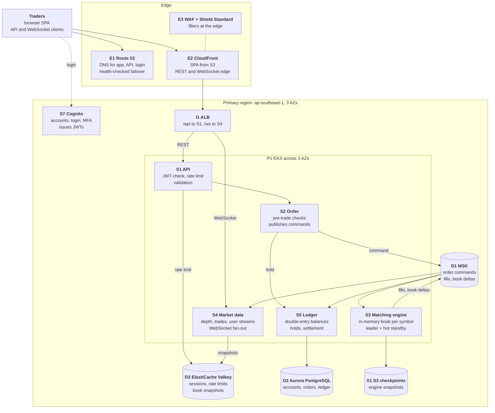
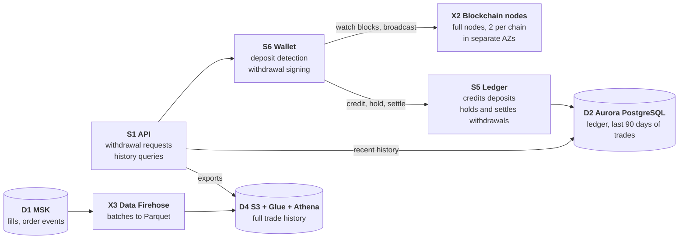
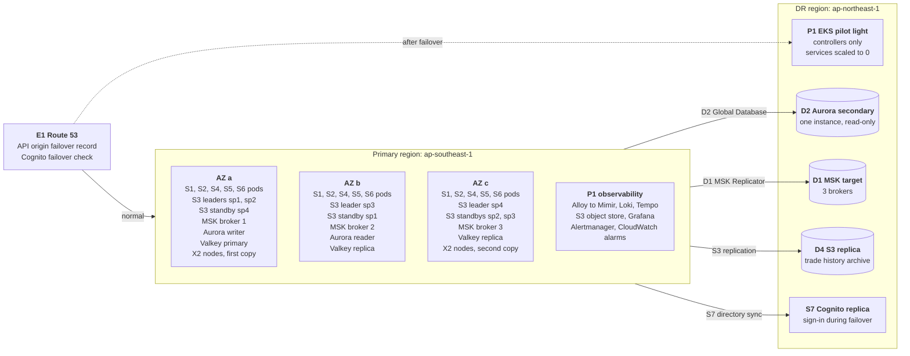
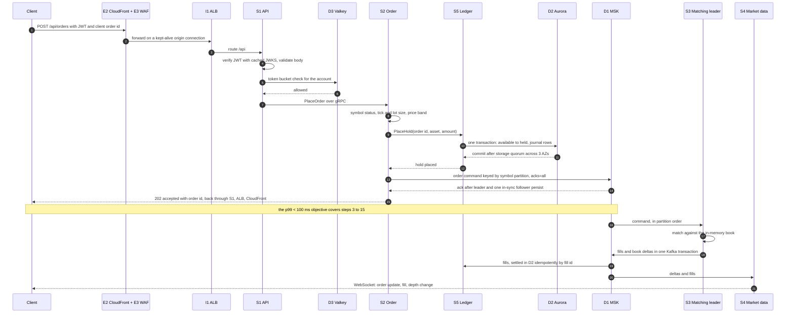

# Problem 1: Building Castle In The Cloud

This is a spot crypto exchange on AWS. It runs in one primary region, ap-southeast-1, across three Availability Zones, with pilot-light disaster recovery in ap-northeast-1. An order passes CloudFront and an Application Load Balancer to an API and an order service on EKS. Before the client gets an answer, the order service places a balance hold in an Aurora PostgreSQL ledger and writes the order command to Amazon MSK. Those two durable writes are the whole synchronous path, and they fit a 100 ms p99 budget with 47 ms of it in reserve. In-memory matching engines, one leader and one hot standby per symbol partition, consume the log and publish fills and book deltas, which drive settlement and WebSocket market data. Every stateful tier keeps a copy in each AZ, so losing an AZ loses no acknowledged order. Losing the region costs up to an hour and a few seconds of trades. At 500 requests per second, redundancy sets the size, and the estimate is about $13,950 a month at on-demand prices.

## Contents

- [Scope](#scope)
- [Decisions](#decisions)
- [Architecture overview](#architecture-overview)
- [How the main flows work](#how-the-main-flows-work)
- [Order placement path](#order-placement-path)
- [Latency budget](#latency-budget)
- [Absorbing overload](#absorbing-overload)
- [High availability and failure modes](#high-availability-and-failure-modes)
- [Capacity and cost](#capacity-and-cost)
- [Scaling beyond the current setup](#scaling-beyond-the-current-setup)

## Scope

### In scope

| Feature | What is covered | Components |
|---|---|---|
| Accounts and login | Sign-up, login, MFA, session revocation | S7, S1, D3 |
| Spot order entry | Limit and market orders, cancel, client order ids for safe retries | S1, S2, S5, D1 |
| Matching | Price-time priority, one in-memory book per symbol | S3, D1, X1 |
| Real-time market data | Order book depth (snapshot plus deltas), public trades, and each user's order and fill stream over WebSocket | S4, D3 |
| Balances ledger | Double-entry journal, holds, fill settlement | S5, D2 |
| Crypto deposits and withdrawals | Hot wallet for one UTXO chain and one account-based chain | S6, X2, S5 |
| Trade history | 90 days online, full history for exports and analytics | D2, D4, X3 |

### Out of scope

- **Products**: fiat rails, margin, futures and options, P2P, staking.
- **Operations**: identity verification, cold-wallet operations and the back office.
- **Security controls**: key custody, IAM, network policy, WAF rules and audit are outside this document's scope; the design leaves room for them (a separate signing path in S6, per-service roles, an edge that carries WAF) but does not specify them.

### Assumptions

| Assumption | Why |
|---|---|
| 500 rps is the peak of REST requests reaching S1, all endpoints together: about 300 rps of order placement and cancel, 200 rps of reads (balances, open orders, history). The monthly average is 30% of peak, 150 rps | The brief gives one number. Order writes are the expensive part, so the split is stated |
| WebSocket traffic is outside the 500 rps: 10,000 concurrent connections at launch, averaging 0.5 KB/s each after conflation, about 13 TB a month | Market data is server push; its cost is connections and bytes, sized separately |
| p99 under 100 ms applies to order placement and cancel, measured server-side at the ALB: `request_processing_time + target_processing_time + response_processing_time` from the access log, per route | Client internet latency is outside the system's control. CloudFront-to-origin latency is tracked separately |
| An order response means accepted: funds held and the command durable in D1. Fills arrive on the user's WebSocket stream | Keeps the matching engine off the synchronous path, like the acknowledgement-only response type large exchanges offer |
| Users are mainly in Southeast Asia, so the primary region is ap-southeast-1 (Singapore) and DR is ap-northeast-1 (Tokyo) | Singapore is the shortest network distance to that user base. Tokyo is a separate geography with every service used here, including MSK Replicator |
| Launch scale: 50 symbols in 4 symbol partitions, 2 chains, 50,000 monthly active users | Sizes the matching tier, the wallet service and Cognito |
| Objectives: an AZ loss loses no acknowledged order and interrupts order placement for at most 60 s. A region loss has an RTO of 60 minutes and an RPO of seconds, with trading halted during failover | Pilot-light DR trades a longer regional RTO for about a quarter of the bill instead of half |
| S7 is created on the Plus plan with a multi-Region customer managed KMS key, available in both regions, before replication is enabled | Both are prerequisites of Cognito multi-Region replication, and a KMS key cannot become multi-Region after it is created |
| Telemetry volume: 100,000 active series, 300 GB of logs and traces for 5% of requests a month | Sizes the observability node group and its S3 store |
| Per-pod throughput figures (for example 250 rps per S1 pod) and the write I/O per order are assumptions | Confirmed by the [pre-launch load test](#pre-launch-load-test) |

## Decisions

| # | Decision | Alternatives considered | Why | Revisit when |
|---|---|---|---|---|
| 1 | E1 Route 53 with health-checked failover records for the API origin and the Cognito domain | Third-party DNS; AWS Global Accelerator | Cognito's multi-Region failover reads a Route 53 health check, and alias queries to CloudFront are free. Third-party DNS cannot drive Cognito failover or alias to CloudFront. Global Accelerator fails over without DNS caching, but CloudFront is already the edge, so it would be a second edge to pay for | Resolver caching makes DNS the longest step of a regional failover |
| 2 | E2 CloudFront in front of the ALB, serving the SPA from S3 | ALB exposed directly; Global Accelerator in front of the ALB | TLS terminates near the user and the origin connection is reused; WebSocket and WAF are carried. A direct ALB puts every TLS handshake on the user's full round trip to Singapore and leaves no edge filter. Global Accelerator does not cache the SPA | Most users sit in one metro and a direct ALB measures faster end to end |
| 3 | E3 WAF with Shield Standard | Shield Advanced | Rate-based and managed rules run at the edge before traffic reaches the region. Shield Standard covers CloudFront and Route 53 at no charge; Shield Advanced costs $3,000 a month on a one-year commitment | Attack history or DDoS cost protection justifies the subscription |
| 4 | I1 ALB with path routing to pod IP targets | Network Load Balancer; API Gateway REST and WebSocket APIs | Path routing for `/api` and `/ws`, HTTP health checks, pod IP targets through the AWS Load Balancer Controller. An NLB has no path routing or HTTP health semantics. API Gateway adds a hop and a per-request charge, and its WebSocket API pushes one `PostToConnection` call per connection per message | Clients need gRPC or client certificates at the edge |
| 5 | S1 API as an in-house service: a local JWT check and one Valkey call | API Gateway usage plans; Kong Gateway | S1's hop is budgeted at 4 ms, and the JWT check and per-account token bucket are application logic. Usage plans meter API keys, not users, and add a hop. Kong Gateway would be one more tier-0 system (its own database or declarative config pipeline, upgrades, HA) in front of S1, whose checks it would not replace | Several teams need gateway features (API products, key management, plugins) that S1 would otherwise re-implement |
| 6 | S2 Order as a long-running pod with an idempotent Kafka producer | AWS Lambda | Warm producer and gRPC connections. Cold starts and connection setup per invocation break the p99 budget | Order rate falls to where idle pods cost more than cold starts would |
| 7 | S3 Matching engine in memory, leader and hot standby per symbol partition, on dedicated pinned-core nodes | Matching in the database; an EC2 Auto Scaling group outside Kubernetes | Single-threaded and deterministic per partition, so a replay rebuilds a book exactly. Database matching serializes every order on the book's row locks. Plain EC2 needs a second deploy and scheduling toolchain for one service, while a dedicated node group gives the same isolation | One partition's engine thread runs above 50% busy; see [Scaling](#scaling-beyond-the-current-setup) |
| 8 | S4 Market data as in-house WebSocket fan-out | API Gateway WebSocket APIs | Long-lived connections, depth conflation, scaling on connections and consumer lag. One push call per connection per message: 10 messages a second to 10,000 connections is 100,000 API calls a second | Connections pass 100,000 and S4 moves to more regions |
| 9 | S5 Ledger as double-entry in PostgreSQL transactions | Amazon DynamoDB transactions; Amazon QLDB | Constraints and settlement idempotent by fill id in SQL; reconciliation and audit need joins over the journal. QLDB reached end of support in 2025 | Ledger write rate needs sharding by account |
| 10 | S6 Wallet in-house, one signer per chain by lease | A third-party custody API | One code path and one audit trail for signing. A custody API puts deposits and withdrawals behind another company's availability and fees | A regulator or insurer requires a licensed custodian |
| 11 | S7 Cognito on the Plus plan with a multi-Region replica, created on a multi-Region customer managed KMS key | Keycloak on EKS; a third-party identity platform | Managed MFA and login, compromised-credential detection and adaptive authentication; replication requires the Essentials or Plus plan and the multi-Region key before it is enabled. Keycloak is another tier-0 system with its own database, upgrades and HA. A third-party platform puts login outside AWS and outside the DR design | The replica's limits (no sign-up, password reset, profile change or TOTP MFA) stop being acceptable during failover |
| 12 | D1 MSK with provisioned kafka.m7g.large brokers | Kinesis Data Streams; SQS FIFO; self-managed Kafka on EC2; MSK Express brokers | An ordered, durable, replayable log per symbol partition; Kafka transactions give exactly-once output and fence a stale leader; MSK Replicator copies the log to DR. Kinesis has no transactions or producer fencing. SQS cannot replay. Self-managed Kafka adds broker operations. Express brokers would cost about $1,200 a month against $738 | Broker CPU above 60% or partitions near 1,000 per broker |
| 13 | D2 Aurora PostgreSQL, I/O-Optimized, with Global Database | RDS for PostgreSQL Multi-AZ; DynamoDB | Six copies across three AZs, failover usually under 30 s, up to 15 readers, Global Database for DR. I/O-Optimized saves about $316 a month at the assumed I/O. RDS reaches another region only through read replicas promoted by hand. DynamoDB: see row 9 | Write I/O falls below 25% of the Aurora bill, where Standard is cheaper |
| 14 | D3 ElastiCache Valkey on three fixed nodes | ElastiCache Serverless; MemoryDB; DynamoDB | Sub-millisecond token buckets and snapshots, Multi-AZ failover in seconds. Valkey nodes cost 20% less than Redis OSS nodes (cache.r7g.large: $0.2104 against $0.263 an hour in Singapore). The launch load is known, so fixed nodes give a fixed bill. MemoryDB's durable log protects data D3 can rebuild. DynamoDB's single-digit-millisecond reads do not fit a check budgeted at 3 ms | Load turns spiky enough that fixed nodes idle or saturate |
| 15 | D4 S3 with Glue and Athena for history older than 90 days | All history in Aurora; Amazon Redshift | Rarely read history costs per GB stored and per TB scanned. Aurora storage costs $0.248 per GB-month and its tables and vacuum work grow with every trade. Redshift is a cluster running for occasional queries | Analytics runs hourly and Athena scan charges exceed a small warehouse |
| 16 | X1 S3 for engine checkpoints | An EBS volume per engine; a compacted Kafka topic | A pod in any AZ can read a checkpoint. EBS is bound to one AZ. A compacted topic works, but book snapshots exceed Kafka's default 1 MB message limit | Checkpoint size makes the 60 s interval the cold-start bottleneck |
| 17 | X2 own blockchain nodes, two per chain | A third-party node API | Deposit credits rest on the exchange's own validated view of each chain. An API puts them behind another party's view, rate limits and outages | A chain's node requirements cost more to host than a provider charges |
| 18 | X3 Data Firehose from MSK to Parquet in S3 | MSK Connect with an S3 sink; a custom consumer on EKS | No consumer to operate for a job Firehose already does | A transformation Firehose cannot do is needed |
| 19 | P1 EKS for S1 to S6, with HPA on CPU for S1 and S2 and KEDA on Kafka consumer lag for S4 and S5 | ECS on Fargate; ECS on EC2; HPA alone | One platform: PodDisruptionBudgets, topology spread over three AZs, Karpenter for the general pool, Lease objects for leader election, a fixed node group for matching. KEDA serves consumer-group lag and PromQL results to the HPA as external metrics, which HPA alone cannot read, so a fill backlog scales S5 before CPU rises. Fargate gives no CPU pinning for the engine; ECS on EC2 lacks the leader-election primitives | Lag-based scaling flaps under bursty fills and CPU proves the steadier signal |
| 20 | P1 observability self-hosted: Grafana Alloy collects metrics, logs and traces into Mimir, Loki and Tempo on EKS with S3 as the object store; Grafana for dashboards; Alertmanager routes alerts; one tenant per team through `X-Scope-OrgID`; CloudWatch for AWS service metrics and the alarms Route 53 health checks read | Amazon Managed Service for Prometheus with Managed Grafana and X-Ray; CloudWatch only | One collector and one tenant model for all three signals, per-symbol histograms at any cardinality, storage at $0.025 per GB-month. CloudWatch bills custom metrics per metric, so per-symbol and per-pod histograms multiply the bill. The managed pair with X-Ray and CloudWatch Logs costs about $315 more a month at launch volumes | A platform team too small to own upgrades and on-call for the stack |

## Architecture overview

### Trading path

### Wallet and trade history

### Region and AZ layout

Each symbol partition (sp1 to sp4) has its leader and its standby in different AZs. Every stateless service runs two pods per AZ.

## How the main flows work

- **Place**: S1 checks the token and the rate limit, S2 runs pre-trade checks, S5 places the hold, and S2 writes the command to D1. The [sequence diagram](#order-placement-path) shows each step. A retry with the same client order id hits the unique key on the hold and returns the original order id.
- **Cancel**: S2 writes a cancel command to the order's symbol partition and answers once D1 has it. The engine removes the order and emits `cancelled`; S5 releases the unfilled part of the hold on that event.
- **Match**: Each symbol partition is one partition of the command topic. Its leader applies commands in offset order and writes fills, book deltas and order events in one Kafka transaction together with its consumer offset, so each fill is published exactly once.
- **Settle**: S5 consumes fills and writes one double-entry transaction per fill (buyer leg, seller leg, fees), keyed by fill id, so a redelivered fill changes nothing. A `CHECK (available >= 0)` constraint makes a negative balance impossible. S2 keeps the `orders` table as a projection of order events.
- **Market data**: S4 holds each book in memory from the deltas and writes a snapshot with its sequence number to D3 every second. A new subscriber gets a snapshot and then deltas; a client that sees a sequence gap asks for a new snapshot. Public depth streams are conflated to 100 ms, which caps bytes per connection.
- **Deposit**: S6 follows each chain on its X2 nodes, matches outputs to users' deposit addresses and credits through S5 after the chain's confirmation count, keyed by transaction hash and output index. A reorg before that count credits nothing.
- **Withdraw**: S5 holds the amount and fee, S6 signs with the hot-wallet key and broadcasts through X2, and S5 settles the hold on confirmation or releases it on failure. One S6 pod per chain holds a signing lease, so nonces and coin selection have a single writer. Approval limits and key custody are security controls outside this document's scope.
- **History**: The last 90 days come from monthly partitions in D2. Older trades are in Parquet in D4, written by X3 from the fill and order-event topics and queried with Athena.
- **Orphaned hold**: If S2 dies after the hold and before the command reaches D1, the hold has no order. A reconciler in S2 finds holds older than 30 s with no order event and writes a cancel for that order id. The engine records the id as cancelled, so a late place command for it is rejected, and S5 releases the hold.
- **Observe**: Alloy runs as a DaemonSet, scrapes every pod's metrics, tails container logs and receives OTLP traces, and writes them to Mimir, Loki and Tempo with the team's tenant in `X-Scope-OrgID`. Alertmanager routes alert rules evaluated in Mimir; CloudWatch alarms on AWS service metrics (Aurora, MSK, ALB) feed the Route 53 health checks that drive failover.

## Order placement path

## Latency budget

Each hop gets a p99 budget. Summing p99 values overstates the p99 of the total, so the real figure sits below the sum.

| Steps | Hop | p99 budget | Why it costs this |
|---|---|---|---|
| 3 | ALB to an S1 pod | 2 ms | One in-region hop; CloudFront reuses its TLS connections to the ALB, so no handshake per request |
| 4 | S1 token and body checks | 1 ms | The JWT signature is checked against keys cached in memory, with no call to Cognito |
| 5 to 6 | S1 to D3 rate limit | 3 ms | One Valkey round trip running a token-bucket script. Under 1 ms in the same AZ; AWS describes round trips between AZs as single-digit milliseconds |
| 7 | S1 to S2 | 3 ms | gRPC on a persistent HTTP/2 connection, possibly across an AZ |
| 8 | S2 pre-trade checks | 1 ms | Symbol rules and price bands are in memory, refreshed from D2 |
| 9 to 12 | Hold in S5 and D2 | 25 ms | One transaction. Aurora writes six copies across three AZs and commits on a quorum of four. The budget includes row-lock waits on a busy account |
| 13 to 14 | Command to D1 | 15 ms | `acks=all` with `min.insync.replicas=2` waits for the leader and a follower in another AZ to persist the record; `linger.ms=0` |
| 15 | Response through S2, S1 and the ALB | 3 ms | Same connections in reverse, possibly across an AZ |
| | Sum of hop budgets | 53 ms | |
| | Reserve | 47 ms | Garbage-collection pauses, queueing at peak, and one retry of a timed-out produce |
| | Objective | 100 ms | Alarm when the per-route p99 exceeds 70 ms for 10 minutes |

The fill reaches the user after the acknowledgement. The engine commits an output transaction at most every 5 ms, and S4 reads with `isolation.level=read_committed`. The target from command in D1 to fill sent by S4 is 30 ms p99; it is tracked, but it sits outside the 100 ms objective.

## Absorbing overload

Above the capacity in the [sizing table](#sizing-for-500-requests-per-second) the system sheds load in a fixed order instead of letting every route queue until it misses the budget. A shed request gets `429 Too Many Requests` with a `Retry-After` header and a body naming the limit (`{"error":"rate_limited","limit":"account_orders","retry_after_ms":400}`); the client SDK waits that long before retrying. Cancels are how a trader exits a position, so they are the one write that is never shed while D1 accepts writes.

| Shed order | Traffic | Limit and where it sits | What the user sees |
|---|---|---|---|
| 1, first | Requests from one IP or one API key above its rate | E3 rate-based rules per IP and per API-key header, evaluated at the edge; blocked requests get a custom 429 response rather than WAF's default 403 | 429 from CloudFront with `Retry-After: 60` |
| 2 | Reads: balances, open orders, history | Per-account token bucket in D3, 20 requests a second, checked by S1 in the same round trip as the order bucket | 429 with `Retry-After` equal to the bucket's refill time |
| 3 | New WebSocket connections | 3,000 connections per S4 pod; a pod at its cap refuses the upgrade and the ALB tries another target; when every pod is full, KEDA is already adding pods | 503 on the upgrade; existing connections are untouched |
| 4 | Order placement for one account | Per-account token bucket in D3, 10 new orders a second | 429 with `limit: account_orders` |
| 5, last | Order placement for one symbol partition | Per-partition queue depth: every second S2 reads the leader's lag (log-end offset minus the leader's committed input offset) and refuses new place commands for that partition above 5,000 commands, or while command-to-fill p99 exceeds 100 ms | 429 with `limit: symbol_queue` naming the symbol; other partitions are unaffected |
| Never | Cancels | A separate per-account cancel bucket of 10 a second guards against a single account flooding; cancels bypass limits 4 and 5, and S2 publishes them whenever D1 acknowledges | 202 whenever D1 is healthy |
| Never | Sign-in and token refresh; market data on open connections | S7 is outside the shed path. Under egress pressure S4 widens depth conflation from 100 ms to 500 ms instead of dropping deltas, so sequence numbers stay contiguous | Slower depth updates, no gaps |

- **Why this order**: a read can be re-fetched, a new connection can wait, a new order is a choice the trader can delay, and a cancel is the trader's exit. Shedding per account and per partition before anything global keeps one hot symbol or one abusive account from touching the rest.
- **Burst-test pass criterion**: at 5× peak for 60 s, every refused request is a 429 and 5xx responses stay under 0.1%; no cancel is refused and cancel p99 stays under 70 ms; no partition's lag passes 5,000 commands; within 10 s of the burst ending, no request is refused. The [pre-launch load test](#pre-launch-load-test) runs this burst.

## High availability and failure modes

| Failure | What happens | Recovery time | Data loss bound |
|---|---|---|---|
| EKS node or pod | Each stateless service keeps two pods per AZ behind a PodDisruptionBudget. The ALB stops sending to lost targets and the others carry the load | Traffic shifts in seconds; pods are replaced in about a minute | None. S1, S2, S4, S5 and S6 keep no state of record |
| S3 matching leader | The standby takes over; see [Matching engine failover](#matching-engine-failover). Orders for that partition's symbols are still accepted into D1 and match once the new leader runs | About 5 s, only for that symbol partition | None. Accepted commands are already in D1 |
| S2 crashes between hold and publish | The orphaned-hold reconciler cancels the order id and S5 releases the hold | 30 s until the funds are free | None. The order was never acknowledged |
| D1 MSK broker | Partitions it led move to in-sync followers. Producers retry with idempotence on, so retries add no duplicates. Writes continue on two brokers. With two brokers down, `min.insync.replicas=2` stops writes and trading halts rather than accept unreplicated orders | Seconds for leader election; MSK replaces the broker | None for `acks=all` writes |
| D2 Aurora writer | The reader in another AZ is promoted and the cluster endpoint follows it. Order placement returns 503 with `Retry-After` during the switch; matching and market data continue, and settlement catches up from D1 | AWS states service is typically restored in under 60 s, often under 30 s | None. Committed data is on the shared volume |
| D3 Valkey primary | A replica is promoted. S1 falls back to per-pod rate limits and S4 serves snapshots from memory | Writes resume in a few seconds, per AWS | Rate-limit counters and snapshots, which are rebuilt |
| Availability Zone | The ALB stops routing to the AZ. Every tier loses a third of its capacity and runs on the other two without scaling. Standbys in other AZs take over the leaders that were there, Aurora fails over if the writer was there, and MSK runs on two brokers | Up to 60 s for order placement if the Aurora writer was in the AZ; about 5 s for matching | None for acknowledged orders: each was on at least two AZs before the ack |
| X2 node | S6 switches to the chain's second node and resumes from the last processed block height | Seconds | None |
| Bad release that corrupts ledger data | The sum-to-zero and `available >= 0` constraints reject arithmetic faults at write time; a consistent but wrong write (a mis-priced fee, a settlement applied twice under a changed fill-id scheme) is caught by the hourly comparison of journal totals against the `fills` topic. Trading halts. D2 is restored by point-in-time restore to the minute before the release as a new, isolated cluster; S5 replays D1 from the offset at that time into it (fills and order events are retained 7 days); the restored ledger is reconciled against the live one and the log; the cluster endpoint moves to it | Hours: the restore of 200 GB, the replay of the corrupt interval and one reconciliation run, with trading halted throughout; timed in a drill | None while the corrupt interval is inside D1's 7-day retention: every balance is recomputed from the log |
| D2 Aurora backups | Automated backups are continuous and cannot be turned off; the retention period is set to 35 days, the maximum, so any point in that window is restorable, and the latest restorable time trails the present by about 5 minutes. The daily system snapshot is copied to ap-northeast-1 as a full copy encrypted with a key valid there. Every restore creates a new cluster. Backups protect against the bad release above, an operator deleting the cluster (automated backups are retained) and a region loss that takes Global Database with it. They do not protect against corruption replicated to the secondary (Global Database mirrors the volume, which is why the recovery is PITR, not failover), against deletion of the backups by whoever holds the account's RDS permissions (a security control outside this document), or against anything in D1 or D3 | Point-in-time restore: assumed under an hour for 200 GB, timed in a drill. A cross-Region snapshot copy takes hours and is at most a day old | Up to 5 minutes for a primary-region PITR; up to 24 hours for the cross-Region copy |
| Region | Pilot-light failover; see [Region failover](#region-failover) | 60 minutes (objective) | Seconds of trades, bounded by replication lag and measured before promotion. Resting orders are cancelled |

### Matching engine failover

- **Placement**: The leader and the standby of a symbol partition run on the matching node group in different AZs, kept apart by pod anti-affinity. Each pod gets two pinned cores (Guaranteed QoS with the static CPU manager), and this node group is never consolidated.
- **Lease**: The leader holds a Kubernetes Lease with a 3 s duration and renews it every second. The standby takes the lease when it expires.
- **Fencing**: Both pods use the same Kafka `transactional.id` for the partition. When the standby calls `initTransactions`, the transaction coordinator bumps the producer epoch and aborts the old leader's open transaction, so a paused old leader that wakes up cannot publish. The lease decides who should lead; the epoch makes it safe if two pods believe they lead.
- **Hot state**: The standby applies the same commands, but only up to the input offset that the leader's last committed output carries. On promotion its book equals the last published state.
- **Determinism**: The engine reads no clock and no randomness. Timestamps come from the command, stamped by S2, so replaying the same commands yields the same fills.
- **Cold start**: If both pods are lost, a new pod loads the latest X1 checkpoint (book and input offset, written every 60 s) and replays D1 from that offset. Sixty seconds at peak is 18,000 commands, replayed in well under a second.

Takeover takes about 5 s: up to 3 s for the lease to expire, then fencing and catch-up.

### Region failover

Aurora Global Database replicates with lag typically under a second, and MSK Replicator copies topics and consumer-group offsets asynchronously. The two streams are independent, so after a regional loss the DR ledger and the DR log can disagree by a few seconds. The runbook therefore fences the primary and measures the lost tail before anything is promoted, rebuilds no order books, cancels every resting order and reconciles balances before trading reopens.

| Step | Action | Target |
|---|---|---|
| 1 | Detect and declare: primary health checks fail, and the incident lead declares a regional failover | 10 min |
| 2 | Fence, then measure. Revoke the S2 producer role's write permission on D1 (IAM is global, so this works while the region is down) and scale S2 to zero if the primary's EKS API answers; scale the S3 leaders to zero so nothing is published after the measurement. Read `AuroraGlobalDBReplicationLag` and the MSK Replicator latency per topic. For each partition, record the last offset replicated to the DR cluster against the primary's log-end offset, and the DR ledger's last commit against the primary's, wherever the primary can still be read. The lost tail per partition goes into the incident record. Promotion waits for this measurement; when the primary cannot be read at all, the tail is recorded from the DR-side values alone and marked unknown until the region returns | 10 min |
| 3 | Aurora managed failover to ap-northeast-1; AWS states the secondary typically takes the primary role within a few minutes | 5 min |
| 4 | Scale the DR node groups, the services and the observability stack up from zero through the same GitOps manifests; services use the DR MSK cluster. Mimir, Loki and Tempo start empty in DR; the primary bucket's history is read once that region returns | 10 min |
| 5 | Settle every fill in the DR log that the DR ledger lacks (idempotent by fill id), cancel all resting orders, release their holds, and check that per-asset liabilities match the wallet balances | 15 min |
| 6 | Route 53 moved the API origin record and the Cognito domain to DR when the primary health checks failed, and the DR ALB has answered 503 until now. Reopen order entry, the most traded symbols first, while watching settlement lag | 10 min |
| 7 | Enable withdrawals only after S6 has scanned each chain for hot-wallet transactions newer than the last replicated withdrawal state, so none is sent twice | After reopening |

- **Cognito in DR**: The replica handles sign-in and token refresh, but cannot create users, reset passwords, change profiles or check TOTP MFA, per AWS. Every account therefore also enrolls email or SMS codes as a second factor, which the replica can still send. Failover of the login domain follows the same Route 53 health check as the API origin.
- **RPO alarm**: `AuroraGlobalDBRPOLag` and the replicator lag alarm at 5 s. `rds.global_db_rpo` could cap Aurora's RPO (minimum 20 s) by blocking commits in the primary, but it stays unset, because a DR-side fault would then stop trading in a healthy primary.
- **Unreplicated trades**: A fill that reached neither DR store is lost to DR. The tail measured in step 2 names the affected partitions and offsets. Aurora tries to snapshot the old primary volume at the point of failure, and that snapshot is the source for correcting those accounts once the region is back.

## Capacity and cost

### Sizing for 500 requests per second

At this load the size comes from redundancy, not throughput. Every stateful tier has a node in each AZ, and every stateless tier has two pods per AZ, so an AZ loss needs no scaling action before the remaining capacity still covers peak.

| Component | Launch size | Load at peak | After losing one AZ |
|---|---|---|---|
| S1 API | 6 pods × 0.5 vCPU; HPA on CPU at 60% | 500 rps | 4 pods, 1,000 rps at an assumed 250 rps per pod |
| S2 Order | 6 pods × 0.5 vCPU; HPA on CPU at 60% | 300 commands/s | 4 pods, about 1,000 commands/s |
| S3 Matching engine | 4 symbol partitions × (leader + standby) × 2 pinned vCPU, on 3 × c7g.2xlarge | 300 commands/s | All 4 leaders run; one standby waits for a replacement node |
| S4 Market data | 6 pods × 1 vCPU; KEDA on connections per pod (a PromQL query against Mimir) and on its consumer group's lag | 10,000 connections, 5 MB/s out | 4 pods, 2,500 connections each |
| S5 Ledger | 6 pods × 0.5 vCPU, up to 12 (the `fills` topic has 12 partitions); KEDA on the `ledger` group's lag, 500 fills per pod | About 1,200 transactions/s (four per order) | 4 pods |
| S6 Wallet | 2 pods × 0.5 vCPU | Tens of requests per minute | 1 pod; signing leases move to it |
| General node group | 9 × m7g.xlarge (36 vCPU), 3 per AZ | About 22 vCPU requested, 60% | 6 nodes, 24 vCPU for about 20 vCPU requested |
| Observability node group | 3 × m7g.xlarge (12 vCPU), one per AZ: Mimir, Loki and Tempo ingesters at replication factor 3, Grafana, Alertmanager; 200 GB gp3 per node for ingester WALs; S3 as the object store | 100,000 active series every 30 s, 300 GB of logs a month, traces for 5% of requests | 2 nodes; writes continue on a quorum of two ingesters, queries read S3 |
| D1 MSK | 3 × kafka.m7g.large, replication factor 3, 7-day retention | About 1 MB/s in at peak, 0.4 MB/s average | 2 brokers carry it; partitions far below the 1,000-per-broker guideline |
| D2 Aurora PostgreSQL | Writer and reader, db.r7g.xlarge (4 vCPU, 32 GiB) | About 1,200 transactions/s | The reader becomes the writer |
| D3 ElastiCache Valkey | 3 × cache.m7g.large, one per AZ | About 1,500 operations/s | 2 nodes |

HPA on CPU fits S1 and S2 because their work arrives as requests and CPU tracks it within seconds. S4 and S5 consume from D1, where a backlog shows up as consumer lag long before CPU moves, so KEDA feeds the lag to the HPA as an external metric and a fill burst scales S5 while the queue is still short. KEDA's Kafka scaler caps replicas at the topic's partition count by default, so `fills` carries 12 partitions.

### Pre-launch load test

The per-pod figures above and the write I/O assumption behind the cost estimate are confirmed by one test before launch, run against the production build in a production-sized environment with D1, D2 and D3 at launch size.

| Phase | Traffic | Timing |
|---|---|---|
| Soak | 2× peak: 1,000 rps (600 place and cancel, 400 reads) and 20,000 WebSocket connections | 30 minutes |
| Burst | 5× peak: 2,500 rps with the same mix | 60 s, starting at minute 20 of the soak |
| Faults | One matching leader killed with SIGKILL; one D3 primary failover | Minute 10 and minute 25 |

| Pass criterion | Threshold | Measured from |
|---|---|---|
| Latency | Per-route p99 at the ALB under 70 ms for place and cancel throughout the soak | ALB access logs |
| Errors | 5xx responses under 0.1% of requests; 429s counted separately | ALB access logs |
| Write I/O | `VolumeWriteIOPs` at or below 12 per order placed (four ledger transactions × three I/Os), the ratio the cost estimate assumes | CloudWatch |
| Matching takeover | The standby leads within 5 s of the kill, and a checking consumer finds no duplicate fill id in `fills` | Engine metrics in Mimir; the checker's log |
| Overload | The burst criterion in [Absorbing overload](#absorbing-overload): 429 only, cancels never refused, no partition past 5,000 commands of lag | ALB logs; S2 metrics |

What is re-sized if a criterion fails:

- **Latency**: the Tempo trace of a slow request shows which hop exceeded its budget. S1 or S2: lower the HPA target from 60% to 40%. D3: cache.m7g.xlarge. D2: db.r7g.2xlarge for the hold transaction. D1: a larger broker class.
- **Errors**: three pods per AZ instead of two for the failing service, and a higher `minAvailable` in its PodDisruptionBudget.
- **Write I/O**: the Aurora and DR lines of the cost estimate are re-priced from the measured ratio, and settlement is batched per account per fill batch to bring it back down.
- **Takeover**: the standby's catch-up distance (how far behind the leader's committed output it reads) or the 3 s lease duration.

### Monthly cost estimate

List prices from the AWS Price List API, read on 2026-11-03: on-demand, 730 hours a month, ap-southeast-1 for the primary and ap-northeast-1 for DR. These are estimates for comparing options, not a quote.

| Component | Configuration | USD per month |
|---|---|---|
| E1 Route 53 | 1 hosted zone; 2 health checks with HTTPS and the fast interval | 6 |
| E2 CloudFront | 13.4 TB out at Asia Pacific rates ($0.120/GB for the first 10 TB, then $0.100); 394 million HTTPS requests at $0.012 per 10,000 | 2,018 |
| E3 WAF + Shield Standard | 1 web ACL, 10 rules, 394 million requests at $0.60 per million; Shield Standard has no charge | 252 |
| I1 ALB | 1 ALB at $0.0252/h, about 19 LCU at $0.008 (processed bytes dominate) | 129 |
| S7 Cognito | Plus plan, 50,000 MAU at $0.020 | 1,000 |
| P1 EKS control plane | 1 cluster at $0.10/h | 73 |
| P1 general nodes | 9 × m7g.xlarge at $0.204/h | 1,340 |
| P1 matching nodes | 3 × c7g.2xlarge at $0.3332/h | 730 |
| Node root volumes | 15 × 50 GB gp3 at $0.096 per GB-month | 72 |
| D1 MSK | 3 × kafka.m7g.large at $0.255/h; 3 × 500 GB at $0.12 per GB-month | 738 |
| D2 Aurora PostgreSQL | I/O-Optimized; writer and reader db.r7g.xlarge at $0.865/h; 200 GB at $0.248 per GB-month | 1,313 |
| D3 ElastiCache Valkey | 3 × cache.m7g.large at $0.1576/h | 345 |
| D4, X1, X3 | Firehose from MSK with Parquet conversion, 657 GB at $0.073/GB; 1 TB in S3 at $0.025 per GB-month; Athena scans and the MSK private connection Firehose needs | 110 |
| X2 Blockchain nodes | 4 × m7g.xlarge; 2 × 1 TB and 2 × 2 TB gp3 | 1,172 |
| NAT gateways | 3 at $0.059/h; 200 GB processed at $0.059/GB | 141 |
| Cross-AZ data transfer | 5 TB at $0.01/GB in each direction; consumers set `client.rack` to read from the replica in their own AZ | 100 |
| P1 observability | 3 × m7g.xlarge at $0.204/h ($447); 3 × 200 GB gp3 ingester volumes ($58); S3 object store, 2 TB at $0.025 per GB-month plus about 2 million requests ($61); CloudWatch: 30 GB of AWS service logs at $0.70/GB, 40 standard alarms at $0.10, AWS service metrics at default resolution at no charge ($25) | 591 |
| **Primary region subtotal** | | **10,130** |
| D2 Aurora secondary | 1 × db.r7g.xlarge I/O-Optimized ($631); 200 GB at $0.27 ($54); 2.89 billion replicated write I/Os at $0.24 per million ($694); 7.4 TB cross-region transfer at $0.09/GB ($666) | 2,045 |
| D1 MSK target cluster | 3 × kafka.m7g.large at $0.2635/h; 3 × 500 GB | 757 |
| D1 MSK Replicator | $0.36/h ($263); 1,050 GB at $0.08/GB processed ($84) and $0.09/GB transfer ($95) | 441 |
| P1 EKS pilot light | Control plane and 3 × m7g.large at $0.1054/h | 304 |
| D3 ElastiCache Valkey | 1 × cache.m7g.large at $0.1616/h, warm for failover | 118 |
| D4 S3 replica | 1 TB stored; 660 GB replicated a month at $0.09/GB | 85 |
| ALB and NAT gateway | One each, idle; Singapore rates assumed | 70 |
| **DR region subtotal** | | **3,820** |
| **Total** | About $0.28 per monthly active user | **13,950** |

- **Write I/O assumption**: About 90 orders a second on average, four ledger transactions per order and three write I/Os per transaction give about 1,100 write I/Os a second. On Aurora Standard, that adds $636 a month of I/O at $0.22 per million: 39% of the Aurora bill, above the 25% at which AWS recommends I/O-Optimized. The same I/O count drives the DR replicated-write and transfer lines. The [pre-launch load test](#pre-launch-load-test) confirms it with the `VolumeWriteIOPs` metric.
- **Not included**: Cognito's multi-Region replication add-on (AWS lists it as a separate charge without a public rate on the page read), an AWS Support plan, Shield Advanced, security services (outside this document's scope), CI/CD, non-production environments, and the X2 nodes' internet egress to other chain nodes.

### Cost levers

| Lever | Effect | When to use it |
|---|---|---|
| 1-year standard reserved instances, no upfront, for the EC2 nodes | 34% off those lines: m7g.xlarge $0.1349/h instead of $0.204, c7g.2xlarge $0.2211 instead of $0.3332. About $1,050 a month across the primary-region nodes, X2 and observability included | After a month of steady usage. Compute Savings Plans if instance families will change |
| Smaller market-data payloads | CloudFront egress scales with bytes per connection. Binary encoding and `permessage-deflate` that halve the 0.5 KB/s average save about $700 a month at launch scale | Before connection count grows |
| Cognito Essentials instead of Plus | $600 a month instead of $1,000 at 50,000 MAU | Only if the security review accepts losing compromised-credential detection and adaptive authentication |
| Headless Aurora secondary | Saves $631 a month; the instance is added at failover time | If DR drills show the added step still fits the 60-minute RTO |
| Fewer ledger write I/Os | The DR replicated-write and transfer lines ($1,360 together) scale with write I/Os, so settling one transaction per account per fill batch instead of one per fill cuts them in proportion | When settlement throughput is the next bottleneck anyway |
| Managed observability (Amazon Managed Service for Prometheus, Managed Grafana, X-Ray, CloudWatch Logs) in place of the self-hosted stack | Removes the three observability nodes and their upgrades and on-call; costs about $315 more a month at launch volumes ($906 against $591) | A platform team too small to own upgrades and on-call for the stack |
| CloudFront flat-rate Premium plan | $1,000 a month with 500 million requests and 50 TB included, WAF bundled, replacing about $2,270 of CloudFront and WAF charges | Not now: above its allowance AWS may serve traffic from more distant edges or throttle it, which the p99 objective cannot absorb, and WebSocket support on the plans is unconfirmed |

## Scaling beyond the current setup

| Trigger | Threshold | Next step |
|---|---|---|
| Pod CPU for S1 and S2; consumer lag or connections for S4 and S5 | CPU above 60% for 5 minutes; lag above 500 fills per S5 pod; more than 3,000 connections per S4 pod | HPA and KEDA add pods and Karpenter adds general nodes. This scales linearly until a data tier binds |
| One symbol partition's engine thread or latency | Engine thread busy above 50%, or command-to-fill p99 above 30 ms | Move symbols to a new partition: add a Kafka partition, map the symbols to it (an explicit map, not a hash, so others stay put), halt each moving symbol for about a second and start its book on the new leader from a checkpoint. A hot symbol gets its own partition and node |
| MSK broker CPU (user plus system) | Above 60%, the MSK guideline | Scale up the broker size, a rolling change of 10 to 15 minutes per broker, then add brokers. Express brokers give up to 3 times the throughput per broker and move partitions up to 20 times faster |
| MSK partitions per broker | Approaching 1,000 including replicas on kafka.m7g.large | Move to kafka.m7g.2xlarge, which takes 2,000 |
| Aurora writer CPU, commit latency or lock waits | CPU above 60%, or commit p99 above 10 ms | Scale the writer up, move balance and history reads to readers (up to 15), batch settlement per account, then shard the ledger by account id across Aurora clusters with S5 routing by account. Matching is unaffected because it never touches D2 |
| Market-data egress or connections | Above 50 TB a month, or 100,000 connections | Binary encoding and compression first. Then run S4 in more regions: MSK Replicator ships book deltas and trades to them, and Route 53 latency routing sends `/ws` to the nearest one, while order entry and matching stay in the primary |
| Observability ingest | Above 1 million active series, or 3 TB of logs a month | Add ingester nodes to the observability node group and raise the replication-factor-3 ring; S3 absorbs storage growth without a change |
| Total load or blast radius | Above 5,000 rps sustained, or one fault able to stop every account | Cell-based architecture: each cell has its own S1, S2, S5, D2 and D3 and serves a slice of accounts, with an edge router mapping account to cell. Matching stays shared by symbol, because a book must see every order for its symbol |
| Regional RTO requirement under 60 minutes | A business or regulatory decision | Warm standby: DR runs scaled-down services and an Aurora reader at all times, which roughly doubles the DR line |
