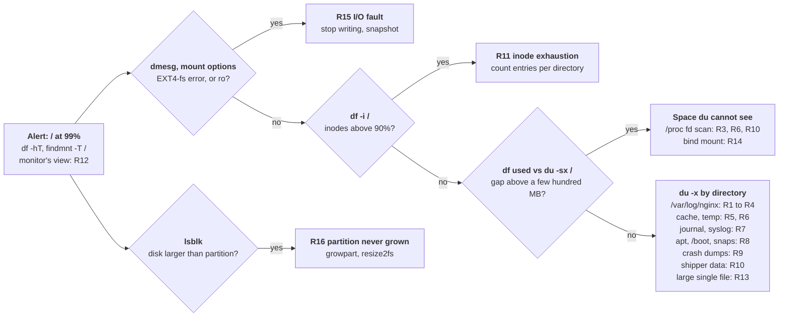

# Problem 2: Diagnose Me Doctor

An Ubuntu 24.04 VM that runs only NGINX as a load balancer reports its root disk at 99%. This runbook keeps the load balancer serving, copies evidence before anything is freed, reclaims what is safe to drop, then follows a fixed order of checks to one of sixteen causes, each with impact, recovery and prevention. The NGINX behaviour quoted here was reproduced with the Ubuntu archive package (NGINX 1.24) on a filesystem filled on purpose. [`diagnose-disk.sh`](diagnose-disk.sh) runs the read-only checks in one pass; [`tests/rotate-check.sh`](tests/rotate-check.sh) proves that log rotation makes NGINX reopen its logs.

## Contents

- [Scope](#scope)
- [Decisions](#decisions)
- [What a full disk does to the load balancer](#what-a-full-disk-does-to-the-load-balancer)
- [First 15 minutes: keep it serving](#first-15-minutes-keep-it-serving)
- [Investigation](#investigation)
- [Root causes](#root-causes)
- [Prevention and monitoring](#prevention-and-monitoring)

## Scope

### In scope

- **The alert**: `/` at 99% on one VM whose only workload is NGINX.
- **Keeping it serving**: what fails at 99% and at 100%, what to free first, how to buy headroom.
- **Finding the cause**: ordered checks and sixteen causes with impact, recovery and prevention.
- **Not recurring**: alerts and configuration.

### Out of scope

- **Other workloads on the same VM**: their consumers differ; the check order still applies.
- **Provider tooling**: resize, snapshot and volume health are named by function, not by vendor command.
- **The fleet**: the log pipeline and retention policy beyond this VM.
- **Other filesystems**: XFS and Btrfs appear only where they differ from ext4.

### Assumptions

| Assumption | If it does not hold |
|---|---|
| The task names "two production issues" but describes one scenario; this page answers it and treats each cause as its own issue | The check order applies unchanged to a second disk incident |
| One 64 GB ext4 root volume, no LVM. An installer-built filesystem reserves 5% of blocks for root (3.2 GB); the Ubuntu cloud image root (`cloudimg-rootfs`) reserves none (`tune2fs -l`: `Reserved block count: 0`) | With a reserve, root services outlive the workers; without one, the master, journald and sshd fail with them. XFS has no reserve and no `tune2fs`. With a separate volume for `/var/log` or the cache, check the mount that alerted |
| NGINX is the Ubuntu archive package: 1.24, logs in `/var/log/nginx`, temp files in `/var/lib/nginx`, workers run as `www-data`, logrotate keeps 14 daily files | The nginx.org package keeps temp files in `/var/cache/nginx/*_temp`, runs workers as `nginx`, keeps 52 daily files, and its postrotate sends `USR1` to the pid in `/run/nginx.pid` |
| NGINX runs as a systemd service, not in a container | In Docker, the container's `json-file` log under `/var/lib/docker/containers/` has no size limit by default and is the first suspect |
| journald keeps the journal on disk (`/var/log/journal` exists) and forwards to rsyslog (`ForwardToSyslog=yes` in `/usr/lib/systemd/journald.conf.d/syslog.conf`, from the `systemd` package) | Without rsyslog, R7 covers only the journal |
| A log shipper may run; which one is unknown | R10 does not apply |
| The volume can be snapshotted and grown online through the provider | Without an online resize, the reserve, where one exists, is the only extra headroom |
| Whether other nodes share the traffic is unknown, so no step depends on draining this one | With a second node, drain this one first |
| Commands run as root | Without root, `du`, `/proc/<pid>/fd` and `tune2fs` return partial results |

## Decisions

| # | Decision | Alternatives considered | Why | Revisit when |
|---|---|---|---|---|
| 1 | Copy a bounded tail of every deleted-but-open file off the disk before any step that frees space | Free space first; skip the copy when the cause looks obvious | `nginx -s reopen`, a truncate or a shipper restart drops the last reference and the kernel discards the file; a 200 MB tail costs seconds | The same lines are confirmed in the log collector |
| 2 | Truncate an open log rather than `rm` it | `rm`, then restart the writer | `rm` frees nothing while a descriptor is open and the writer keeps logging into a file nobody can open; truncation frees the blocks at once, and NGINX writes with `O_APPEND`, so new lines land at the new end with no sparse gap | Never for a file a process holds open |
| 3 | `nginx -s reopen` rather than `systemctl restart nginx` | A restart; `nginx -s reload` | `reopen` (`USR1`) switches every log without dropping a connection; the unit's stop gives the graceful quit 5 seconds (`--retry QUIT/5`) before `SIGTERM`, which cuts long downloads and WebSocket sessions; `reload` reopens logs too but replaces the workers | The master is wedged, or a binary upgrade is due anyway |
| 4 | Cap the journal with `SystemMaxUse=` rather than set `ForwardToSyslog=no` | Disable forwarding; lower `MaxRetentionSec=` | The cap bounds the disk whatever a unit logs; `/var/log/syslog` is what other Ubuntu tooling reads | A shipper reads the journal directly |
| 5 | `proxy_cache_path` with `max_size`, `min_free` and `inactive` rather than a periodic purge | A cron job deleting old entries; `proxy_cache_purge` | The cache manager evicts least recently used entries at the limit inside NGINX; a purge job races it, and a cache file deleted while open frees nothing | The cache has its own volume, where `min_free` alone holds it |
| 6 | A separate volume for `/var/log` and `/var/cache/nginx` | A larger root volume; ext4 project quotas | A flood stops at that volume while apt, sshd and `/` keep working; quotas need a `prjquota` remount and a quota per directory | The VM is immutable and logs leave within seconds |
| 7 | Ship logs off the VM, keep two or three days locally | 14 days local, compressed | Retention sized to the disk breaks at the next traffic step; shipped logs survive the VM | 14 days fits in under half the disk |
| 8 | Alert on time to full and available bytes, not a percentage alone | 90% and 95% thresholds | At 18.6 GB a day a 64 GB disk goes from 85% to full in 12 hours; a percentage fires at the same point on a 10 GB and a 1 TB disk | 5% of every disk is more than a day of growth |
| 9 | `tune2fs -m 1` as a bridge, reset to `-m 5` once the cause is fixed | Leave 1%; never touch the reserve | The reserve keeps root services writing on a full disk; lending it buys about 2.6 GB on 64 GB for the time the fix takes | `Reserved block count: 0`, where there is nothing to lend |

## What a full disk does to the load balancer

Workers run as `www-data` and get `ENOSPC` (`28: No space left on device`) as soon as `df` shows `Avail` 0; root processes (the master, journald, sshd) keep writing into the reserve where one exists. At 99% the workers have about 0.6 GB left on 64 GB. At 1,000 requests per second with 215-byte access log lines (`combined` format, a common browser user agent) the access log alone writes 215 KB/s, 18.6 GB a day, and uses that 0.6 GB in about 45 minutes.

Observed with NGINX 1.24 when the filesystem holding its logs, temp paths and cache was full:

| Traffic | Disk use | Result |
|---|---|---|
| Fits in memory buffers | None | Served normally |
| Request body larger than `client_body_buffer_size` (8 KB on x86-64, 16 KB on other 64-bit platforms) | `client_body_temp_path` | `500 Internal Server Error`; `[crit] pwrite() "/var/lib/nginx/body/0000000002" failed (28: No space left on device)` |
| Response larger than `proxy_buffers` (8 × 4 KB or 8 KB) to a client slower than the upstream | `proxy_temp_path`, up to `proxy_max_temp_file_size` (1024 MB) per request | 200 and headers go out, then the connection closes mid-body: a client limited to 2 MB/s received 3.4 MB of a 64 MB response (`curl` exit 18); `[crit] pwritev() "/var/lib/nginx/proxy/..." failed (28: ...)` |
| `proxy_cache` hit | Read only | Served normally |
| `proxy_cache` miss | A temp file on the way into the cache | No response: `curl: (52) Empty reply from server`; `[crit] pwrite() "/var/lib/nginx/proxy/..." failed (28: ...)` |
| Access log line | Append | Request served, line lost; `[alert] write() to "/var/log/nginx/access.log" failed (28: ...)` at most once a minute per worker |
| Error log line | Append | Lost when the error log is on the same disk, the lines above included |
| `nginx -t`, `-s reload`, `-s reopen` | By the master, as root | Succeeded |

| Component | On a full disk |
|---|---|
| Health checks from a load balancer in front | A check that proxies a small request keeps passing, so the node stays in rotation while uploads and cache misses fail |
| logrotate | gzip writes the `.gz` before the original goes; it fails (`gzip: stdout: No space left on device`), logrotate exits 1 and keeps the uncompressed file, so rotation frees nothing |
| journald | Runs as root; to respect its limits it deletes only archived journal files |
| rsyslog | Drops to the `syslog` user (`$PrivDropToUser syslog` in `/etc/rsyslog.conf`), so `/var/log/syslog` and `/var/log/auth.log` stop with the workers |
| apt and unattended-upgrades | Downloads and unpacks fail, so security updates stop; an upgrade cut mid-unpack leaves packages half-configured until `dpkg --configure -a` |
| SSH and shell work | sshd accepts logins. Ubuntu ships `tmp.mount` only as an example under `/usr/share/systemd/`, so `/tmp` is a directory on `/` and editors, `sort` and scripts that need temp files fail for non-root users |

## First 15 minutes: keep it serving

Paste the commands into a plain interactive shell, not under `set -e` or an `EXIT` trap: a `grep` with no match or a missing path would close the shell, and a trap that removes its working directory takes the staged evidence with it. The two scripts in this folder use `set -euo pipefail` because they run non-interactively and must stop on the first fault.

### Confirm what is full and whether NGINX still serves

```bash
df -hT /                     # Use% = used / (used + available); available excludes root's reserve
df -i /                      # near 100% with bytes free is R11
dmesg -T | tail -n 20        # "EXT4-fs error", "I/O error", "Remounting filesystem read-only": R15
findmnt -n -o OPTIONS /      # "ro," first means the root was remounted read-only (R15)
systemctl is-active nginx
curl -sS -o /dev/null -w '%{http_code}\n' http://127.0.0.1/<health-path>
grep -E '\[(crit|alert)\].*(No space left|Read-only file system)' /var/log/nginx/error.log | tail -n 5
```

A passing health check proves only the in-memory path; `crit` lines with errno 28 mean uploads and cache misses already fail. If the cause may be evidence (an unknown large file, a suspected intrusion), snapshot the volume through the provider first; it uses no space on the VM.

### Copy evidence before freeing anything

Decision 1: copy first, then free.

```bash
# 1. Deleted-but-open files on /, with holder, inode and size
find /proc/[0-9]*/fd -lname '*(deleted)' -printf '%p -> %l\n' 2>/dev/null
stat -L -c 'inode %i, %s bytes' /proc/<pid>/fd/<n>
# 2. A target off /: RAM (/dev/shm is half of it by default), another mount, or another host
df -h /dev/shm               # a 200 MB tail per file must fit with room to spare
mkdir -p /dev/shm/evidence
printf '%s pid=%s fd=%s inode=%s size=%s\n' "$(date -Is)" <pid> <n> <inode> <size> >> /dev/shm/evidence/index.txt
# 3. A bounded tail (the whole file when it is smaller), locally or straight off the box
tail -c 200M /proc/<pid>/fd/<n> > /dev/shm/evidence/<pid>-<n>.tail
tail -c 200M /proc/<pid>/fd/<n> | ssh <user>@<collector> 'cat > /srv/evidence/<host>-<pid>-<n>.tail'
# 4. Only then release the file
nginx -s reopen
```

`/dev/shm` is memory: copies vanish at reboot and compete with NGINX for RAM, so move them off the VM within the hour. When neither RAM, another mount nor SSH has room, attach a scratch volume through the provider, or keep the index line and accept the loss. Do the same for files held by a shipper or rsyslog before truncating them.

### Reclaim space that is safe to drop

Work down the table and check `df -h /` after each step.

| # | Action | Command | Frees | Cost |
|---|---|---|---|---|
| 1 | Release deleted logs | `nginx -s reopen` | Every deleted log NGINX still holds | None: workers switch files without dropping connections |
| 2 | Empty a deleted file another process holds | `: > /proc/<pid>/fd/<n>`, from the evidence step | Its blocks, at once | Its content |
| 3 | Drop downloaded packages | `apt-get clean` | `/var/cache/apt/archives` | A later download |
| 4 | Trim the journal | `journalctl --vacuum-size=500M` | Archived journal files beyond 500 MB | Older system logs |
| 5 | Remove old rotated logs | `find /var/log/nginx -name '*.gz' -mtime +2 -delete`, after copying them off the VM if retention requires | Compressed logs older than two days | Local history |
| 6 | Empty a live log that is itself the problem | `tail -n 200000 /var/log/nginx/access.log > /dev/shm/evidence/access.tail`, then `truncate -s 0 /var/log/nginx/access.log` | The whole file | Its content; new lines start at the new end |
| 7 | Shrink an oversized cache | Lower `max_size` in `proxy_cache_path`, then `nginx -t && nginx -s reload` | Cache above the limit, least recently used first | Hit ratio. A 41 MB cache fell to 5.1 MB within 3 seconds of the reload and the newest entry still hit |

### Buy headroom if that is not enough

- **Lend the workers part of the reserve**: `tune2fs -m 1 /dev/<root-device>` applies to the mounted filesystem at once (decision 9); with `Reserved block count: 0` there is nothing to lend.
- **Grow the volume online**: resize through the provider, then `growpart /dev/<disk> <partition-number>` and `resize2fs /dev/<root-partition>`; ext4 grows mounted and NGINX keeps serving (R16).

### What not to do

- **`rm` on a log NGINX has open**: decision 2. After the fact, `nginx -s reopen` releases it; the recreated file is mode 0644 instead of logrotate's 0640.
- **Clearing `/var/lib/nginx/body` or `/var/lib/nginx/proxy`**: NGINX unlinks each temp file right after creating it, so the directories look empty and deleting there frees nothing (R6).
- **`logrotate -f` on a full disk**: gzip needs room for the compressed copy, fails, and the original stays.
- **Deleting by hand under `/var/lib/dpkg`, `/var/lib/apt`, `/boot` or `/var/log/journal`**: `apt autoremove --purge` and `journalctl --vacuum-size` keep the package database and the journal consistent.
- **Installing tools on the full disk**: `apt-get install ncdu` needs the space being diagnosed; `du`, `find` and `diagnose-disk.sh` are enough.
- **`mount -o remount,rw /` on a filesystem the kernel set read-only**: R15; writing before a check lengthens the repair.

## Investigation

Each check rules out a class of causes. `diagnose-disk.sh` runs them in one pass at idle I/O priority, each collector under a timeout, and ends with the collectors it could not run (exit 1), so a partial report is visible as one. Send its output to memory:

```bash
sudo ./diagnose-disk.sh / > /dev/shm/disk-report.txt
```



### Checks in order

```bash
# 1. Filesystem, options, reserve. A monitor may watch another mount (/boot, a snap's squashfs, always 100%): R12. "ro": R15
df -hT; findmnt -T /; findmnt -n -o OPTIONS /
tune2fs -l "$(findmnt -n -o SOURCE /)" | grep -E '^(Block count|Reserved block count|Block size|Inode count)'
# 2. Kernel errors on the device (R15)
dmesg -T | grep -iE 'ext4-fs (error|warning)|i/o error|remount' | tail -n 20
# 3. Disk, partition and LVM sizes: a disk larger than its partition is R16
lsblk -o NAME,SIZE,TYPE,FSTYPE,MOUNTPOINTS
vgs; lvs                     # where LVM is in use
# 4. Inodes: IUse% near 100% while Use% is lower means millions of small files (R11)
df -i /
# 5. Growth rate: bytes per minute give the time to full and separate a live writer from old data
df -B1 --output=used /; sleep 60; df -B1 --output=used /
# 6. Where the bytes are (-x stays on this filesystem); the largest directory maps to a cause in the diagram
du -xh --max-depth=1 / 2>/dev/null | sort -h
du -xh --max-depth=2 /var 2>/dev/null | sort -h | tail -n 20
# 7. Space du cannot see: a gap above a few hundred MB is deleted-but-open files (R3, R6, R10) or files under
#    a mount point (R14). A held file is listed once per holder: count it once
df -B1 --output=used /; du -sxB1 / 2>/dev/null
find /proc/[0-9]*/fd -lname '*(deleted)' -printf '%p -> %l\n' 2>/dev/null
lsof -nP +L1                 # where installed; with a path argument it needs -a
# 8. Large files, and files written in the last 15 minutes: the live writers (R13)
find / -xdev -type f -size +500M -printf '%s\t%t\t%p\n' 2>/dev/null | sort -n
find / -xdev -type f -mmin -15 -size +10M -printf '%s\t%p\n' 2>/dev/null
# 9. What NGINX writes: "error_log ... debug" (R4), proxy_cache_path without max_size (R5), temp paths on /,
#    an empty access.log beside a large, current access.log.1 (R3)
nginx -T 2>/dev/null | grep -nE 'access_log|error_log|proxy_cache_path|_temp_path|proxy_max_temp_file_size|proxy_buffering'
nginx -V 2>&1 | tr ' ' '\n' | grep -E 'temp-path|log-path'
ls -lhS --time-style=long-iso /var/log/nginx
# 10. logrotate: no recent nginx line in the status file, a failed service, or
#     "Ignoring nginx because it is writable by group or others" (R2). -d is a dry run
cat /etc/logrotate.d/nginx
logrotate -d /etc/logrotate.conf 2>&1 | grep -iE '^error|ignoring'
systemctl list-timers logrotate.timer; systemctl status logrotate.service --no-pager
journalctl -u logrotate.service --since=-3d -p warning --no-pager
grep nginx /var/lib/logrotate/status
# 11. Journal and syslog: a journal near its cap, or a large /var/log/syslog (R7)
journalctl --disk-usage
systemd-analyze cat-config systemd/journald.conf | grep -vE '^(#|$)'
ls -lhS /var/log | head
# 12. Packages: kernels besides the running one, a large apt cache, disabled snap revisions (R8)
du -sh /var/cache/apt/archives /boot /var/lib/snapd/snaps
uname -r; dpkg -l 'linux-image-[0-9]*' | grep '^ii'
snap list --all | grep disabled
# 13. Crash dumps (R9)
cat /proc/sys/kernel/core_pattern
du -sh /var/crash /var/lib/apport/coredump /var/lib/systemd/coredump
# 14. Log shipper: a data directory or held deleted files that keep growing (R10)
systemctl list-units --type=service --state=running | grep -Ei 'fluent|filebeat|vector|otel|promtail|alloy'
```

## Root causes

| ID | Cause | Signature |
|---|---|---|
| [R1](#r1-rotation-works-but-retention-outgrew-the-disk) | Rotation works, but retention outgrew the disk | Daily sawtooth with a rising floor; `/var/log/nginx` largest, all 14 rotations present |
| [R2](#r2-logrotate-does-not-run-or-skips-nginx) | logrotate does not run, or skips NGINX | Steady climb; no rotated files, or an old `nginx` entry in `/var/lib/logrotate/status` |
| [R3](#r3-logs-rotate-but-nginx-keeps-writing-to-the-old-file) | Logs rotate, but NGINX keeps writing to the old file | `access.log` empty while `access.log.1` is large and current, or NGINX holds a deleted log |
| [R4](#r4-debug-or-verbose-error-logging) | Debug or verbose error logging | `error.log` outgrows `access.log`; `nginx -T` shows `error_log ... debug` |
| [R5](#r5-proxy-cache-without-a-size-limit) | proxy cache without a size limit | Flat near 99%; the cache path is largest and `proxy_cache_path` has no `max_size` |
| [R6](#r6-temp-files-from-large-uploads-and-downloads) | Temp files from large uploads and downloads | Spikes that recover; workers hold deleted `body/` or `proxy/` files |
| [R7](#r7-journal-and-syslog) | Journal and syslog | `/var/log/journal` or `/var/log/syslog` large; one unit dominates the journal |
| [R8](#r8-packages-old-kernels-and-snaps) | Packages, old kernels and snaps | A step after upgrades; apt cache, `/boot` or `/var/lib/snapd/snaps` large |
| [R9](#r9-crash-dumps) | Crash dumps | Files in `/var/crash` or a coredump directory; workers restarting |
| [R10](#r10-a-log-shipper-buffering-or-holding-files) | A log shipper buffering or holding files | Shipper output errors; its data directory grows; it holds deleted logs |
| [R11](#r11-inode-exhaustion) | Inode exhaustion | `df -i` near 100% while `df -h` shows free space |
| [R12](#r12-the-reserve-and-what-the-monitor-measures) | The reserve and what the monitor measures | The alert's number differs from `df`, or names another mount |
| [R13](#r13-a-stray-large-file) | A stray large file | One step; `find -size +500M` shows a capture, archive or dump |
| [R14](#r14-files-hidden-under-a-mount-point) | Files hidden under a mount point | `df` used exceeds the `du` total with no deleted-open files |
| [R15](#r15-an-io-fault-or-a-read-only-remount-that-looks-like-a-full-disk) | An I/O fault or a read-only remount | Writes fail while `df` shows free space; `EXT4-fs error` or `I/O error` in `dmesg`; `/` mounted `ro` |
| [R16](#r16-a-root-partition-never-grown-after-the-disk-was-resized) | A root partition never grown after the disk was resized | `lsblk` shows the disk larger than its partition; `df` reports the old size |

### R1 Rotation works but retention outgrew the disk

`/etc/logrotate.d/nginx` keeps 14 daily files, two of them uncompressed (`delaycompress`). At 1,000 requests per second and 215 bytes a line that is 18.6 GB a day; two uncompressed days plus 12 compressed at an assumed 10:1 come to 37 + 22 = 59 GB, the whole disk once the OS is counted.

- **Impact**: everything in [the first table](#what-a-full-disk-does-to-the-load-balancer) once the workers' space runs out.
- **Recovery**: ship or delete the oldest `.gz` files, then lower `rotate`.
- **Prevention**: retention from measured traffic and the ratio of one real rotated file; a few days local, the rest shipped ([Configuration](#configuration)).

### R2 logrotate does not run or skips NGINX

logrotate runs from `logrotate.timer` (`OnCalendar=daily`); `/etc/cron.daily/logrotate` exits early under systemd. Two failures are silent: a group- or world-writable config file (`error: Ignoring nginx because it is writable by group or others`, yet `logrotate.service` ends with `Result=success`) and a syntax error anywhere under `/etc/logrotate.d` (exit 1; `systemctl --failed` lists the service). A disabled timer, or a source-built NGINX logging where no logrotate file looks, gives the same picture.

- **Impact**: as R1, as a steady climb.
- **Recovery**: fix the cause (`chmod 0644 /etc/logrotate.d/nginx`, `systemctl enable --now logrotate.timer`), free room for compression, run `logrotate -v /etc/logrotate.conf` once.
- **Prevention**: alert on `error:` lines from `logrotate.service` and on the age of the `nginx` entry in `/var/lib/logrotate/status`; the exit status misses skipped files.

### R3 Logs rotate but NGINX keeps writing to the old file

The packaged postrotate, `invoke-rc.d nginx rotate >/dev/null 2>&1`, runs `/etc/init.d/nginx rotate`: `start-stop-daemon --stop --signal USR1` against the pid file named by the `pid` directive in `/etc/nginx/nginx.conf`. A pid path that differs from the running master's, a removed init script or an NGINX started by hand with another config makes it fail silently: `access.log` is renamed to `.1` and recreated empty, NGINX keeps writing to `.1`, `notifempty` skips the empty file from then on, and `.1` grows without limit while logrotate exits 0. Delete `.1` and NGINX writes into a deleted inode held by the master and every worker, which `du` stops counting. [`tests/rotate-check.sh`](tests/rotate-check.sh) reproduces both outcomes in a disposable container: with the packaged config every NGINX process ends on the new inodes; without the `postrotate` block the descriptors follow the rename and the new `access.log` stays at 0 bytes.

- **Impact**: as R1, plus logs that are hard to find (in `.1`) or unreadable (deleted).
- **Recovery**: copy the evidence, then `nginx -s reopen`; the next rotation works.
- **Prevention**: the rotation test after any change to the unit, pid path or logrotate file; an alert on deleted-but-open bytes.

### R4 Debug or verbose error logging

The Ubuntu binary is built `--with-debug` (`nginx -V`), so `error_log /var/log/nginx/error.log debug;` takes effect: about 13 KB per proxied request, 60 times a 215-byte access line. The nginx.org package has debug support only in its `nginx-debug` binary. At the default `error` level an upstream that refuses connections still adds one `connect() failed` line per request.

- **Impact**: the error log fills the disk tens of times faster than traffic alone.
- **Recovery**: level back to `error` or `warn`, `nginx -t && nginx -s reload`, then truncate the error log.
- **Prevention**: `debug_connection <client-ip>;` in the `events` block for one client; flag `debug` in config review.

### R5 proxy cache without a size limit

The cache manager evicts least recently used entries when the cache exceeds `max_size` or free space drops below `min_free` (NGINX 1.19.1 and later). Without either it removes only entries unused for `inactive` (10 minutes by default), so a long `inactive` with no `max_size` lets the cache take the disk; a `max_size` close to the free space fills to it and holds the disk flat.

- **Impact**: every miss ends with no response while hits work, so failures look random by URL.
- **Recovery**: `max_size` and `min_free` below what the disk can hold, then reload. The manager deletes at most `manager_files` (100) entries per iteration with `manager_sleep` (50 ms) between, so millions of small objects shrink slowly unless `manager_files` is raised for the cleanup.
- **Prevention**: decision 5, the cache on its own volume, and `use_temp_path=off` so cache writes skip `proxy_temp_path`.

### R6 Temp files from large uploads and downloads

A request body larger than `client_body_buffer_size` goes to `client_body_temp_path`, up to `client_max_body_size` (1 MB by default, so this matters where the limit was raised). A response that outruns the client goes to `proxy_temp_path`, up to `proxy_max_temp_file_size` (1024 MB), a limit that does not apply to responses being cached. NGINX unlinks these files on creation, so `du /var/lib/nginx` shows nothing while the `/proc` scan shows them: `/var/lib/nginx/proxy/0000000009 (deleted)` at 60 MB during one slow download; fifty slow clients fetching a 1 GB file can hold 50 GB. At `error_log ... warn` NGINX logs `a client request body is buffered to a temporary file` and `an upstream response is buffered to a temporary file`; the default `error` level hides both.

- **Impact**: transient alone; near full it becomes 500s on uploads and truncated downloads.
- **Recovery**: the space returns when the requests finish; nothing on disk can be deleted to speed that up.
- **Prevention**: `proxy_request_buffering off` on upload routes streams the body to the upstream; a lower `proxy_max_temp_file_size`, or `0` on download routes, makes NGINX forward only as fast as the client reads; temp paths on a separate volume.

### R7 Journal and syslog

journald's defaults are `SystemMaxUse=` 10% and `SystemKeepFree=` 15% of the filesystem, each capped at 4 GB, the smaller winning, so on 64 GB the journal stays at or below 4 GB unless a drop-in raised the limits. The larger risk is the copy: journald forwards every entry to rsyslog, which writes it again to `/var/log/syslog`, rotated weekly with 4 files kept and no size limit (`/etc/logrotate.d/rsyslog`). A unit logging in a loop, such as a shipper retrying its output, is stored twice.

- **Impact**: once the workers' space is gone rsyslog stops too, so the incident's own logs are lost.
- **Recovery**: `journalctl --vacuum-size=500M`; `truncate -s 0 /var/log/syslog` (rsyslog holds it open, so not `rm`); quiet the noisy unit.
- **Prevention**: decision 4, plus `maxsize` on the rsyslog files.

### R8 Packages, old kernels and snaps

unattended-upgrades downloads into `/var/cache/apt/archives`; each kernel update installs a new image, modules and initrd and keeps the previous ones; snapd keeps `refresh.retain` revisions of each snap, 2 by default on classic Ubuntu.

- **Impact**: a step after an upgrade; a kernel upgrade that runs out of space during initramfs generation leaves packages half-configured.
- **Recovery**: `apt-get clean`; `apt autoremove --purge`, which keeps the running kernel; `snap list --all`, then `snap remove <name> --revision=<rev>` per disabled revision; `dpkg --configure -a` if an upgrade broke.
- **Prevention**: `APT::Periodic::CleanInterval "7";` in `/etc/apt/apt.conf.d/`; `Unattended-Upgrade::Remove-Unused-Kernel-Packages "true";` set explicitly (it ships commented out); `snap set system refresh.retain=2`.

### R9 Crash dumps

With apport enabled (`enabled=1` in `/etc/default/apport`), `kernel.core_pattern` pipes cores to it: reports in `/var/crash`, cores in `/var/lib/apport/coredump`, at most 5 per user (`max_corefiles_per_uid`). With systemd-coredump as the handler, cores go to `/var/lib/systemd/coredump`, capped at 10% of the disk (`MaxUse=`) while keeping 15% free (`KeepFree=`).

- **Impact**: bounded disk use, but each crash drops that worker's connections and a crash loop (a third-party module, a broken build) repeats it.
- **Recovery**: copy one report off the VM, delete the rest, fix the crash.
- **Prevention**: `MaxUse=1G` in a `coredump.conf` drop-in; alert on new files in `/var/crash`.

### R10 A log shipper buffering or holding files

Both mechanisms act only while the destination is unreachable. Filebeat keeps a file open until it has read it to the end, so rotated and deleted logs keep their space while its output is blocked; its disk queue, once enabled, defaults to `queue.disk.max_size: 10GB`. Fluent Bit's filesystem buffer discards old chunks only once `storage.total_limit_size` is set on the output.

- **Impact**: the disk fills from two sides, the held logs and the buffer.
- **Recovery**: restore the destination. If that takes longer than the space lasts, copy the evidence, then restart the shipper (events it had not read are lost) or empty the held files through `/proc/<pid>/fd/<n>`.
- **Prevention**: a buffer limit inside a disk budget, a maximum open time per file (`close_timeout` in Filebeat), alerts on output errors and buffer size.

### R11 Inode exhaustion

ext4 fixes the inode count at `mkfs` time: one per 16 KB with the default `inode_ratio` in `/etc/mke2fs.conf` (about 4 million on 64 GB), one per 8 KB on the Ubuntu cloud image root (`tune2fs -l`: `Inode count`). Only millions of small files reach it: a cache of small objects, or session and temp files left by a script. Creation then fails with the same errno as a full disk: an upload returned 500 with `open() ".../body/0000000019" failed (28: No space left on device)` while `df -h` showed 1% used.

- **Impact**: appends to existing logs continue; new temp files, cache entries and rotated logs cannot be created.
- **Recovery**: the directory with the most entries (`find / -xdev -printf '%h\n' | sort | uniq -c | sort -n | tail`), then remove them or lower the cache's `max_size`. Growing the volume adds inodes too, since each new block group brings its own inode table.
- **Prevention**: alert on inode use; format a cache volume with a lower ratio (`mkfs.ext4 -i 4096`) or with XFS, which allocates inodes on demand.

### R12 The reserve and what the monitor measures

`df` computes `Use%` as used ÷ (used + available), and available excludes the reserve, so 100% in `df` means the workers have nothing left while root still has the reserve. A monitor computing 1 − available ÷ size agrees with `df` within a point; one computing used ÷ size reads about 5 points lower with a 5% reserve. A monitor without a filesystem filter may be reporting `/boot`, or a snap's read-only squashfs mount, which always reads 100%.

- **Impact**: none on NGINX when the monitor watches the wrong mount; on `/`, 99% means the workers are about 0.6 GB from errno 28.
- **Recovery**: `tune2fs -m 1` where a reserve exists; correct the monitor's mount and formula.
- **Prevention**: alert on available bytes and time to full for `/`, squashfs and tmpfs excluded.

### R13 A stray large file

A packet capture left running, a log archive, or a heap or database dump copied in for analysis. `find /proc/[0-9]*/fd -lname '<path>'` (or `lsof <path>`) shows whether something still writes to it.

- **Impact**: one step in the graph; while the writer runs, the growth continues.
- **Recovery**: stop the writer, then move the file off the VM or delete it, after a snapshot if it might be evidence.
- **Prevention**: ring-buffer captures (`tcpdump -C 100 -W 10` keeps at most 10 files of 100 million bytes) on a scratch volume or `/dev/shm`.

### R14 Files hidden under a mount point

Only when another filesystem is mounted on a directory of `/`, for example a new volume on `/var/log/nginx` after NGINX had written there: the old files still use space on `/`, but `du` sees the new volume.

- **Impact**: lost space only.
- **Recovery**: `mkdir -p /mnt/rootfs && mount --bind / /mnt/rootfs`, then `du -xsh /mnt/rootfs/var/log/nginx`; delete the hidden files through `/mnt/rootfs` and `umount /mnt/rootfs`.
- **Prevention**: stop the service and move the data before mounting over a directory with content.

### R15 An I/O fault or a read-only remount that looks like a full disk

Ubuntu cloud images mount `/` with `errors=remount-ro` (`/etc/fstab`), so a metadata error turns the root read-only: `dmesg` shows `EXT4-fs error (device vda1): ... Remounting filesystem read-only`, `findmnt -n -o OPTIONS /` starts with `ro,`, and every write fails with `EROFS` (`30: Read-only file system`); a failing device returns `EIO` (`5: Input/output error`) first. The symptoms read as a full disk (logs stop, uploads return 500, `apt` fails) while `df` shows free space. SMART is rarely available on a virtual disk (`smartctl -H /dev/<disk>`, from `smartmontools`), so volume health comes from the provider.

- **Impact**: the request failures of a full disk, plus logrotate, journald and package operations all fail, with no warning from `df`.
- **Recovery**: stop writing to the volume, snapshot it, then check it from a rescue boot with `fsck.ext4 -f` on the unmounted device; if the device itself returns errors, restore the snapshot to a new volume. `mount -o remount,rw /` without a check risks more damage.
- **Prevention**: alert on `node_filesystem_readonly` and `node_filesystem_device_error`, on `EXT4-fs error` and `I/O error` in the kernel log, and on the provider's volume health events.

### R16 A root partition never grown after the disk was resized

A larger volume changes nothing until the partition and filesystem follow: `lsblk` shows the disk (128G) larger than its partition (64G) and `df` reports the old size. cloud-init's `growpart` and `resizefs` modules run at every boot (frequency `always`, default `mode: auto`, `devices: ["/"]`), so the size stays old on a VM never rebooted after the resize, one with `/etc/growroot-disabled`, one whose cloud-init is disabled, or a root on LVM, where `growpart` grows the partition but not the volume group.

- **Impact**: capacity that was paid for is absent, and the first symptom is the same 99% alert.
- **Recovery**: `growpart /dev/<disk> <partition-number>` (exit 1 means no free space to grow into), then `resize2fs /dev/<root-partition>`; with LVM, `pvresize /dev/<partition>` and `lvextend -r -l +100%FREE /dev/<vg>/<lv>`. All run online.
- **Prevention**: a post-resize step that compares `lsblk` with `df -h /`; keep cloud-init's `growpart` enabled where it is the mechanism.

## Prevention and monitoring

### Alerts

node_exporter metric names; the textfile collector rows need a small script on the VM.

| Signal | Source | Alert when | Points to |
|---|---|---|---|
| Time to full for `/` | `predict_linear(node_filesystem_avail_bytes{mountpoint="/"}[6h], 4 * 3600) < 0` | True for 15 minutes | Any live writer, hours before a percentage alert |
| Available bytes on `/` | `node_filesystem_avail_bytes`, squashfs and tmpfs excluded | Below 15% of size (warning), 5% (critical) | Slow growth; the reserve is already excluded |
| Read-only or faulting filesystem | `node_filesystem_readonly`, `node_filesystem_device_error`; `EXT4-fs error` or `I/O error` in the kernel log | Any | R15 |
| Disk larger than its partitions | Textfile collector comparing `lsblk -b` disk and partition sizes | Gap above 1 GB | R16 |
| Inode use | `node_filesystem_files_free / node_filesystem_files` | Below 10% | R11 |
| Deleted-but-open bytes | Textfile collector running the `/proc` scan from `diagnose-disk.sh` every 5 minutes | Above 1 GB for 30 minutes | R3, R6, R10 |
| Size of `/var/log/nginx`, the cache path, `/var/log/journal` | Textfile collector running `du -sb` | Above its budget | R1, R4, R5, R7 |
| logrotate health | `error:` lines from `logrotate.service`; age of the `nginx` entry in `/var/lib/logrotate/status` | Any error; entry older than two days | R2, R3 |
| NGINX disk errors | `No space left on device` or `Read-only file system` in the error log; 500s on upload routes | Any | The workers are already out of space |
| Crash reports | New files in `/var/crash` | Any | R9 |
| Shipper output | The shipper's own metrics: output errors, buffer size | Errors for 10 minutes | R10 |

### Configuration

- **Retention sized to traffic**: rotate by size as well as by day; logrotate checks `maxsize` only when it runs, so the timer moves to hourly.

```text
# /etc/logrotate.d/nginx
/var/log/nginx/*.log {
    daily
    maxsize 1G
    rotate 7
    missingok
    compress
    delaycompress
    notifempty
    create 0640 www-data adm
    sharedscripts
    postrotate
        invoke-rc.d nginx rotate >/dev/null 2>&1
    endscript
}
```

```ini
# systemctl edit logrotate.timer
[Timer]
OnCalendar=
OnCalendar=hourly
```

- **Log less**: `access_log off;` in the health check location, or `access_log ... if=$loggable;` with a `map` that drops it. `buffer=64k flush=5s` cuts write calls, not volume.
- **Bounded cache and temp files**: `proxy_cache_path /var/cache/nginx/app levels=1:2 keys_zone=app:50m max_size=10g min_free=5g inactive=7d use_temp_path=off;`, `proxy_max_temp_file_size 256m;`, `proxy_request_buffering off;` on upload routes.
- **A capped journal**: `/etc/systemd/journald.conf.d/size.conf` with `[Journal]` and `SystemMaxUse=1G`, applied by `systemctl restart systemd-journald`.
- **Decisions 6 and 7**: a separate volume for `/var/log` and `/var/cache/nginx`; logs shipped, with the shipper's buffer capped below the space it can use.
- **Package hygiene**: `APT::Periodic::CleanInterval`, unused kernel removal in unattended-upgrades, `refresh.retain=2` for snaps.
- **Resize procedure**: after every volume resize, `growpart`, `resize2fs`, then `lsblk` against `df -h /`.
- **Rotation test**: `tests/rotate-check.sh` after any change to the NGINX unit, the pid path or the logrotate file.
- **Capacity review**: growth rate against free space monthly and after every traffic change; grow the disk while the time to full is above 30 days.
