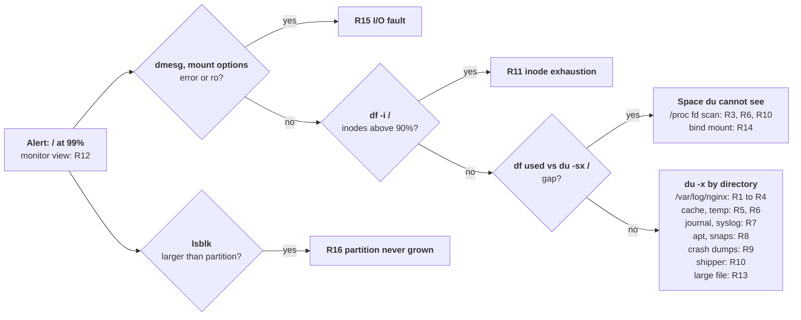

# Problem 2: Diagnose Me Doctor

An Ubuntu 24.04 VM running only NGINX as a load balancer reports its root disk at 99%. This runbook keeps it serving, copies evidence before freeing anything, reclaims what is safe to drop, then follows a fixed order of checks to one of sixteen causes. [`diagnose-disk.sh`](diagnose-disk.sh) runs the read-only checks in one pass; [`tests/rotate-check.sh`](tests/rotate-check.sh) proves that rotation makes NGINX reopen its logs.

## Contents

- [Scope](#scope)
- [Decisions](#decisions)
- [What a full disk does to the load balancer](#what-a-full-disk-does-to-the-load-balancer)
- [First 15 minutes: keep it serving](#first-15-minutes-keep-it-serving)
- [Investigation](#investigation)
- [Root causes](#root-causes)
- [Prevention and monitoring](#prevention-and-monitoring)

## Scope

### In scope

- **The alert**: `/` at 99% on one VM whose only workload is NGINX.
- **Keeping it serving**: what fails, what to free first, how to buy headroom.
- **Finding the cause**: ordered checks and sixteen causes.
- **Not recurring**: alerts and configuration.

### Out of scope

- **Other workloads on the VM**: the check order still applies.
- **Provider tooling**: resize, snapshot and volume health, named by function.
- **The fleet**: log pipeline and retention beyond this VM.
- **Other filesystems**: XFS and Btrfs, except where they differ from ext4.

### Assumptions

- **One scenario**: the task names "two production issues" but describes one.
- **One 64 GB ext4 root, no LVM**: an installer-built filesystem reserves 5% for root (3.2 GB); the cloud image root reserves none (`tune2fs -l`: `Reserved block count: 0`).
- **The Ubuntu NGINX package**: 1.24, logs in `/var/log/nginx`, temp files in `/var/lib/nginx`, workers as `www-data`, 14 daily rotations.
- **A systemd service**: in Docker, the unbounded `json-file` log under `/var/lib/docker/containers/` is the first suspect.
- **journald on disk, forwarding to rsyslog**: `ForwardToSyslog=yes` in `/usr/lib/systemd/journald.conf.d/syslog.conf`.
- **Unknowns**: whether a shipper runs and whether other nodes share traffic, so no step drains this one.
- **Commands run as root**; `du` and `/proc/<pid>/fd` are partial otherwise.

## Decisions

| # | Decision | Alternatives considered | Why | Revisit when |
|---|---|---|---|---|
| 1 | Copy a tail of each deleted-but-open file before freeing space | Free first | `reopen`, truncate or a shipper restart discards the file | Lines confirmed off-box |
| 2 | Truncate an open log, never `rm` it | `rm` and restart | `rm` frees nothing while a descriptor is open | Never, for a held file |
| 3 | `nginx -s reopen`, not `systemctl restart nginx` | Restart; `reload` | `reopen` drops no connection; a stop cuts transfers at 5 seconds (`--retry QUIT/5`) | The master is wedged |
| 4 | Cap the journal with `SystemMaxUse=` | `ForwardToSyslog=no`; lower `MaxRetentionSec=` | Bounds the disk whatever a unit logs | A shipper reads the journal |
| 5 | `proxy_cache_path` with `max_size`, `min_free`, `inactive` | A cron purge | The cache manager evicts in-process; a purge job races it | The cache has its own volume |
| 6 | A separate volume for `/var/log` and `/var/cache/nginx` | A larger root; quotas | A flood stops there while apt, sshd and `/` keep working | Logs leave at once |
| 7 | Ship logs off the VM, keep two or three days locally | 14 days local | Disk-sized retention breaks at the next traffic step | 14 days fits in half the disk |
| 8 | Alert on time to full and available bytes | 90% and 95% thresholds | 18.6 GB a day fills 64 GB from 85% in 12 hours | 5% exceeds a day of growth |
| 9 | `tune2fs -m 1` as a bridge, `-m 5` after the fix | Leave 1%; never touch it | About 2.6 GB on 64 GB | `Reserved block count: 0` |

## What a full disk does to the load balancer

Workers run as `www-data` and get `ENOSPC` (`28: No space left on device`) once `df` shows `Avail` 0; root processes keep writing into the reserve where one exists. At 99% the workers have about 0.6 GB left on 64 GB; at 1,000 requests per second with 215-byte `combined` lines the access log writes 18.6 GB a day and uses that in about 45 minutes. Observed on a full filesystem:

| Path | Disk use | On a full disk |
|---|---|---|
| Request within memory buffers | None | Served |
| Body above `client_body_buffer_size` (8 KB on x86-64) | `client_body_temp_path` | `500 Internal Server Error`; `[crit] pwrite() "/var/lib/nginx/body/0000000002" failed (28: No space left on device)` |
| Response above `proxy_buffers` (8 × 4 KB or 8 KB) to a slow client | `proxy_temp_path`, up to `proxy_max_temp_file_size` (1024 MB) per request | 200 and headers, then the connection closes mid-body (3.4 MB of 64 MB at 2 MB/s, `curl` exit 18); `[crit] pwritev()` with errno 28 |
| `proxy_cache` hit | Read only | Served |
| `proxy_cache` miss | A temp file into the cache | `curl: (52) Empty reply from server`; `[crit] pwrite()` with errno 28 |
| Access or error log line | Append | Served, line lost; `[alert] write() to "/var/log/nginx/access.log" failed (28: ...)` at most once a minute per worker |
| `nginx -t`, `-s reload`, `-s reopen` | By the master, as root | Succeeded |
| Health check in front | A small proxied request | Passes, so the node stays in rotation while uploads and cache misses fail |
| logrotate | gzip writes the `.gz` first | `gzip: stdout: No space left on device`, exit 1, nothing freed |
| rsyslog | `$PrivDropToUser syslog` | `/var/log/syslog` and `/var/log/auth.log` stop with the workers |
| apt, unattended-upgrades | Downloads and unpacks | Security updates stop |

## First 15 minutes: keep it serving

Paste the commands into a plain interactive shell, not under `set -e` or an `EXIT` trap: a `grep` with no match would close the shell, and a trap that removes its working directory takes the staged evidence with it.

### Confirm what is full and whether NGINX still serves

```bash
df -hT /                     # available excludes root's reserve
df -i /                      # near 100% with bytes free is R11
dmesg -T | tail -n 20        # "EXT4-fs error", "I/O error", "Remounting filesystem read-only": R15
findmnt -n -o OPTIONS /      # "ro," first: remounted read-only (R15)
systemctl is-active nginx
curl -sS -o /dev/null -w '%{http_code}\n' http://127.0.0.1/<health-path>
grep -E '\[(crit|alert)\].*(No space left|Read-only file system)' /var/log/nginx/error.log | tail -n 5
```

A passing health check proves only the in-memory path; `crit` lines with errno 28 mean uploads and cache misses already fail. If the cause may be evidence, snapshot the volume first.

### Copy evidence before freeing anything

Decision 1: copy first, then free.

```bash
# 1. Deleted-but-open files, with holder, inode and size
find /proc/[0-9]*/fd -lname '*(deleted)' -printf '%p -> %l\n' 2>/dev/null
stat -L -c 'inode %i, %s bytes' /proc/<pid>/fd/<n>
# 2. A target off /: /dev/shm (half of RAM by default), another mount or host
df -h /dev/shm               # a 200 MB tail per file must fit
mkdir -p /dev/shm/evidence
printf '%s pid=%s fd=%s inode=%s size=%s\n' "$(date -Is)" <pid> <n> <inode> <size> >> /dev/shm/evidence/index.txt
# 3. A bounded tail, locally or straight off the box
tail -c 200M /proc/<pid>/fd/<n> > /dev/shm/evidence/<pid>-<n>.tail
tail -c 200M /proc/<pid>/fd/<n> | ssh <user>@<collector> 'cat > /srv/evidence/<host>-<pid>-<n>.tail'
# 4. Only then release the file
nginx -s reopen
```

`/dev/shm` is RAM shared with NGINX and lost at reboot, so move copies off the VM within the hour.

### Reclaim space that is safe to drop

Work down the table; check `df -h /` after each step.

| # | Action | Command | Frees | Cost |
|---|---|---|---|---|
| 1 | Release deleted logs | `nginx -s reopen` | Deleted logs NGINX holds | None |
| 2 | Empty a held deleted file | `: > /proc/<pid>/fd/<n>` | Its blocks | Its content |
| 3 | Drop downloaded packages | `apt-get clean` | `/var/cache/apt/archives` | A later download |
| 4 | Trim the journal | `journalctl --vacuum-size=500M` | Archived journals beyond 500 MB | Older system logs |
| 5 | Remove old rotated logs | `find /var/log/nginx -name '*.gz' -mtime +2 -delete` | Logs older than two days | Local history |
| 6 | Empty the offending live log | `tail -n 200000 /var/log/nginx/access.log > /dev/shm/evidence/access.tail`, then `truncate -s 0 /var/log/nginx/access.log` | The whole file | Its content |
| 7 | Shrink an oversized cache | Lower `max_size` in `proxy_cache_path`, then `nginx -t && nginx -s reload` | Cache above the limit | Hit ratio; a 41 MB cache fell to 5.1 MB in 3 seconds |

### Buy headroom if that is not enough

- **Lend the reserve**: `tune2fs -m 1 /dev/<root-device>` applies to the mounted filesystem at once (decision 9).
- **Grow the volume online**: resize the volume, then `growpart /dev/<disk> <partition-number>` and `resize2fs /dev/<root-partition>`; ext4 grows mounted (R16).

### What not to do

- **`rm` on an open log**: decision 2; `nginx -s reopen` releases it, recreated as 0644 instead of logrotate's 0640.
- **Clearing `/var/lib/nginx/body` or `/var/lib/nginx/proxy`**: NGINX unlinks each temp file on creation, so deleting there frees nothing (R6).
- **Hand-deleting under `/var/lib/dpkg`, `/var/lib/apt`, `/boot` or `/var/log/journal`**: use `apt autoremove --purge` and `journalctl --vacuum-size`.
- **`mount -o remount,rw /` after the kernel set it read-only**: R15; check before writing.

## Investigation

After the Confirm block, each check rules out a further class of causes; `diagnose-disk.sh` runs them all at idle I/O priority under timeouts and exits 1 when a collector could not run:

```bash
sudo ./diagnose-disk.sh / > /dev/shm/disk-report.txt
```



1. `lsblk -o NAME,SIZE,TYPE,FSTYPE,MOUNTPOINTS`: a disk larger than its partition is R16.
2. `du -xh --max-depth=1 / 2>/dev/null | sort -h`, then `du -xh --max-depth=2 /var 2>/dev/null | sort -h | tail -n 20`: the largest directory maps to a cause in the diagram.
3. `df -B1 --output=used /; du -sxB1 / 2>/dev/null`: a gap of hundreds of MB is deleted-but-open files (R3, R6, R10) or files under a mount point (R14).
4. `find /proc/[0-9]*/fd -lname '*(deleted)' -printf '%p -> %l\n' 2>/dev/null`, or `lsof -nP +L1`: the deleted files and their holders.
5. `find / -xdev -type f -size +500M -printf '%s\t%t\t%p\n' 2>/dev/null | sort -n` and `find / -xdev -type f -mmin -15 -size +10M -printf '%s\t%p\n' 2>/dev/null`: large files and live writers (R13).
6. `nginx -T 2>/dev/null | grep -nE 'access_log|error_log|proxy_cache_path|_temp_path|proxy_max_temp_file_size|proxy_buffering'`: `error_log ... debug` is R4, `proxy_cache_path` without `max_size` is R5, temp paths on `/` are R6.
7. `ls -lhS --time-style=long-iso /var/log/nginx`: an empty `access.log` beside a large, current `access.log.1` is R3; all 14 rotations present is R1; none is R2.
8. `logrotate -d /etc/logrotate.conf 2>&1 | grep -iE '^error|ignoring'; systemctl list-timers logrotate.timer; journalctl -u logrotate.service --since=-3d -p warning --no-pager; grep nginx /var/lib/logrotate/status`: an `Ignoring nginx` error, a failed run, a disabled timer or an old `nginx` entry is R2.
9. `journalctl --disk-usage; ls -lhS /var/log | head`: a journal near its cap or a large `/var/log/syslog` is R7.
10. `du -sh /var/cache/apt/archives /boot /var/lib/snapd/snaps; uname -r; dpkg -l 'linux-image-[0-9]*' | grep '^ii'; snap list --all | grep disabled`: old kernels, a large apt cache or disabled snaps are R8.

## Root causes

### R1 Retention outgrew the disk

`/etc/logrotate.d/nginx` keeps 14 daily files, two uncompressed (`delaycompress`): at 1,000 requests per second, two uncompressed days plus 12 compressed at 10:1 come to 37 + 22 = 59 GB, the whole disk.

- **Confirm**: `/var/log/nginx` largest, all 14 rotations present, a daily sawtooth.
- **Impact**: [the table above](#what-a-full-disk-does-to-the-load-balancer).
- **Recovery**: ship or delete the oldest `.gz` files, then lower `rotate`.
- **Prevention**: retention from measured traffic, most of it shipped ([Configuration](#configuration)).

### R2 logrotate skips NGINX

Silent failures: a group- or world-writable config file (`error: Ignoring nginx because it is writable by group or others`, yet `Result=success`), a syntax error under `/etc/logrotate.d`, or a disabled `logrotate.timer`.

- **Confirm**: a steady climb; no rotated files, or an old `nginx` entry in `/var/lib/logrotate/status`.
- **Impact**: as R1.
- **Recovery**: `chmod 0644 /etc/logrotate.d/nginx` or `systemctl enable --now logrotate.timer`, then `logrotate -v /etc/logrotate.conf`.
- **Prevention**: alert on `error:` lines from `logrotate.service` and on the status entry's age.

### R3 Rotated logs not reopened

The packaged postrotate, `invoke-rc.d nginx rotate >/dev/null 2>&1`, sends `USR1` to the pid file named in `/etc/nginx/nginx.conf` and fails silently when that differs from the running master's: `access.log` is renamed to `.1` and recreated empty, NGINX keeps writing to `.1`, and `.1` grows without limit while logrotate exits 0. [`tests/rotate-check.sh`](tests/rotate-check.sh) reproduces both outcomes in a container: new inodes with the packaged config, a 0-byte `access.log` without `postrotate`.

- **Confirm**: `access.log` empty while `access.log.1` grows, or NGINX holds a deleted log.
- **Impact**: as R1, plus logs in `.1` or deleted.
- **Recovery**: copy the evidence, then `nginx -s reopen`.
- **Prevention**: the rotation test after any unit, pid path or logrotate change; alert on deleted-but-open bytes.

### R5 Unbounded proxy cache

Without `max_size` or `min_free` (NGINX 1.19.1 and later) the cache manager removes only entries unused for `inactive` (10 minutes by default), so a long `inactive` lets the cache take the disk.

- **Confirm**: flat near 99%; the cache path is largest; `nginx -T` shows no `max_size`.
- **Impact**: misses get no response while hits work: failures look random by URL.
- **Recovery**: `max_size` and `min_free` below what the disk holds, then reload.
- **Prevention**: decision 5, the cache on its own volume, `use_temp_path=off`.

### R6 Temp files for uploads and downloads

A body above `client_body_buffer_size` goes to `client_body_temp_path`; a response that outruns the client goes to `proxy_temp_path`, up to `proxy_max_temp_file_size` (1024 MB). NGINX unlinks these files on creation, so `du /var/lib/nginx` shows nothing while the `/proc` scan does: `/var/lib/nginx/proxy/0000000009 (deleted)` at 60 MB during one slow download.

- **Confirm**: spikes that recover; workers hold deleted `body/` or `proxy/` files.
- **Impact**: transient alone; near full, 500s on uploads and truncated downloads.
- **Recovery**: the space returns when the requests finish.
- **Prevention**: `proxy_request_buffering off` on upload routes; a lower `proxy_max_temp_file_size`; temp paths on a separate volume.

### R7 Journal and syslog

journald caps itself at 10% of the filesystem or 4 GB (`SystemMaxUse=`), but forwards every entry to rsyslog, which writes it again to `/var/log/syslog`, rotated weekly with 4 files kept and no size limit (`/etc/logrotate.d/rsyslog`).

- **Confirm**: `/var/log/journal` or `/var/log/syslog` large; one unit dominates the journal.
- **Impact**: rsyslog stops with the workers, so the incident's own logs are lost.
- **Recovery**: `journalctl --vacuum-size=500M`; `truncate -s 0 /var/log/syslog` (rsyslog holds it open).
- **Prevention**: decision 4, plus `maxsize` on the rsyslog files.

### R11 Inode exhaustion

ext4 fixes the inode count at `mkfs` time (one per 16 KB by default, about 4 million on 64 GB); millions of small files exhaust it, and creation fails with errno 28 while `df -h` shows 1% used.

- **Confirm**: `df -i` near 100% while `df -h` shows free space.
- **Impact**: appends continue; new temp files, cache entries and rotated logs fail.
- **Recovery**: the directory with the most entries (`find / -xdev -printf '%h\n' | sort | uniq -c | sort -n | tail`), then remove them.
- **Prevention**: alert on inode use; `mkfs.ext4 -i 4096` or XFS for a cache volume.

### R12 The monitor versus `df`

`df` computes `Use%` as used ÷ (used + available), excluding the reserve, so its 100% is the workers' zero; a monitor using used ÷ size reads about 5 points lower, and one without a filesystem filter may report `/boot` or a snap's squashfs, always 100%.

- **Confirm**: the alert's number differs from `df`, or names another mount.
- **Impact**: none off `/`; on `/`, 99% is about 0.6 GB from errno 28.
- **Recovery**: `tune2fs -m 1` where a reserve exists; correct the monitor's mount and formula.
- **Prevention**: alert on available bytes and time to full, squashfs and tmpfs excluded.

### Less common causes

| Id | Cause | Confirm | Recover | Prevent |
|---|---|---|---|---|
| R4 | Debug error logging, about 13 KB per proxied request | `error.log` outgrows `access.log` | Level back to `error`, reload, truncate | `debug_connection <client-ip>;` for one client |
| R8 | Apt cache, old kernels, snap revisions | `/var/cache/apt/archives`, `/boot` or `/var/lib/snapd/snaps` large after upgrades | `apt-get clean`; `apt autoremove --purge`; `snap remove <name> --revision=<rev>` | `APT::Periodic::CleanInterval "7";`, `Unattended-Upgrade::Remove-Unused-Kernel-Packages "true";`, `refresh.retain=2` |
| R9 | Crash dumps | `/var/crash` or a coredump directory growing | Copy one report off the VM, delete the rest, fix the crash | `MaxUse=1G` in a `coredump.conf` drop-in |
| R10 | A log shipper buffering while its destination is down | Output errors; a growing data directory | Restore the destination, or copy the evidence and restart it | A buffer limit inside a disk budget |
| R13 | A stray large file | `find -size +500M`; `lsof <path>` shows a live writer | Stop the writer; move or delete the file after a snapshot | Ring-buffer captures (`tcpdump -C 100 -W 10`) |
| R14 | Files hidden under a mount point | `df` used exceeds the `du` total with no deleted-open files | `mount --bind / /mnt/rootfs`, delete through it | Move the data before mounting over it |
| R15 | An I/O fault or read-only remount (`errors=remount-ro`) | `EXT4-fs error` or `I/O error` in `dmesg`; `/` mounted `ro` | Stop writing, snapshot, `fsck.ext4 -f` from a rescue boot | Alert on `node_filesystem_readonly` and `node_filesystem_device_error` |
| R16 | A root partition never grown after a resize | `lsblk` shows the disk larger than its partition | `growpart /dev/<disk> <partition-number>`, then `resize2fs /dev/<root-partition>` | Compare `lsblk` with `df -h /` after every resize |

## Prevention and monitoring

### Alerts

node_exporter names; textfile rows need a small script on the VM.

| Signal | Source | Alert when | Points to |
|---|---|---|---|
| Time to full for `/` | `predict_linear(node_filesystem_avail_bytes{mountpoint="/"}[6h], 4 * 3600) < 0` | 15 minutes | Any live writer, hours early |
| Available bytes on `/` | `node_filesystem_avail_bytes`, squashfs and tmpfs excluded | Below 15% of size (warning), 5% (critical) | Slow growth |
| Read-only or faulting filesystem | `node_filesystem_readonly`, `node_filesystem_device_error`; `EXT4-fs error` or `I/O error` in the kernel log | Any | R15 |
| Inode use | `node_filesystem_files_free / node_filesystem_files` | Below 10% | R11 |
| Deleted-but-open bytes | Textfile collector running the `/proc` scan every 5 minutes | Above 1 GB for 30 minutes | R3, R6, R10 |
| Size of `/var/log/nginx`, the cache path, `/var/log/journal` | Textfile collector running `du -sb` | Above its budget | R1, R4, R5, R7 |
| logrotate health | `error:` lines from `logrotate.service`; age of the `nginx` status entry | Any error; older than two days | R2, R3 |

### Configuration

- **Retention sized to traffic**: rotate by size as well as by day; logrotate checks `maxsize` only when it runs, so the timer goes hourly.

```text
# /etc/logrotate.d/nginx
/var/log/nginx/*.log {
    daily
    maxsize 1G
    rotate 7
    missingok
    compress
    delaycompress
    notifempty
    create 0640 www-data adm
    sharedscripts
    postrotate
        invoke-rc.d nginx rotate >/dev/null 2>&1
    endscript
}
```

```ini
# systemctl edit logrotate.timer
[Timer]
OnCalendar=
OnCalendar=hourly
```

- **Log less**: `access_log off;` in the health check location.
- **Bounded cache and temp files**: `proxy_cache_path /var/cache/nginx/app levels=1:2 keys_zone=app:50m max_size=10g min_free=5g inactive=7d use_temp_path=off;`, `proxy_max_temp_file_size 256m;`, `proxy_request_buffering off;` on upload routes.
- **A capped journal**: `/etc/systemd/journald.conf.d/size.conf` with `[Journal]` and `SystemMaxUse=1G`, then `systemctl restart systemd-journald`.
- **Rotation test**: `tests/rotate-check.sh` after any change to the NGINX unit, pid path or logrotate file.
- **Capacity review**: monthly; grow the disk while time to full exceeds 30 days.
