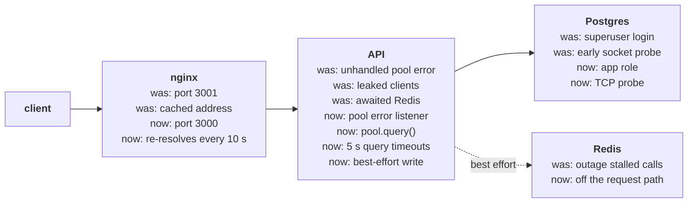

# Problem 3: Debugging issues within system

Every `/api/*` call through nginx failed because nginx proxied to the wrong port. Behind it, a Postgres restart crashed the API, a Redis outage failed every request, nginx kept a stale API address, and a database error leaked pool connections. The stack also had eight hardening gaps: no query timeout, health endpoints that nginx did not route, startup that ignored dependency health, no memory limits and a port open on every interface, a superuser database login, a hardcoded password, an end-of-life base image running as root, and config files that were never mounted. [`tests/smoke.sh`](tests/smoke.sh) runs each failure scenario in [CI](../../.github/workflows/p3-ci.yml), together with checks for five of the hardening gaps.

## Contents

- [Scope](#scope)
- [Decisions](#decisions)
- [How I diagnosed it](#how-i-diagnosed-it)
- [Root causes and fixes](#root-causes-and-fixes)
- [Running and verifying](#running-and-verifying)
- [Monitoring and alerts](#monitoring-and-alerts)
- [Preventing this in production](#preventing-this-in-production)

## Scope

### In scope

- **nginx**: the only published port, `127.0.0.1:8080`, proxying to the API.
- **API**: Node 26 and Express; `GET /api/users` reads the database time and records the call in Redis, `GET /status` reports liveness, `GET /ready` reports database reachability.
- **PostgreSQL 15**: the API's only required dependency.
- **Redis 7**: stores `last_call`; the API answers without it.

### Out of scope

- **Application features**: no users table; the handler returns the database time.
- **Production hosting**: replicas, orchestration, backups, host firewall.
- **TLS**: nginx listens on plain HTTP; in production a TLS-terminating proxy would sit in front of it.

### Assumptions

- **One Docker host**: a loopback bind suffices.
- **Tens of concurrent clients**: a pool of 10 per replica against the default `max_connections` of 100.
- **A fresh `pgdata` volume on first start**: the role init script runs only then.
- **Secrets come from the environment**: `.env` locally, passwords generated per run and masked in CI, a secrets manager in production.

## Decisions

| # | Decision | Alternatives considered | Why | Revisit when |
|---|---|---|---|---|
| 1 | nginx re-resolves the upstream (`resolver` plus a variable in `proxy_pass`) | Restart nginx after each API deploy | nginx caches the address at startup; re-resolving needs no operator step | The API gets a stable address |
| 2 | `pool.query()` instead of `connect()` and `release()` by hand | `try/finally` around `release()` | The pool releases or discards the client on every path | A handler needs a transaction |
| 3 | Best-effort Redis write, not awaited | Await behind a short timeout | Redis stores only `last_call`; awaiting put its availability on the request path | The cache serves real data |
| 4 | `service_healthy` for Postgres, `service_started` for Redis | `service_healthy` for both | The API runs without Redis, so Redis health must not block startup | Redis becomes required |
| 5 | Delete the unmounted `init.sql` and `nginx.conf` | Mount them | `max_connections = 20` leaves 17 non-superuser slots: one pool of 10 fits, a second replica does not; the empty `nginx.conf` stops nginx | Postgres needs tuning |
| 6 | Secrets from the environment and a least-privilege `app` role | Hardcoded superuser | A credential in source is in every clone; a superuser can drop the database | A secrets manager issues short-lived credentials |
| 7 | Query timeouts of 5 s, below nginx's 10 s read timeout | The proxy timeout alone | A stuck query frees its connection at 5 s instead of holding it after nginx answers 504 | A query needs more than 5 s |
| 8 | nginx `1.30` and Node `26`; Postgres stays on `15` | Postgres 17 or 18 | A Postgres major upgrade means `pg_upgrade` or dump and restore, not a stability fix | A maintenance window; PG 15 end of life, November 2027 |
| 9 | Memory limits per service and a loopback bind | No limits; `0.0.0.0:8080` | A leaking process restarts at its limit; the port is reachable from the host only | A load balancer on another host |

## How I diagnosed it

I ran the original stack and worked from the outside in: the request path first, then each dependency failing in turn, then the files.

| Step | Command | Observed |
|---|---|---|
| 1 | `curl localhost:8080/api/users` | `502` from nginx: `upstream: "http://172.30.0.4:3001/api/users"` |
| 2 | `wget -qO- localhost:3000/api/users` inside the API container | `{"ok":true,...}`: the API works, so the fault is in routing |
| 3 | `docker compose restart postgres` | The API exits with code 1: `Unhandled 'error' event`; no restart policy, so it stays down |
| 4 | `docker compose stop redis`, then call the API | `500` after 20 s of ioredis retries |
| 5 | Port fixed, API recreated on a new IP | `502`; nginx still connects to the old address |
| 6 | `SHOW max_connections` in Postgres | `100`, the default: `postgres/init.sql` is not mounted |
| 7 | `wc -c /etc/nginx/nginx.conf` in the nginx container | The size of the image's own file, not 0: `nginx/nginx.conf` is not mounted |
| 8 | `\du` in `psql` | The API's user is the superuser |
| 9 | `docker inspect` on each container | `Memory: 0`, so no limit; nginx published on `0.0.0.0:8080` |
| 10 | Reading `api/src/index.js` | `pool.connect()` with no `finally { release() }`; no `statement_timeout` or `query_timeout`; the database password in the source |
| 11 | Reading `nginx/conf.d/default.conf` | Only `/api/` is proxied, so `/status` gets 404 |
| 12 | Reading `docker-compose.yml` and `api/Dockerfile` | `depends_on` without health checks; the password repeated in Compose; `node:20`, `npm install` with no lockfile, no `USER`, so the API runs as root |
| 13 | `pg_isready` with and without `-h 127.0.0.1` on an empty volume, with a test init script that sleeps 6 s | The socket probe passes at 1 s; the TCP probe at 7 s, when the final server logs `listening on IPv4` |

## Root causes and fixes

The request path, with the fault each hop had in the original stack and its fix:



### Outage causes

| # | Root cause | Impact | Fix |
|---|---|---|---|
| 1 | nginx proxies to `api:3001`; the API listens on `3000` | Every API call returns 502 | [`nginx/conf.d/default.conf`](nginx/conf.d/default.conf) targets port 3000 |
| 2 | nginx resolves `api` once at startup | After the API container is recreated, nginx sends traffic to the released address until restarted | Docker's DNS as `resolver` (`valid=10s`) and the upstream in a variable |
| 3 | No `error` listener on the `pg` pool | A dropped idle connection crashes the process; no restart policy, so it stays down | `pool.on("error")` in [`api/src/index.js`](api/src/index.js) and `restart: unless-stopped`. For a clean stop, a `SIGTERM` handler in `index.js` closes the server and the pool and exits 0 (or 1 after 10 s), and `init: true` runs tini as PID 1 to forward signals and reap zombies |
| 4 | `release()` skipped when the query throws; no acquire timeout | Each failed query keeps a connection; after 10, requests hang and nginx answers 504 | `pool.query()` releases or discards the client on every path; `connectionTimeoutMillis: 2000`; pool size from `DB_POOL_MAX` |
| 5 | The Redis write is awaited with ioredis defaults | Redis stores only `last_call`, yet an outage fails every request after 20 s | Best-effort write, logged on failure; `enableOfflineQueue: false`, `maxRetriesPerRequest: 1`, `commandTimeout: 500` |

### Hardening gaps

| # | Root cause | Impact | Fix |
|---|---|---|---|
| 6 | No `statement_timeout` or `query_timeout` on the pool | A stuck query holds its connection after nginx has answered 504; enough of them exhaust the pool | `statement_timeout: 5000` and `query_timeout: 5000`, below nginx's 10 s `proxy_read_timeout`; nginx connects with a 2 s `proxy_connect_timeout`. A stuck query gets a 503 at 5 s, and the pool closes that connection and frees its slot |
| 7 | `/status` and `/ready` are not routed through nginx | A load balancer or external health probe cannot reach the health endpoints | `location = /status` and `location = /ready` proxied to the API |
| 8 | `depends_on` without health checks | The API and nginx can start before their dependencies accept connections | Postgres and the API (`/ready`) gate with `service_healthy`; Redis with `service_started`. The Postgres probe is `pg_isready -h 127.0.0.1`: the first-boot server listens on the unix socket only, so a socket probe passes before the init scripts run and the API starts into refused connections |
| 9 | No memory limits; port 8080 on all interfaces | One runaway process can starve the host; the API is reachable from every network | `deploy.resources.limits.memory` (api 256M, nginx 64M, redis 128M, postgres 512M); `127.0.0.1:8080:80` |
| 10 | The API connects as the Postgres superuser | A leaked credential or an injected statement can drop databases or create roles | [`postgres/init/01-app-role.sh`](postgres/init/01-app-role.sh) creates `app` with `LOGIN`, `CONNECT` on the database and `USAGE` on `public`; identifiers and the password pass as `psql` variables (`:"user"`, `:'pw'`), never interpolated; the API connects as `APP_DB_USER` |
| 11 | Database password hardcoded in `index.js` and Compose | A credential in source, changed only by a code change | Compose reads settings from `.env` (template: [`.env.example`](.env.example)), which is gitignored, and refuses to start without `POSTGRES_PASSWORD` and `APP_DB_PASSWORD` |
| 12 | `node:20` base image (end of life 2026-04-30), `npm install` with no lockfile, root user | No security fixes, unreproducible builds, a root process | `node:26-alpine`, `npm ci --omit=dev`, npm removed after the install (Trivy found fixable HIGH CVEs in the `undici` and `brace-expansion` copies bundled with npm), a non-root UID, `.dockerignore`; a `HEALTHCHECK` that probes `/status` with `wget`, which Compose's own check on `/ready` overrides in this stack |
| 13 | `postgres/init.sql` (`max_connections = 20`) and an empty `nginx/nginx.conf` are never mounted | Config that looks active but isn't; the empty `nginx.conf` would stop nginx | Both removed; Postgres keeps its default 100 connections |

## Running and verifying

Run from `src/problem3`. The suite needs `curl`, `xargs` and `seq` on the host and pulls `alpine:3`. It stops Redis, freezes and restarts Postgres, and stops and recreates the API, so point it only at this stack.

```bash
cp .env.example .env     # set POSTGRES_PASSWORD and APP_DB_PASSWORD, e.g. openssl rand -base64 20
docker compose down -v   # drop the pgdata volume of an earlier attempt
docker compose up --build --wait
./tests/smoke.sh
docker compose down -v
```

The role init script runs only on an empty `pgdata` volume, so a re-run after an earlier attempt, or after a change to `APP_DB_USER` or `APP_DB_PASSWORD`, needs `docker compose down -v` first.

| Check | What it proves | Root cause it covers |
|---|---|---|
| `/` and `/api/users` return 200 through nginx | nginx reaches the API on port 3000 | nginx proxying to the wrong port |
| `/status` and `/ready` return 200 through nginx | Both health endpoints are routed | Health endpoints not routed through nginx |
| nginx's only port binding is `127.0.0.1:8080`; every service has a memory limit | The port is reachable from the host only; a runaway container stops at its limit | No memory limits; port 8080 on all interfaces |
| The API's own database login reports `rolsuper` as `false` | The API connects as `app`, not as the superuser | The API connecting as the superuser |
| `docker compose config` fails with `POSTGRES_PASSWORD` and `APP_DB_PASSWORD` empty | Compose has no password to fall back on | Hardcoded database password |
| 500 requests at concurrency 50 all return 200 | A pool of 10 serves 50 concurrent clients without an error. It tests capacity; the leak has its own check | Pool size, set by the leak fix |
| [`tests/pool-leak.js`](tests/pool-leak.js), run inside the API image against the stack's Postgres | `connect()` plus a throwing query and no `release()` exhausts a pool of 2 after two failures, and `SELECT 1` fails at the proof pool's 1 s acquire timeout instead of hanging; `pool.query()` on the same query leaves the pool usable after ten | Connection leak on a failed query |
| `/api/users` returns 200 within 5 s while Redis is stopped | Redis stays off the request path | Redis awaited on the request path |
| With Postgres frozen by `docker compose pause`, `/api/users` returns 503 after about 5 s; it serves again after `unpause` | A frozen server never answers, so the client-side `query_timeout` fires before nginx's 10 s read timeout, and the pool recovers | No query timeout |
| After a Postgres restart the API answers again; its restart count is unchanged | The process survives a dropped connection | Crash on a dropped pool connection |
| `docker compose stop -t 10 api`: the container exits with code 0 within 10 s; the API serves again after `start` | Node receives `SIGTERM`, closes the server and the pool, and exits 0 before Docker sends `SIGKILL` at 10 s | Crash on a dropped pool connection: the clean stop in its fix |
| After the API is recreated on a new IP, nginx routes to it without a reload | The upstream is re-resolved | nginx caching the API's address |

The suite fails against the original stack, where `/api/users` gets 502. The rest is covered outside it:

- **CI**: `docker compose config --quiet` and `nginx -t` prove the files parse; hadolint, `npm audit` and the Trivy image scan, which fails on fixable HIGH and CRITICAL CVEs, cover the base image.
- **Unit tests**: [`api/test/app.test.js`](api/test/app.test.js) covers the handler's failure paths, including the 503 for a failed query.
- **Manual, by reading**: `statement_timeout` and the 2 s `connectionTimeoutMillis` in `api/src/index.js`, since a frozen server exercises only the client-side `query_timeout`; the `depends_on` conditions in `docker-compose.yml`; the absence of `init.sql` and `nginx/nginx.conf`.
- **Manual, measured once**: the TCP health probe, timed during diagnosis on an empty volume.

## Monitoring and alerts

nginx writes every request in the `upstream_timing` access-log format (`rt` request time, `urt` upstream time, `upstream` address, `ustatus` upstream status, `rid` request ID) and passes the ID to the API as `X-Request-ID`.

| Signal | Source | Alert when | Points to |
|---|---|---|---|
| nginx 5xx ratio on the response status, split by `ustatus` | Access log | Above 1% for 5 minutes | API unreachable (502; `ustatus=-` when the `api` name does not resolve); database down or query timeout (503); blocked API, or a stopped API whose address nginx still caches for up to 10 s (504) |
| p99 `rt` and `urt` | Access log | Above 500 ms for 10 minutes | Pool waiting, slow queries, slow Postgres connects |
| Container restarts, health, memory against limit | Docker events, cAdvisor | Any restart in 15 minutes; unhealthy for 1 minute; memory above 85% or an OOM kill | A crash loop, or a leak heading for the limit |
| `/ready` through nginx | Blackbox probe on `:8080/ready` | Failing for 1 minute | The API cannot reach Postgres, or nginx cannot reach the API |
| `canceling statement due to statement timeout` | Postgres log | More than 5 in 5 minutes | A slow query or lock contention |
| Postgres connections and pool `waitingCount` | `postgres_exporter`; an API metric to add for `pool.waitingCount` | Above 80% of `max_connections`; waiting above 0 for 2 minutes | A leak, or pool size times replicas set too high |
| Redis up, and `cache write failed` log lines | `redis_exporter`, log query | Down for 1 minute; more than 10 `cache write failed` lines in 5 minutes | `last_call` stops updating; requests still succeed |

## Preventing this in production

- **Gate every change**: the smoke and fault suite, `docker compose config` and `nginx -t` in CI; every config file in the repo is mounted, or deleted.
- **Review rules for resilience**: release a pooled connection in `finally` or never take it by hand; every emitter has an `error` listener; non-critical dependencies stay off the request path.
- **Bound every wait**: query timeouts below the proxy timeout, a connect timeout on the pool, a memory limit on each container.
- **Size capacity on paper**: pool size times replicas stays below `max_connections` minus the reserved slots.
- **Least privilege and short-lived secrets**: the application role holds `CONNECT` and `USAGE`; in production its password is a short-lived credential from a secrets manager (Vault's database secrets engine, or a rotated AWS Secrets Manager entry).
- **Keep the supply chain current**: a supported base image, lockfile installs, and the Trivy image scan in CI that blocks fixable HIGH and CRITICAL vulnerabilities.
