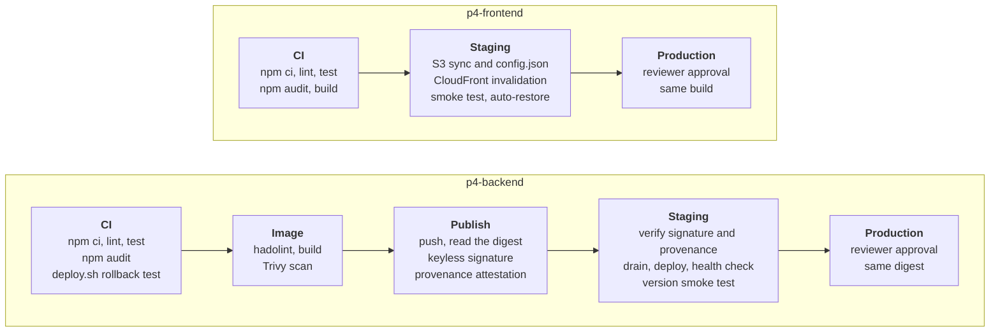

# Problem 4: Ship It Twice

Two pipelines, one per application. `p4-backend` builds the Express API into a container image, scans it, publishes it by digest with a keyless signature and a provenance attestation, then rolls it out to EC2 instances one at a time through SSM Run Command, staging first and production after a reviewer approves. `p4-frontend` builds the Vite SPA once, publishes the same build to S3 behind CloudFront in staging and then production, and puts the previous `index.html` back if the smoke test fails. Every stage runs on each push to `main`; without AWS credentials the deploy stages run as dry runs that print the calls they would make, while the image publish, signature and provenance checks run for real against the repository owner's GHCR namespace.

## Contents

- [Scope](#scope)
- [Layout](#layout)
- [How the pipelines work](#how-the-pipelines-work)
- [What production ready means here](#what-production-ready-means-here)
- [Decisions](#decisions)
- [Rollback](#rollback)
- [Connecting a real AWS account](#connecting-a-real-aws-account)
- [Left out on purpose](#left-out-on-purpose)

## Scope

### In scope

- **Backend**: an HTTP API as a container image, one container per EC2 instance behind an Application Load Balancer, in a staging and a production environment.
- **Frontend**: a static single-page application in an S3 bucket served by CloudFront, with a runtime `config.json` per environment.
- **Pipelines**: build, test, scan, publish, promote, deploy, verify and roll back, as GitHub Actions workflows that run in this repository.
- **IAM**: the OIDC trust and the least-privilege roles the workflows assume, as Terraform in [`infra/`](infra/).

### Out of scope

- **The rest of the AWS estate**: VPC, subnets, the ALB and target group, the instances, the bucket and the distribution. They are inputs to the Terraform module, and the assumptions state what they must provide.
- **Application features**: the API serves `/healthz`, `/api/version` and `/api/items`; the SPA shows the API version. Both exist to give the pipelines something real to ship.
- **A database**: the API has none, so there is no migration step.

### Assumptions

| Assumption | Why |
|---|---|
| Staging and production are separate AWS accounts, each with roles that trust GitHub's OIDC provider for this repository, the `main` branch and the environment. The production account holds the ECR repository, and its repository policy lets the staging instance role pull | No long-lived AWS keys in GitHub, and a staging credential cannot touch production. One registry keeps one digest per release, and production never pulls from the staging account |
| EC2 instances, at least two per environment, run Amazon Linux 2023 with Docker, the SSM agent and `cosign`, carry the tags `App=p4-backend` and `Env=<env>`, and sit in an ALB target group on port 8080 with a 30-second deregistration delay and the default health check (five passes 30 seconds apart) | SSM needs no inbound port or SSH key; tags let the pipeline find the fleet; the other instances carry traffic while one is drained |
| Runtime settings and secrets are in `/etc/p4-backend.env` on each instance, rendered at boot from Parameter Store or Secrets Manager | The image holds no environment-specific value, so one image serves both environments |
| The instances can reach Sigstore's public endpoints | `deploy.sh` verifies the image signature before it starts the container. Without that reach the verification, and so the deploy, fails closed; a private Sigstore deployment or offline bundles would lift the dependency |
| The ECR repository has immutable tags and scan on push | A commit SHA tag can never point to a different image later; the pipeline deploys by digest anyway |
| The frontend bucket is private with versioning on, served by CloudFront through origin access control, with 403 and 404 mapped to `/index.html` | Standard SPA hosting; versioning is what makes the automatic `index.html` restore possible |
| The API has its own hostname, and the backend sends `Access-Control-Allow-Origin` from `ALLOWED_ORIGIN` | Keeps the two releases independent: neither depends on the other's routing |
| GitHub environments `staging` and `production` exist; both accept deployments from `main` only, and `production` requires a reviewer | A person approves each production release, and no other branch can deploy |
| `main` is always releasable; pull requests run build and tests only | Trunk-based flow: every merge is a release candidate |

## Layout

GitHub runs workflows only from the repository's root `.github/workflows/`. The files live there, and [`.github/workflows/`](.github/workflows/) in this folder holds symlinks to them.

| Path | Role |
|---|---|
| `backend/` | Express API (`/healthz`, `/api/version`, `/api/items`), unit tests, Dockerfile |
| `backend/deploy/rollout.sh` | Runs on the CI runner: rolls an image across the instances one at a time |
| `backend/deploy/deploy.sh` | Runs on each instance through SSM: verifies the signature, swaps the container, health-checks it, rolls back on failure |
| `backend/deploy/test-deploy.sh` | Runs in CI against the runner's Docker: deploys a healthy image, a broken one and one whose signature check fails, and asserts the rollback and the refusal |
| `frontend/` | Vite SPA that reads `/config.json` at runtime and shows the API version |
| `frontend/config/<env>.json` | Per-environment runtime config, applied at deploy time |
| `frontend/deploy/publish.sh` | Uploads the build to S3 with cache headers, invalidates CloudFront, and restores a previous `index.html` version on request |
| `infra/` | Terraform: OIDC provider, publish role, deploy role per environment, instance profile, ECR repository and its cross-account pull policy |
| `p4-backend.yml`, `p4-frontend.yml` | The two pipelines |
| `p4-infra.yml` | Terraform format check, validation and Trivy misconfiguration scan |
| `p4-docs.yml` | Markdown lint, local link check and shellcheck for this folder |
| `_node.yml`, `_container.yml`, `_docs.yml`, `_deploy-ec2.yml`, `_deploy-s3.yml` | Reusable workflows they call; `_node.yml`, `_container.yml` and `_docs.yml` are shared with Problem 3 |

## How the pipelines work

| Trigger | Backend | Frontend |
|---|---|---|
| Pull request touching the app | CI, the `deploy.sh` test, image build and scan; nothing is published or deployed | CI and build |
| Push to `main`, or a manual run from `main` with no input | CI, image published as `<registry>/p4-backend@sha256:<digest>`, signed and attested, staging, then production | CI, build uploaded as artifact `frontend-dist`, staging, then production |
| Manual run from `main` with `image` or `artifact-run-id` | Skips the build and redeploys that digest after checking its form and registry | Skips the build and redeploys that run's artifact after validating the run |

A manual run from any other branch builds and tests only, and fails when given `image` or `artifact-run-id`. Pushes to `main` and manual runs from `main` share one concurrency group per workflow: a run waits until the one in flight finishes, including a run paused at the production approval, and a newer run replaces it while it waits.

The image moves through three jobs with different rights. `build` holds only `contents: read`: it lints the Dockerfile, builds, scans with Trivy and saves the image as a run artifact. `publish` has `packages: write`, `id-token: write` and `attestations: write`, but runs no application code: it loads the artifact, pushes it under the commit SHA tag, reads the digest, signs it with a keyless certificate bound to the `_container.yml` workflow on `main`, and attests build provenance. The registry is ECR when the `ECR_REGISTRY` and `AWS_ECR_ROLE_ARN` variables are set, otherwise GHCR under the repository owner's namespace (`ghcr.io/<owner>`), so the publish path is exercised on every push to `main` even with no AWS account.

Inside `_deploy-ec2.yml`, each deploy job starts by checking that the reference is a digest, verifying the signature (`cosign verify` against the publishing workflow's identity) and the provenance (`gh attestation verify`), and reading the commit revision from the image's label. `rollout.sh` then handles each instance in turn:

1. Deregister it from the target group and wait for draining.
2. Send `deploy.sh` through `AWS-RunShellScript` with a 60-second delivery timeout and a 600-second execution timeout, and poll the command until it ends. On the instance, the script verifies the signature again, pulls the image within 180 seconds, replaces the container and polls `/healthz` for up to 60 seconds. If the container fails to start or the check fails, it restarts the previous image.
3. Register the instance again and wait until the ALB reports it in service.
4. If the deploy failed, stop the rollout, so at most one instance ever ran a bad build. That instance is back on its previous image when it has one; on a first deploy, or when the previous image also fails, it is re-registered unhealthy and the in-service wait fails the job.

One instance takes at most about 15 minutes: the drain, up to 11.5 minutes for the command, and the in-service wait for five passing health checks. The deploy job's 60-minute limit covers four instances at that worst case, so a larger fleet needs a higher `timeout-minutes`. If the limit or a cancel stops the job mid-rollout, a cleanup step registers the drained instance again.

The smoke test then reads `/api/version` from the environment's URL and compares it with the revision label, so a deploy that silently kept an old container fails the job.

Inside `_deploy-s3.yml`, `publish.sh` records the live `index.html` version, then uploads in an order that keeps clients consistent: hashed assets first with `max-age=31536000, immutable`, then `config.json` and `index.html` with `no-cache`, then an invalidation of only those two paths. Old assets stay in the bucket, so a tab still running the previous `index.html` can load its chunks. The smoke test fetches `config.json`, `index.html` and every asset `index.html` references; if it fails, the job copies the recorded version back over `index.html` and invalidates it.

## What production ready means here

| Property | How the pipelines provide it |
|---|---|
| Pinned build inputs | Lockfiles with `npm ci` and every action pinned to a full commit SHA. Node is pinned to major 26 in CI and in the image; the `node:26-alpine` tag floats within that major, so the image takes base-image patches while no update bot runs |
| Build once, promote by identity | Production deploys the exact digest or artifact that staging received; the frontend takes its environment from `config.json` instead of a rebuild |
| Quality and security gates | ESLint, unit tests, `npm audit` on production dependencies, hadolint, and a Trivy scan that blocks fixable HIGH and CRITICAL vulnerabilities before any publish. Separate workflows run shellcheck on the scripts and a Trivy misconfiguration scan on the Terraform, without gating the deploys |
| Provenance | A keyless signature and a build-provenance attestation on every published image; the runner verifies both before the rollout, and each instance verifies the signature again before the container starts |
| No stored cloud credentials | OIDC to a role per environment; workflow tokens start at `permissions: {}`, each calling job grants what its reusable workflow needs, and the image build job narrows that to `contents: read` |
| Controlled promotion | Production is a protected environment with a required reviewer and a `main`-only branch policy; one deploy per application and environment at a time, and a newer run never cancels one mid-rollout |
| Zero-downtime backend deploys | With at least two instances: one at a time with ALB draining, health checks, automatic rollback on the instance, and a halt on the first failure |
| Cache-safe frontend deploys | Immutable hashed assets, `no-cache` entry points, a two-path invalidation, and an automatic restore of the previous `index.html` |
| Validated rollback | A manual run redeploys an earlier digest or build without a rebuild, after checking that the digest comes from the configured ECR registry or the owner's GHCR namespace, or that the run was a successful push to `main` of the frontend workflow |
| Tested deploy logic | `test-deploy.sh` runs `deploy.sh` in CI against a healthy image, a broken one and one whose signature check fails, and asserts the rollback and the refusal. It stubs `cosign`, so real Sigstore verification runs only in the deploy jobs and on the instances |
| Visible deploys | The backend job writes the digest, revision and AWS calls to the job summary, and its smoke test checks the served revision; the frontend job writes the source run and the AWS calls, and its smoke test checks `config.json` and every referenced asset |

## Decisions

| # | Decision | Alternatives considered | Why | Revisit when |
|---|---|---|---|---|
| 1 | SSM Run Command replaces the container on long-lived instances | AWS CodeDeploy; Ansible | The service is released by hand today, so the smallest step that adds safety wins: no agent to install beyond the one in the AMI, no inbound port, audited in CloudTrail | The fleet moves into an Auto Scaling group that needs blue/green or alarm-based rollback (CodeDeploy); hosts need configuration management (Ansible); the API moves to EKS with a GitOps controller or to ECS, where a deploy is a manifest or task-definition change and both scripts retire |
| 2 | Deploy by digest, never by tag | Immutable tags only | A digest names one set of bytes; a tag is a pointer that a registry setting protects. The signature and the attestation are bound to the digest as well | Never; a tag remains for humans to read |
| 3 | Keyless signing and build-provenance attestation, verified before every deploy | No signing; key-based signing with a KMS key | Keyless binds the signature to the workflow identity with nothing to rotate or leak; provenance says which commit and workflow built the image | A private Sigstore deployment or an air-gapped fleet, where key-based signing with offline verification fits better |
| 4 | Build and publish are separate jobs | One job that builds and pushes | The job that runs the build, and so any third-party build step, holds no registry or cloud credential; the job that holds them runs nothing but push, sign and attest | Never |
| 5 | GHCR when ECR is not configured | Skip publishing without AWS | The publish, signature and verification path runs for real on every push to `main`, so a broken step shows up here and not on the first real release | An AWS account is wired: set the two variables and the same workflow publishes to ECR |
| 6 | GitHub environments gate promotion | A marker file in S3 written by staging; a separate release workflow | Environments give required reviewers, branch policies and per-environment variables with no extra moving part | A compliance need for a signed promotion record, when a promotion attestation written by the staging job becomes a second gate |
| 7 | The runner drains and re-registers instances; the instance deploys and rolls itself back | Rollback driven from the runner | The instance already knows its previous image and can restore it even if the runner loses contact; the runner needs only the ALB and SSM calls | The fleet moves into an Auto Scaling group, where instance refresh replaces in-place deploys |
| 8 | Automatic frontend rollback restores the previous `index.html` version | Re-run the previous build; keep a copy under another key | S3 versioning already keeps every `index.html`; a copy plus one invalidation is the whole rollback and needs no artifact | Never while the bucket is versioned |
| 9 | The backend smoke test checks the served revision, not only a 200 | Health endpoint only | A 200 from an old container is the failure this check exists to catch | Never |
| 10 | IAM as Terraform, with trust pinned to the repository, the branch or environment, and the calling workflow file | Prose documentation; hand-written JSON | The policies are reviewable, validated in CI and applied the same way each time. IAM evaluates only a few OIDC claims, so the repository's subject claim is customised to include `job_workflow_ref` and each trust policy matches the full subject. Only a job running `_deploy-ec2.yml` or `_deploy-s3.yml` from `main` in that environment can assume a deploy role, and both files hardcode the script that runs with it | The rest of the estate moves into Terraform, when this module joins it |
| 11 | Terraform format and validation in CI, no plan | A plan against a real account | There is no account in this exercise; format and validation catch syntax and reference errors, and Trivy's misconfiguration scan flags HIGH and CRITICAL patterns in the resources. Values only AWS can check, such as ARNs and the principals in a policy, surface in a plan or apply | An account exists: add a plan on pull requests with its own read-only role |

The deploy mechanism, judged against today's conditions (a manual release process, one containerized service, a small EC2 fleet, GitHub-hosted runners with no network path into the VPC):

| | SSM Run Command (chosen) | CodeDeploy | Ansible |
|---|---|---|---|
| Reach from GitHub-hosted runners | AWS API calls under the OIDC role; no inbound port, no SSH keys | AWS API calls | SSH into private instances, which needs a bastion, a self-hosted runner in the VPC, or the `aws_ssm` connection plugin plus an S3 bucket for file transfer |
| Setup beyond the pipeline | None: the SSM agent ships with Amazon Linux 2023 and Ubuntu AMIs | Agent install, an `appspec.yml` with lifecycle hooks, an application and deployment groups, and revision bundles in S3 | Inventory, SSH keys or the plugin's bucket, a control node, and roles or playbooks |
| Rollout control | Per-instance commands from `rollout.sh`, which drains and re-registers between them; SSM's own tag targeting with `max-concurrency` and `max-errors` stays unused, because draining needs ALB calls between instances. The two scripts are about 150 lines together | Native rolling and blue/green with ALB integration and alarm-based automatic rollback | `serial` batches; draining and rollback are playbook tasks |
| Audit | Each command and its output in SSM, and the API call in CloudTrail | Deployment history in the CodeDeploy console and CloudTrail | Runner logs only, unless AWX or AAP is added |
| Fit for this service | The smallest step up from a manual release, with nothing new to run or learn | Strongest for an Auto Scaling fleet, but heavy for one service; its design centres on file revisions, not container images | Strongest for host configuration management, which this task does not need |

## Rollback

| Target | How | Guard |
|---|---|---|
| Backend | Run `p4-backend` manually from `main` with `image` set to an earlier digest reference. The build is skipped; staging and production redeploy that digest | The reference must be `<registry>/p4-backend@sha256:<digest>`, and the registry must be the configured ECR registry or `ghcr.io/<owner>`. The signature and provenance are verified again, which ties the image to this repository, and the version smoke test checks the served revision |
| Backend, during a rollout | Automatic: `deploy.sh` restarts the previous image on a failed start or health check, and `rollout.sh` stops after the first failed instance | The previous image is the one recorded on the instance at its last successful deploy; a first deploy has none |
| Frontend | Run `p4-frontend` manually from `main` with `artifact-run-id` set to an earlier run. The build is skipped; staging and production republish that run's artifact | The run must be a successful `push` to `main` of `p4-frontend.yml` within the 30-day artifact retention that `_node.yml` sets; artifacts from pull requests or other workflows are refused |
| Frontend, during a deploy | Automatic: a failed smoke test copies the previously live `index.html` version back and invalidates it | Needs bucket versioning, which the assumptions require |

## Connecting a real AWS account

Apply the Terraform in [`infra/`](infra/) once per account, then set the repository's OIDC subject claim to include `job_workflow_ref` as its README shows. The production account's apply creates the ECR repository and the publish role and lists the staging account in `ecr_pull_account_ids`; the staging account's apply sets `ecr_account_id` to the production account and `create_ecr_repository = false`. Three of the variables below are module outputs; the others repeat module inputs or come from the ALB and CloudFront. Nothing in them is secret.

Set `ECR_REGISTRY` and `AWS_ECR_ROLE_ARN` and publish once before setting `AWS_DEPLOY_ROLE_ARN`: the instance profile pulls only from ECR, so a GHCR digest, including a rollback target published before the switch, does not pull on the instances unless the package is public. The first run after `AWS_DEPLOY_ROLE_ARN` is set for an environment leaves dry-run mode there.

| Variable | Scope | Value |
|---|---|---|
| `AWS_REGION` | Repository | Region of the stack |
| `ECR_REGISTRY` | Repository | `<production account>.dkr.ecr.<region>.amazonaws.com` |
| `AWS_ECR_ROLE_ARN` | Repository | The publish role in the production account: trusted by `_container.yml` on `main` only, allowed to push to the one repository |
| `AWS_DEPLOY_ROLE_ARN` | Environment | The deploy role for that environment: trusted by `_deploy-ec2.yml` and `_deploy-s3.yml` running in that environment on `main` |
| `TARGET_GROUP_ARN`, `BACKEND_URL` | Environment | Backend target group and public URL |
| `FRONTEND_BUCKET`, `CLOUDFRONT_DISTRIBUTION_ID`, `FRONTEND_URL` | Environment | Frontend bucket, distribution and public URL |

The deploy role's permissions are the calls the scripts and the cleanup step make and nothing else: `ec2:DescribeInstances`, `elasticloadbalancing:DescribeTargetHealth` and `ssm:GetCommandInvocation` on all resources, since none of them has a resource type to scope to; register and deregister targets on the environment's target group; `ssm:SendCommand` on `AWS-RunShellScript` against instances tagged with the application and environment; list the bucket and its object versions, put and get objects, and get object versions; `cloudfront:CreateInvalidation` on the distribution. It is explicitly denied `iam:*`, `sts:AssumeRole` and `ec2:TerminateInstances`. The instance profile carries `AmazonSSMManagedInstanceCore` and pull access to the repository.

## Left out on purpose

| Item | Why it is out | When to add it |
|---|---|---|
| Terraform for the rest of the AWS side (VPC, ALB, instances, bucket, distribution) | The task is the release pipeline; the surrounding estate needs its own plan and apply pipeline. The IAM module in `infra/` is the part the workflows depend on | Before the first real deploy |
| Dependabot or Renovate | This repository keeps a single amended commit, and each push replaces the previous one, so an update pull request would target a commit the next push discards | In any real repository, for actions, npm and Docker |
| Admission control (Kyverno or equivalent) | There is no cluster to enforce it in; the signature check runs in `deploy.sh` instead | The API moves to EKS or ECS |
| End-to-end tests against staging | There is no running staging to test | As a job between the staging and production deploys |
| Canary or metric-based rollback | Needs CloudWatch alarms and traffic shifting | When traffic is high enough for a canary to give a signal |
| Database migrations | The sample API has no database | With the first schema, as a pre-deploy step that stays compatible with the previous release |
| Release notifications | No team channel to notify | As a final job posting to chat |
