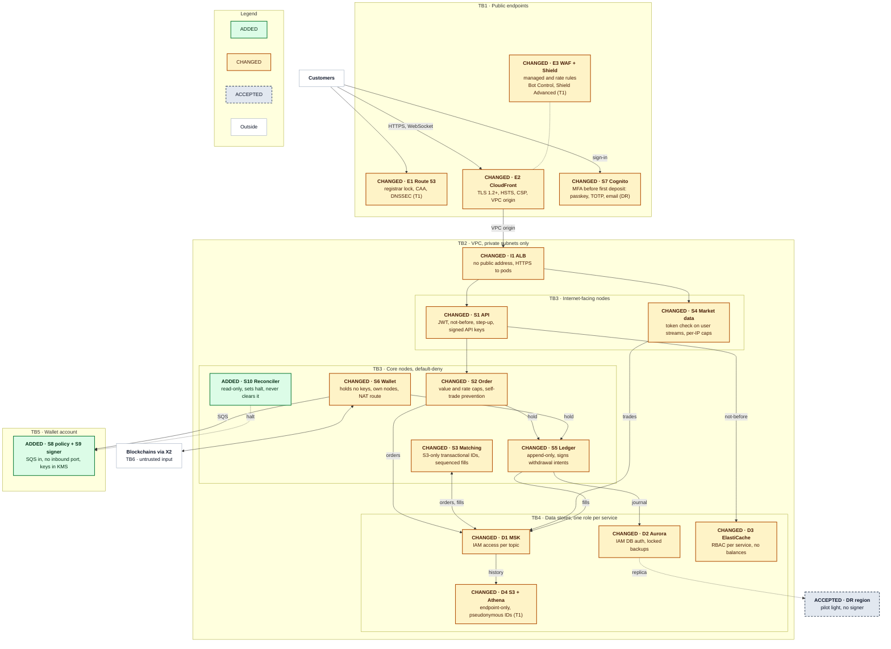
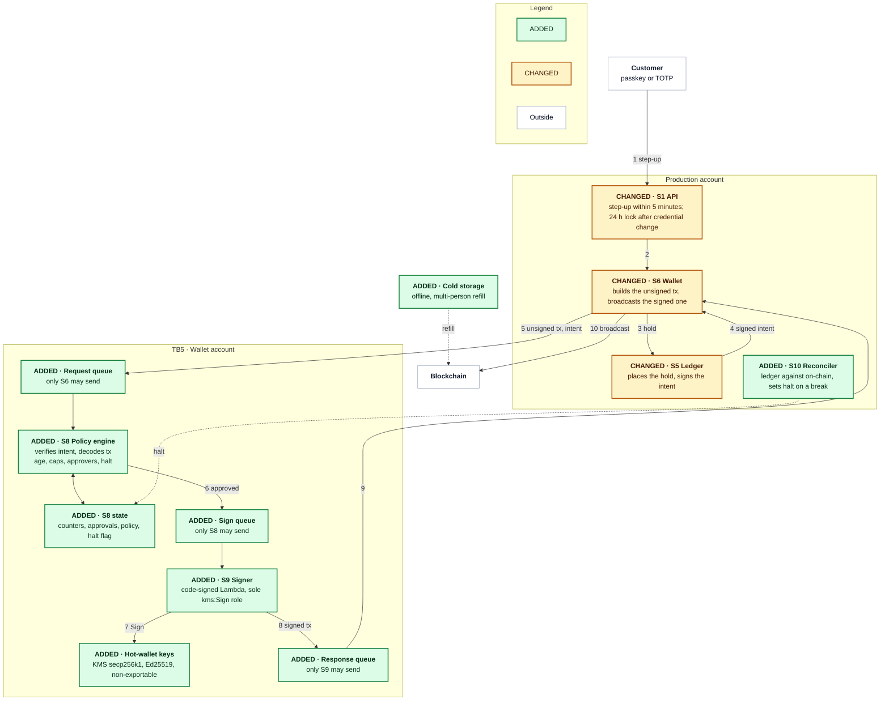
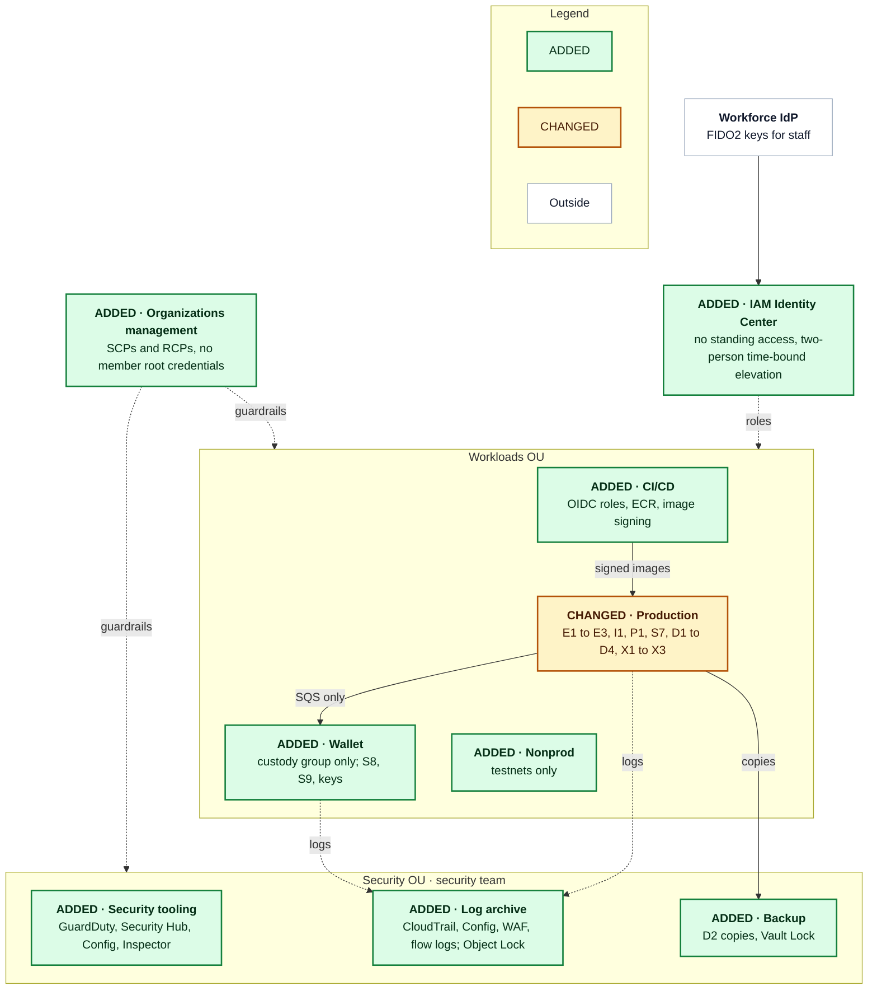

# Problem 5: Fortify The Castle

Money moves in the ledger (S5), the hot wallet (S6) and the order log that feeds both (D1), so the controls concentrate there. Signing leaves EKS for a wallet account, where a policy engine (S8) that production cannot write to decodes every unsigned transaction against its stored intent before a signer (S9) calls KMS with a non-exportable key. The order path gains per-topic writes, fenced leaders, sequenced settlement, an append-only ledger and a halt-only reconciler (S10); every funded account has a second factor; only CloudFront faces the internet. The controls cost CPU, not a round trip, so they fit the baseline's 47 ms reserve; they add $400 to $700 a month to its $13,950, Shield Advanced $3,000 from T1.

The baseline is [Problem 1](../problem1/SOLUTION.md): a spot crypto exchange in ap-southeast-1 across three AZs, pilot-light DR in ap-northeast-1, 500 rps at peak, 50,000 MAU, a 100 ms p99 order budget with 47 ms in reserve. Components keep its IDs:

| ID | Role |
|---|---|
| E1 | Route 53 DNS |
| E2 | CloudFront edge |
| E3 | WAF and Shield |
| I1 | ALB to S1 and S4 |
| S1 | API: JWT, rate limits |
| S2 | Order: pre-trade checks |
| S3 | Matching engine per partition |
| S4 | Market data WebSocket |
| S5 | Ledger: balances, holds |
| S6 | Wallet: deposits, withdrawals |
| S7 | Cognito: sign-in, MFA |
| D1 | MSK: orders, fills |
| D2 | Aurora PostgreSQL: ledger |
| D3 | ElastiCache Valkey: limits, sessions |
| D4 | S3 and Athena: trade history |
| X1 | S3 matching checkpoints |
| X2 | Blockchain full nodes |
| X3 | Data Firehose to Parquet |
| P1 | EKS and observability |
| S8, S9, S10 | New: policy engine, signer, reconciler |

`SEC-n` is a [register](#security-changes-register) row, `TB1` to `TB7` a trust boundary, `F1` to `F11` a fact I do not have yet; tiers are T0 (refuse to ship without), T1 (first 90 days) and T2 (deferred).

## Contents

- [Scope](#scope)
- [Decisions](#decisions)
- [Threat model](#threat-model)
- [Secured architecture](#secured-architecture)
- [Security changes register](#security-changes-register)
- [Priorities](#priorities)
- [Latency and cost impact](#latency-and-cost-impact)
- [Facts I would need](#facts-i-would-need)
- [Trade-offs](#trade-offs)

## Scope

### In scope

The baseline at launch scale (500 rps, 50,000 MAU, 4 partitions, 2 chains, two regions), from the edge to the image pipeline.

### Out of scope

| Item | Where it belongs |
|---|---|
| KYC and AML, with a vendor | The compliance programme (F1, F9) |
| Fiat rails and cards (no PCI DSS scope) | A cardholder-data environment if cards come (F7) |
| Corporate IT | The workforce IdP's device policy (F6) |
| Physical security of cold storage | The custody procedure (F2) |
| A 24/7 security operations centre | The operations plan (F11) |
| Mobile hardening; back-office tooling | The mobile pipeline; a separate account |

### Assumptions

- **Baseline figures hold**: $13,950 a month, the 47 ms reserve, the 70 ms alarm, the 2× soak and 5× burst test.
- **Keys are set at creation** (SEC-28): [ElastiCache](https://docs.aws.amazon.com/AmazonElastiCache/latest/dg/at-rest-encryption.html), Aurora and Cognito replication cannot take one later.

## Decisions

| # | Decision | Alternatives | Why | Revisit when |
|---|---|---|---|---|
| 1 | KMS hot-wallet keys in a wallet account (SEC-23) | Custodian; CloudHSM; MPC | Non-exportable keys, nothing to run | A regulator (F1, F2) or a chain KMS cannot sign (F3) |
| 2 | S8 decodes each transaction against its intent (SEC-24) | Checks inside S6; approval alone | Production cannot write S8's state | The hot float passes insurance cover |
| 3 | Cognito stays on the Plus plan (SEC-11, SEC-12, SEC-28) | In-house; third-party | Managed MFA and threat protection | The replica's limits become unacceptable |
| 4 | Private I1 behind a CloudFront VPC origin (SEC-3) | Prefix-list ALB | No public address | VPC origins gain gRPC |
| 5 | EKS Pod Identity per service (SEC-8) | IRSA; node role | No OIDC provider per cluster | A workload outside EKS |
| 6 | One role per service per store (SEC-18, SEC-20, SEC-29) | A shared application role | Blast radius of one service | Per-role review slows |
| 7 | Default-deny network policy; node groups by exposure (SEC-9) | Service mesh; flat network | Kernel-enforced, no proxy hop | An auditor requires per-call identity (SEC-38) |
| 8 | Shield Advanced from T1 (SEC-7) | At launch; Shield Standard alone | Turns on in minutes; $3,000 a month | DDoS history (F5), extortion, a high-profile listing |
| 9 | One AWS account per blast radius (SEC-32) | Permission boundaries | The only boundary SCPs and RCPs attach to | A new product |
| 10 | S9 as a code-signed Lambda function (SEC-23) | A signer pod; Nitro Enclaves | No listener, unreachable from the cluster | A custody standard requires attestation |
| 11 | Two-person, delayed policy changes; emergency path only tightens (SEC-24) | Single-administrator changes | One administrator cannot raise a cap | Staffing (F11) covers every large withdrawal |
| 12 | SMS removed; email for DR sign-in only (SEC-11, SEC-42) | Keep SMS; drop email | SIM swap; the replica cannot check TOTP | The replica supports TOTP |
| 13 | Append-only ledger with compensating entries (SEC-20) | Mutable balances table | No role can edit history | Journal size slows balance derivation |
| 14 | Read-only reconciler, halt-only (SEC-21) | A scheduled report | Minutes to halt, not a working day | On-call (F11) acts within minutes |

## Threat model

### Assets

In priority order:

| Asset | Loss mode |
|---|---|
| Customer funds and hot-wallet keys (S6, S9, KMS) | Final on-chain |
| Ledger and order-flow integrity (D2, D1) | Unseen until withdrawals fail |
| Credentials, sessions and API keys (S7, D3, S1) | Account takeover |
| Personal data (D2, D4, logs) | Disclosure |
| Availability (E1 to E3, I1, P1) | An outage timed to a market move |
| Audit evidence (CloudTrail, Config, application logs) | Erased traces |

### Adversaries

| Adversary | Goal | Entry | Register rows |
|---|---|---|---|
| Account takeover | Withdraw a victim's balance | S7 sign-in, S1 API keys | SEC-11 to SEC-15, SEC-24 |
| Hot-wallet thief | A signature on their transaction | S6, production account, CI | SEC-23 to SEC-25, SEC-32, SEC-36 |
| Insider | Move funds, edit balances, erase traces | Console, databases, back-office tools | SEC-20, SEC-24, SEC-30, SEC-33, SEC-34 |
| DDoS and extortion | An outage at a market move, or ransom | E1 to E3, I1, S4 | SEC-3, SEC-5, SEC-7 |
| Supply chain | Attacker code in production | Dependency, base image, CI, SPA | SEC-4, SEC-36 |
| API abuse, market manipulation | Spoofing, wash trading, order floods, scraping | S1, S2, S4 | SEC-5, SEC-15, SEC-17 |
| Cloud credential theft | A leaked key or pod role | IAM, instance metadata, CI | SEC-8, SEC-10, SEC-32 |
| Malicious chain data | Credit for an unsettled deposit | S6's view of a chain | SEC-21, SEC-26 |

### Trust boundaries

| ID | Boundary | Rule |
|---|---|---|
| TB1 | Internet to E1, E2, E3, S7 sign-in | Anything arrives; WAF and Cognito filter first |
| TB2 | Edge to VPC | Only CloudFront reaches I1 (VPC origin); no public address inside |
| TB3 | Internet-facing pods to core pods | S1 and S4 parse untrusted input on their own nodes and reach only S2, S6, D3 and read-only D2 (S1) or D1 and D3 (S4) |
| TB4 | Workloads to data stores | One IAM or database role per service |
| TB5 | Production to wallet account | One SQS message crosses; production sets S8's halt flag and nothing else |
| TB6 | Blockchains to S6 | Untrusted until X2 confirms and an independent source matches |
| TB7 | People and CI to the control plane | Staff via Identity Center, CI via OIDC roles, under organization guardrails |

## Secured architecture

Each node carries a header tag (`ADDED ·`, `CHANGED ·`, `ACCEPTED ·`) and a matching fill; white nodes are outside the system, and (T1) marks a first-90-days line. Five changes alter the design rather than configure it: signing moves to S8 and S9 behind a queue (SEC-23, SEC-24, TB5); I1 leaves the internet (SEC-3); the cluster splits by exposure (SEC-9, SEC-10); S10 can only halt (SEC-21); one account per blast radius (SEC-32).

### Runtime topology

### Withdrawal path

Each step stops a different attacker: a stolen session fails the step-up (1), S6 cannot invent an amount because S5 signs the intent (3 to 4), a compromised production account fails S8's decode (5), a modified signer fails code signing (7), and S10 halts what nothing else catches (9 to 10); above the value threshold (F2), two approvers confirm the decoded fields, never raw bytes.

### Account structure

## Security changes register

Marks are against the baseline; tiers are reasoned in [Priorities](#priorities).

### Edge and network

| ID | Component | Mark | Change | Protects against | Tier |
|---|---|---|---|---|---|
| SEC-1 | E1 | CHANGED | Registrar and registry lock, registrar MFA, CAA for ACM only | Domain hijack, rogue certificate | T0 |
| SEC-2 | E1 | CHANGED | DNSSEC on the hosted zone | Forged DNS answers | T1 |
| SEC-3 | E2, I1 | CHANGED | I1 private behind a CloudFront [VPC origin](https://docs.aws.amazon.com/AmazonCloudFront/latest/DeveloperGuide/private-content-vpc-origins.html), HTTPS to pods | WAF bypass | T0 |
| SEC-4 | E2 | CHANGED | TLS 1.2 minimum, HSTS, strict CSP, origin access control | Injected script, clickjacking | T0 |
| SEC-5 | E3 | CHANGED | Managed rule groups, rate rules per IP and API key, a web ACL on S7 | Floods, stuffing, injection | T0 |
| SEC-6 | E3 | CHANGED | Bot Control on sign-up, sign-in and reset; its account-takeover group [cannot attach](https://docs.aws.amazon.com/cognito/latest/developerguide/user-pool-waf.html) to S7 | Automation under per-IP limits | T1 |
| SEC-7 | E3 | CHANGED | Shield Advanced on E2 and E1; a private I1 cannot enroll | DDoS at a market move | T1 |
| SEC-8 | P1 | CHANGED | EKS Pod Identity per service, IMDSv2 hop limit 1, private endpoint | Node-role abuse | T0 |
| SEC-9 | P1 | CHANGED | Default-deny network policy, node groups by exposure, no `kubectl exec` | Lateral movement | T0 |
| SEC-10 | VPC | ADDED | Organization-only VPC endpoints, a NAT route for S6 and X2 only, DNS Firewall allow-list | Exfiltration | T0 |

### Identity and sessions

| ID | Component | Mark | Change | Protects against | Tier |
|---|---|---|---|---|---|
| SEC-11 | S7 | CHANGED | MFA before a deposit address or API key: passkeys, TOTP, email for sign-in only (SEC-42); no SMS | Password reuse, SIM swap | T0 |
| SEC-12 | S7 | CHANGED | [Plus plan](https://docs.aws.amazon.com/cognito/latest/developerguide/cognito-sign-in-feature-plans.html) threat protection, full-function mode | Credential stuffing | T0 |
| SEC-13 | S1, S7 | CHANGED | Refresh token rotation, 60-minute access tokens, a per-user not-before time in D3 | A stolen token after sign-out | T0 |
| SEC-14 | S1 | CHANGED | Step-up (passkey or TOTP, 5 minutes) for withdrawals, API keys and security changes; a credential change locks withdrawals 24 hours | Session hijack cash-out | T0 |
| SEC-15 | S1 | CHANGED | Scoped API keys (read, trade, withdraw), an IP allow-list for withdraw, Ed25519 request signatures | Leaked or replayed keys | T0 |
| SEC-16 | S4 | CHANGED | User streams carry the access token, checked as S1 does | Cross-user reads | T0 |

### Order flow and ledger

| ID | Component | Mark | Change | Protects against | Tier |
|---|---|---|---|---|---|
| SEC-17 | S2 | CHANGED | Maximum order value, per-account order rates, self-trade prevention in S3, integer minor units, one S5 hold for orders and withdrawals | Double spend, spoofing, wash trades | T0 |
| SEC-18 | D1 | CHANGED | [IAM access control](https://docs.aws.amazon.com/msk/latest/developerguide/kafka-actions.html) per topic: S2 writes `orders`, S3 writes `fills` and `trades`; Kafka 3.8 or later; TLS | Forged orders or fills | T0 |
| SEC-19 | S3, S5 | CHANGED | Per-partition transactional IDs for S3's role only; a per-symbol fill sequence that S5 checks | Impostor leader, reordered fills | T0 |
| SEC-20 | S5, D2 | CHANGED | Append-only journal (only S5 inserts, entries sum to zero per asset), IAM database authentication, pgaudit | Balance edits by anyone | T0 |
| SEC-21 | S10 | ADDED | Read-only reconciler of ledger, fills and withdrawals against chain, settlement and broadcasts; a break sets S8's halt flag, never cleared by S10 | Unseen loss | T0 |
| SEC-22 | S10 | ADDED | Nightly replay of `orders` through the same S3 build; fills must match production's | Tampered matching | T1 |

### Wallet and withdrawals

| ID | Component | Mark | Change | Protects against | Tier |
|---|---|---|---|---|---|
| SEC-23 | S9 | ADDED | Signing moves to S9, a code-signed Lambda function in the wallet account, with non-exportable [KMS keys](https://docs.aws.amazon.com/kms/latest/developerguide/symm-asymm-choose-key-spec.html); `kms:Sign` for S9's role alone | Key theft, a modified signer | T0 |
| SEC-24 | S8, S5 | ADDED | S5 signs the intent; S8 verifies it, decodes the unsigned transaction against it, then checks address age, caps, screening (F1), approvers (F2) and the halt flag | Compromised S6 or production account | T0 |
| SEC-25 | S6 | CHANGED | Hot float per asset capped (F2), deposits swept to cold, manual multi-person refill | Unbounded loss | T0 |
| SEC-26 | S6 | CHANGED | Credit after the X2 confirmation depth plus an independent match (F10); a deeper reorganization freezes the amount | Fake deposits, reorg double spends | T0 |
| SEC-27 | S8, S2, S7 | ADDED | Kill switches with runbooks: halt all withdrawals, halt one symbol, sign one user out everywhere | Slow incident response | T0 |

### Data protection

| ID | Component | Mark | Change | Protects against | Tier |
|---|---|---|---|---|---|
| SEC-28 | D1 to D4, S7 | CHANGED | A KMS customer managed key per data class at creation; S7's key multi-Region from the start, since a key [cannot become multi-Region](https://docs.aws.amazon.com/kms/latest/developerguide/multi-region-keys-overview.html) later | Readable snapshots, unreplicable user pool | T0 |
| SEC-29 | D2, D3 | CHANGED | TLS required, ElastiCache RBAC per service, no balances in D3 | Traffic capture, cache tampering | T0 |
| SEC-30 | D2 | CHANGED | Deletion protection; AWS Backup copies to a Vault Lock vault in the backup account; SCPs deny deleting clusters and snapshots | Ledger and backups destroyed together | T0 |
| SEC-31 | D2, D4 | CHANGED | Email, phone and KYC reference encrypted in the application with a separate key; pseudonymous user IDs in D4 | Personal data in a dump | T1 |

### Accounts, detection and supply chain

| ID | Component | Mark | Change | Protects against | Tier |
|---|---|---|---|---|---|
| SEC-32 | Accounts | ADDED | Eight accounts by blast radius; SCPs and RCPs deny leaving the organization, disabling audit, IAM users, extra Regions and key deletion; no member root credentials | Cross-account spread | T0 |
| SEC-33 | People | ADDED | Identity Center federated to the workforce IdP (FIDO2), no standing write access, two-person time-bound elevation, no SSH, separate wallet administrators | A lone insider, a stolen laptop | T0 |
| SEC-34 | Detection | ADDED | Organization CloudTrail and Config under [S3 Object Lock](https://docs.aws.amazon.com/AmazonS3/latest/userguide/object-lock.html); GuardDuty with EKS, S3 and RDS protection; alarms on root sign-in, policy changes and `kms:Sign` outside S9 | Unseen compromise, deleted evidence | T0 |
| SEC-35 | Detection | ADDED | GuardDuty Runtime Monitoring on EKS nodes, Security Hub CSPM, Inspector on ECR images | Container escapes, drift, new CVEs | T1 |
| SEC-36 | CI/CD | ADDED | OIDC roles, digest-pinned dependencies, a scan gate on fixable HIGH and CRITICAL, [ECR managed signing](https://docs.aws.amazon.com/AmazonECR/latest/userguide/managed-signing.html) enforced at admission, two-person review | Tampered dependency, image or pipeline | T0 |

### Accepted risks

| ID | Component | Risk accepted | Why acceptable now | Compensating control | Revisit when |
|---|---|---|---|---|---|
| SEC-37 | S4 | Public market-data channels unauthenticated | Identical public data; SEC-16 covers user streams | Per-IP connection caps, own node group | Scraping outgrows the caps |
| SEC-38 | P1 | No mutual TLS between pods | A sidecar mesh adds two proxy hops from the 47 ms reserve | [Nitro in-transit encryption](https://docs.aws.amazon.com/AWSEC2/latest/UserGuide/data-protection.html), default-deny policy, TLS on Kafka | Another team's workload joins the cluster |
| SEC-39 | DR region | Withdrawals pause in a regional outage | A key replica doubles its exposure | Trading and deposits fail over; DR keys funded from cold storage | Terms require DR withdrawals |
| SEC-40 | D3 | S1 accepts orders without the not-before check while D3 is down | Failing closed makes a cache outage a trading outage | A revoked token trades at most 60 more minutes | Abuse seen during a D3 incident |
| SEC-41 | S9 | Multi-tenant KMS HSMs, not CloudHSM | Non-exportable keys; CloudHSM is a cluster to run | Key policy, SCPs, the `kms:Sign` alarm | Single-tenant HSMs or hierarchical derivation required |
| SEC-42 | S7 | Email codes stay a sign-in factor | The DR replica cannot check TOTP | Never satisfies step-up; sign-in notifications | The replica supports TOTP, or a mailbox takeover |
| SEC-43 | S6 | Loss up to the hot float | Unattended withdrawals need funds online | S8's hourly caps, S10's halt, insurance (F2) | The float passes insurance cover |
| SEC-44 | Production account | A production administrator files many users' intents and, after 24 hours, drains up to the hourly cap | User-signed withdrawals need a custom WebAuthn flow | S8 alarms on new-address volume | User-signed withdrawals land |

## Priorities

### Refuse to ship without

T0 means an irreversible loss if absent (funds, keys, ledger, evidence) or a rebuild if added later:

- **SEC-14, SEC-23 to SEC-25, SEC-27**: funds leave only through independent checks.
- **SEC-17 to SEC-21, SEC-26**: the ledger cannot be silently wrong.
- **SEC-11 to SEC-13, SEC-15, SEC-16**: a stolen password is not enough.
- **SEC-3, SEC-8 to SEC-10, SEC-32, SEC-33**: one stolen credential stays contained; separate accounts later are a migration.
- **SEC-28**: keys and multi-Region status are fixed at creation.
- **SEC-30, SEC-34**: evidence and backups outlive the attacker.
- **SEC-1, SEC-4, SEC-5, SEC-36**: only reviewed code runs; browser and DNS routes are closed.
- **Launch gate**: an external penetration test of S1, S6, S8, S9 and the withdrawal flow with no open critical or high finding; one tabletop of the hot-wallet-drain runbook.

### First 90 days

- **SEC-2**: a DNSSEC signing mistake takes the domain offline; SEC-1 blocks the common hijack path.
- **SEC-6**: Bot Control rules tuned without real traffic lock customers out.
- **SEC-7**: Shield Advanced turns on in minutes; DDoS history (F5), extortion or a high-profile listing pulls it forward.
- **SEC-22**: the replay needs reproducible S3 builds first.
- **SEC-31**: cluster encryption covers a stolen snapshot; field encryption is schema work.
- **SEC-35**: findings need someone to triage them (F11).
- **Process**: a quarterly hot-wallet-drain game day; a public bug bounty after the penetration test.

### Deferred

- **SEC-38**, service mesh: proxy hops on every synchronous order-path call.
- **SEC-41**, CloudHSM or MPC custody: until a regulator or insurer (F1, F2) or a chain KMS cannot sign for (F3).
- **SEC-44**, user-signed withdrawals: the customer's passkey signs the details S8 verifies; a custom WebAuthn flow.
- **Nitro Enclaves attestation for S8 and S9**: until a custody standard requires attested execution.
- **Network Firewall egress, Database Activity Streams on D2, Macie on D4**: until command-and-control by IP, a database audit standard or personal data in D4 (F4).
- **Proof of reserves, market surveillance on D4**: form depends on the regime (F1).
- **SOC 2 Type II or ISO 27001**: when institutional clients or the regulator ask (F7).

## Latency and cost impact

Only WAF, TLS and S1's token and request checks sit on the order path, none adding a round trip; prices are ap-southeast-1 list prices ([WAF](https://aws.amazon.com/waf/pricing/), [Shield](https://aws.amazon.com/shield/pricing/), [Cognito](https://aws.amazon.com/cognito/pricing/), [KMS](https://aws.amazon.com/kms/pricing/), [PrivateLink](https://aws.amazon.com/privatelink/pricing/), read on 2026-11-03) above the baseline's $13,950 a month.

| Control | Path | Latency effect | Cost |
|---|---|---|---|
| WAF and Bot Control (SEC-5, SEC-6) | Order, market data, sign-in | Edge, outside the measured p99 window | $1 per rule group a month; Bot Control $10 plus $10 per million requests, so sign-in only |
| TLS everywhere (SEC-3, SEC-18, SEC-29) | Order | Pooled connections; broker and pod CPU | Broker sizing with TLS on |
| JWT, not-before, request signatures (SEC-13, SEC-15) | Order | Local checks; not-before rides the D3 call | None |
| Network policy, node groups (SEC-9) | Every internal call | Kernel-enforced | Looser bin-packing |
| KMS keys at rest (SEC-28) | Off the request path | None | $1 per key a month |
| Withdrawal checks and signing (SEC-23, SEC-24) | Withdrawal only | Seconds through SQS, S8 and KMS; 24 hours for a new address | $0.15 per 10,000 requests, within the default [quota](https://docs.aws.amazon.com/kms/latest/developerguide/requests-per-second.html) |
| Cognito Plus (SEC-12) | Sign-in only | Inside Cognito | In the baseline ($1,000 against $600 on Essentials, F8) |
| Shield Advanced (SEC-7) | None | None | $3,000 a month, 1-year commitment |
| VPC endpoints (SEC-10) | AWS API calls from pods | Shorter than NAT | About $200 a month for 7 endpoints in 3 AZs |
| Detection (SEC-34, SEC-35) | Off the request path | None | Volume-based |

Controls outside the baseline's 53 ms of hop budgets may use 5 ms of the 47 ms reserve, verified in its load test with every control on against the 70 ms alarm and 0.1% 5xx; launch controls add $400 to $700 a month (3 to 5%), Shield Advanced $3,000 (about 22%) from T1.

## Facts I would need

| ID | Fact | Why it matters | Assumed meanwhile |
|---|---|---|---|
| F1 | Licensing regime and regulator, from counsel | Custody, retention, screening, travel rule, reporting | Segregated assets, address screening, 5-year retention under Object Lock |
| F2 | Custody model and insurance, from the treasury lead | Hot float cap, approval threshold, cold-storage procedure | 24 hours of P95 withdrawals per asset; offline cold storage |
| F3 | Asset list and signing schemes, from the roadmap | KMS has no hierarchical key derivation | secp256k1 or Ed25519 only; addresses derive from public keys |
| F4 | Users' countries and data-residency rules, from counsel | Where personal data may live | Southeast Asia; replication to Tokyo allowed |
| F5 | Peak traffic and DDoS history, from the forecast | Whether SEC-7 moves to T0; WAF rate limits | No targeted DDoS at launch; 500 rps peak |
| F6 | Workforce identity provider, from the IT team | Identity Center federates to it | An existing IdP with FIDO2 keys |
| F7 | Compliance targets, from the business roadmap | When evidence collection must be continuous | SOC 2 within the first year; no PCI DSS scope |
| F8 | Monthly active users, from the business forecast | Sizes Cognito Plus and Bot Control costs | The baseline's 50,000 MAU |
| F9 | KYC vendor and document storage, from compliance | Whether identity documents enter D2 or D4 | The vendor holds documents; D2 stores a reference |
| F10 | Second source for deposits, from the wallet team | SEC-26 needs a second confirmation | A commercial node provider per chain |
| F11 | On-call capacity, from the staffing plan | Whether a detection is acted on within minutes | None 24/7 at launch; S8 and S10 halt automatically |

## Trade-offs

- **Slower withdrawals**: a new address or credential change waits 24 hours; large withdrawals wait for two approvers; raising a cap takes two people and 24 hours.
- **A second deployment surface**: S8 and S9 ship through their own pipeline, run by a different group.
- **Higher run cost**: Shield Advanced from T1, VPC endpoints, three node groups instead of one.
- **Engine and protocol constraints**: Kafka 3.8 or later; no gRPC on the public API.
- **A second sign-in for withdrawals**: the step-up asks for a passkey or TOTP again inside a session.
