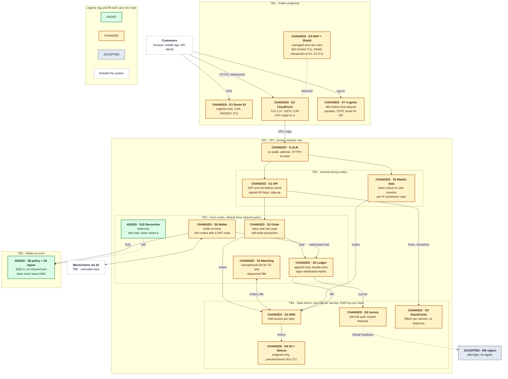
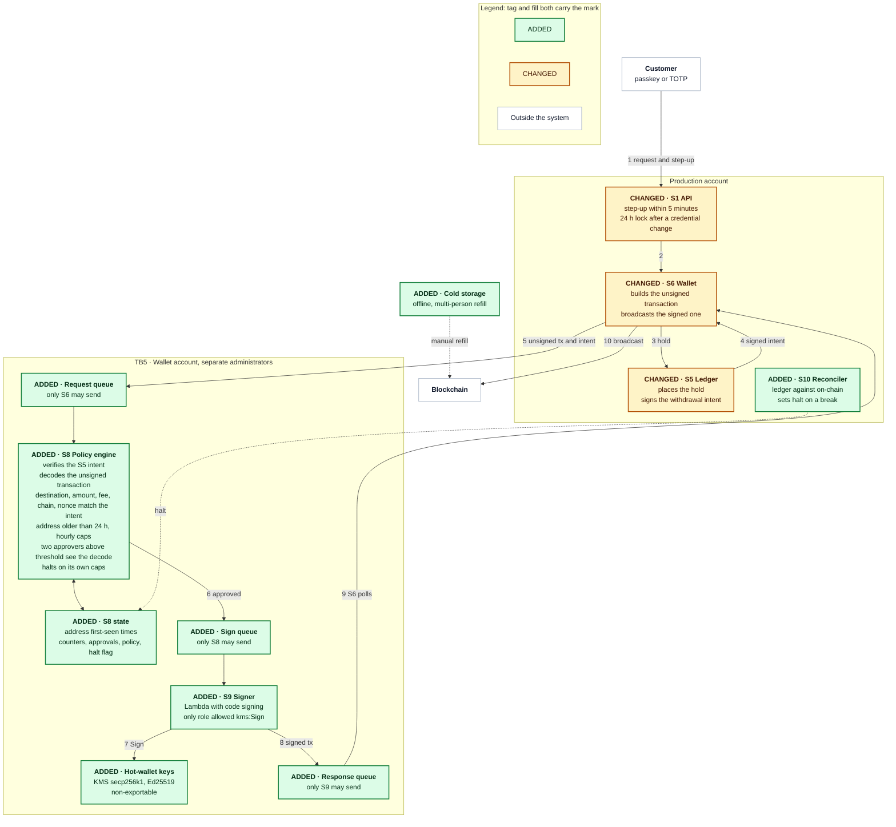
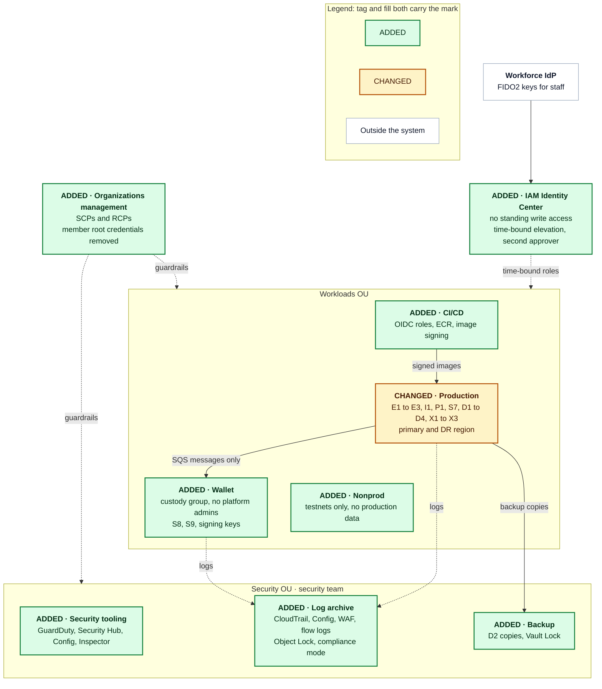

# Problem 5: Fortify The Castle

Money moves in the ledger (S5), the hot wallet (S6) and the order log that feeds both (D1), so security work starts there. The largest change is in S6: signing leaves the EKS cluster for a separate wallet account, where a policy engine (S8) that production cannot write to decodes every unsigned transaction and checks it against the stored withdrawal intent before a signer (S9) asks KMS for a signature with a key that never leaves its HSM. The order path gains per-topic write permissions on D1, fenced matching leaders, sequence-checked settlement, an append-only ledger and a reconciler that can halt withdrawals; every funded account has a second factor; CloudFront becomes the only thing reachable from the internet. These controls cost CPU, not a network round trip, so they fit the baseline's 47 ms reserve. Launch controls add $400 to $700 a month to the baseline's $13,950; Shield Advanced adds $3,000 from the second tier.

The baseline is [Problem 1](../problem1/SOLUTION.md): a spot crypto exchange in ap-southeast-1 across three Availability Zones with pilot-light DR in ap-northeast-1, 500 requests per second at peak, 50,000 monthly active users, and a 100 ms p99 order budget with 47 ms in reserve. Components keep its IDs:

| ID | Role |
|---|---|
| E1 | Route 53, health-checked failover DNS |
| E2 | CloudFront edge for SPA, REST and WebSocket |
| E3 | WAF and Shield at the edge |
| I1 | ALB: `/api` to S1, `/ws` to S4 |
| S1 | API: JWT check, rate limits, validation |
| S2 | Order: pre-trade checks, publishes commands |
| S3 | Matching engine, leader and standby per symbol partition |
| S4 | Market data WebSocket fan-out |
| S5 | Ledger: double-entry balances, holds, settlement |
| S6 | Wallet: deposits, withdrawal building and broadcast |
| S7 | Cognito: accounts, sign-in, MFA, tokens, DR replica |
| D1 | MSK: order commands, fills, book deltas |
| D2 | Aurora PostgreSQL: accounts, orders, ledger |
| D3 | ElastiCache Valkey: rate limits, sessions, snapshots |
| D4 | S3 with Glue and Athena: trade history |
| X1 | S3 matching-engine checkpoints |
| X2 | Blockchain full nodes, two per chain |
| X3 | Data Firehose, MSK to Parquet |
| P1 | EKS with the observability stack (Alloy into Mimir, Loki, Tempo; Grafana; Alertmanager) |
| S8, S9, S10 | New here: withdrawal policy engine, signer, reconciler |

`SEC-n` is a row in the [security changes register](#security-changes-register), `TB1` to `TB7` are trust boundaries, `F1` to `F11` are facts I do not have yet, and the tiers are T0 (refuse to ship without), T1 (first 90 days) and T2 (deferred).

## Contents

- [Scope](#scope)
- [Decisions](#decisions)
- [Threat model](#threat-model)
- [Secured architecture](#secured-architecture)
- [Security changes register](#security-changes-register)
- [Priorities](#priorities)
- [Latency and cost impact](#latency-and-cost-impact)
- [Facts I would need](#facts-i-would-need)
- [Trade-offs](#trade-offs)

## Scope

### In scope

The baseline at launch scale (500 rps, 50,000 MAU, 4 symbol partitions, 2 chains, primary and DR regions): edge, identity and sessions, order path and ledger, wallet and signing, data stores, account structure, detection, and the pipeline that builds every image.

### Out of scope

| Item | Where it belongs |
|---|---|
| KYC checks and AML monitoring, run with a vendor | The compliance programme (F1, F9) |
| Fiat rails and cards, so no PCI DSS scope | A cardholder-data environment if cards are added (F7) |
| Corporate IT: laptops, phones, office network | The device policy the workforce IdP enforces (F6) |
| Physical security of cold storage, outside AWS | The custody procedure (F2) |
| Incident-response staffing, a 24/7 security operations centre | The operations plan (F11); S8 and S10 halt automatically meanwhile |
| Mobile app hardening; back-office tooling | The mobile pipeline; an own account behind Identity Center |

### Assumptions

- **Baseline figures hold**: $13,950 a month, the 47 ms reserve, the 70 ms alarm, a load test of 2× peak for 30 minutes then a 5× burst for 60 s.
- **Unknown facts carry an assumed value**: F1 to F11 in [Facts I would need](#facts-i-would-need).
- **No 24/7 security operations at launch** (F11), so S8 and S10 halt on their own.
- **Stores and the user pool get their keys at creation** (SEC-28): Aurora, ElastiCache and Cognito replication cannot take a key later.

## Decisions

| # | Decision | Alternatives considered | Why | Revisit when |
|---|---|---|---|---|
| 1 | KMS hot-wallet keys in a separate wallet account (SEC-23) | Third-party custodian; CloudHSM; MPC custody | Non-exportable keys in FIPS 140-3 Level 3 HSMs, one signing role, no cluster to run | A regulator or insurer requires single-tenant HSMs or a custodian (F1, F2); a chain needs key derivation KMS lacks (F3) |
| 2 | S8 decodes each unsigned transaction against its intent before S9 signs (SEC-24) | Checks inside S6; human approval alone | Production cannot write S8's state; approvers see fields, not bytes | The hot float passes insurance cover: user-signed withdrawals |
| 3 | Cognito stays: Plus plan, threat protection, a DR replica on a multi-Region customer managed key (SEC-11, SEC-12, SEC-28) | In-house identity service; third-party platform | Managed passkeys, TOTP, compromised-credential checks and replication without a tier-0 system to run | The replica's limits (no sign-up, reset or TOTP) become unacceptable |
| 4 | Private I1 behind a CloudFront VPC origin (SEC-3) | Public ALB limited to CloudFront's prefix list; Global Accelerator | No public address; a prefix-list ALB stays reachable through any CloudFront distribution without a secret header | VPC origins gain gRPC |
| 5 | EKS Pod Identity, one IAM role per service (SEC-8) | IAM roles for service accounts; the node role | No OIDC provider per cluster; IMDSv2 with hop limit 1 keeps pods off the node role | A workload outside EKS needs the same model |
| 6 | One IAM or database role per service at every store (SEC-18, SEC-20, SEC-29) | A shared application role | A compromised service reaches only its own data | Per-role review slows: a policy-as-code gate |
| 7 | Default-deny network policy; node groups by exposure (SEC-9) | Service mesh with mutual TLS; a flat network | Kernel-enforced, no proxy hop on the order path | Another team's workload joins, or an auditor requires workload identity per call (SEC-38) |
| 8 | Shield Advanced on CloudFront and Route 53 only, from T1 (SEC-7) | Shield Advanced at launch; Shield Standard alone | Turns on in minutes; enrolling a private I1 protects nothing; $3,000 a month, one-year commitment | DDoS history (F5), an extortion demand, a listing expected to draw attacks |
| 9 | One AWS account per blast radius (SEC-32) | One account with permission boundaries | The only boundary SCPs, RCPs and separate administrators attach to; moving workloads later is a migration | A new product needs its own blast radius |
| 10 | S9 as a Lambda function with code signing (SEC-23) | A signer pod in EKS; EC2 with Nitro Enclaves | No listener, no path from the cluster, reviewed code enforced by the platform | A custody standard requires attested execution |
| 11 | Two-person, 24-hour-delayed S8 policy changes; an emergency path that only lowers or halts (SEC-24) | Single-administrator changes; no emergency path | A compromised administrator cannot raise a cap alone or at once; defence still tightens in seconds | Staffing (F11) puts a person in the loop for every large withdrawal |
| 12 | SMS removed; an email code kept for DR sign-in only (SEC-11, SEC-42) | Keep SMS; drop email too | SIM swap is a standard takeover path; the DR replica cannot check TOTP, and an email code never satisfies step-up | The replica supports TOTP |
| 13 | Append-only ledger with compensating entries (SEC-20) | An updatable balances table | No role can edit history; a deferred constraint holds each transaction at zero per asset | Journal size slows balance derivation |
| 14 | A read-only reconciler that can halt but never clear (SEC-21) | A scheduled reconciliation report | Minutes to halt instead of a working day; a one-way flag cannot be abused to resume | On-call capacity (F11) acts on every break within minutes |

## Threat model

Assets, in priority order: customer funds and hot-wallet keys (a theft is final on-chain); ledger and order-flow integrity in D2 and D1 (a theft nobody sees until withdrawals fail); credentials, sessions and API keys in S7, D3 and S1; personal data in D2, D4 and logs; availability of E1 to E3, I1 and P1 during a market move, when attacks are timed; audit evidence in CloudTrail, Config and application logs.

### Adversaries

| Adversary | Goal and entry point | Answered by |
|---|---|---|
| Account takeover: stuffing, phishing, SIM swap, infostealers | Withdraw a victim's balance through S7 sign-in and recovery or S1 API keys | SEC-11 to SEC-15, SEC-24 |
| Hot-wallet thief | A signature on the attacker's transaction, through S6, the production account, CI or a laptop | SEC-23 to SEC-25, SEC-32, SEC-36 |
| Insider | Move funds, edit balances, read data or erase traces through the console, databases or back-office tools | SEC-20, SEC-24, SEC-30, SEC-33, SEC-34 |
| DDoS and extortion | An outage at a market move, or a ransom, against E1 to E3, I1, S4 | SEC-3, SEC-5, SEC-7 |
| Supply chain | Attacker code in a dependency, base image, CI step or the SPA | SEC-4, SEC-36 |
| API abuse and market manipulation | Spoofing, wash trading, order floods, scraping through S1, S2, S4 | SEC-5, SEC-15, SEC-17 |
| Cloud credential theft | A leaked key or a pod's role, through IAM, instance metadata or CI | SEC-8, SEC-10, SEC-32 |
| Malicious chain data | Credit for a deposit that never settles, through S6's view of a chain | SEC-21, SEC-26 |

### Trust boundaries

- **TB1 Internet to public endpoints**: E1, E2, E3 and S7's sign-in endpoints accept anything; WAF and Cognito filter first.
- **TB2 Edge to VPC**: only CloudFront reaches I1, through a VPC origin; nothing in the VPC has a public address.
- **TB3 Internet-facing pods to core pods**: S1 and S4 parse untrusted input on their own nodes; S1 reaches only S2, S6, D3 and read-only history in D2, S4 only D1 and D3.
- **TB4 Workloads to data stores**: one IAM or database role per service.
- **TB5 Production to wallet account**: one SQS message crosses; production can set S8's halt flag and change nothing else.
- **TB6 Blockchains to S6**: chain data is untrusted until X2 confirms it and an independent source matches it.
- **TB7 People and CI to the control plane**: staff only through IAM Identity Center, CI only through OIDC roles, both under organization guardrails.

## Secured architecture

Each node carries its mark twice: a header tag (`ADDED ·`, `CHANGED ·`, `ACCEPTED ·`) and a fill (green, amber, grey with a dashed border); ACCEPTED means the baseline's design stands, white nodes are outside the system, and (T1) marks a first-90-days line. Six changes alter the design rather than configure it: signing leaves S6 for S8 and S9 in a wallet account (SEC-23, SEC-24); withdrawals become queue messages (TB5); I1 leaves the internet (SEC-3); the cluster splits by exposure, with a NAT route only for S6 and X2 (SEC-9, SEC-10); S10 can halt withdrawals and nothing else (SEC-21); each blast radius gets its own account (SEC-32).

### Runtime topology

### Withdrawal path

Each step stops a different attacker: a stolen session fails the step-up (1), S6 cannot invent an amount because S5 signs the intent (3 to 4), a compromised S6 or production account fails S8's decode (5), a modified signer fails code signing (7), and S10 halts a loss nothing else catches (9 to 10). S8 checks the decoded destination, amount, fee, chain and nonce against the intent before the address age, caps, screening (F1) and halt flag; above the value threshold (F2), two custody-group approvers confirm the decoded fields, never raw bytes. Policy changes need two custody-group members and a 24-hour delay; the emergency path, also two-person, only lowers a limit or halts.

### Account structure

## Security changes register

Mark is against the baseline. Tier reasoning is in [Priorities](#priorities); ACCEPTED rows are in [Accepted risks](#accepted-risks).

### Edge and network

| ID | Component | Mark | Change | Protects against | Tier |
|---|---|---|---|---|---|
| SEC-1 | E1 | CHANGED | Registrar and registry lock, registrar MFA, CAA records for ACM only | Domain hijack; a rogue certificate | T0 |
| SEC-2 | E1 | CHANGED | DNSSEC on the hosted zone | Forged DNS answers | T1 |
| SEC-3 | E2, I1 | CHANGED | I1 private behind a CloudFront [VPC origin](https://docs.aws.amazon.com/AmazonCloudFront/latest/DeveloperGuide/private-content-vpc-origins.html); HTTPS to pods; no gRPC, so the API stays REST and WebSocket | Requests that skip WAF | T0 |
| SEC-4 | E2 | CHANGED | TLS 1.2 minimum; HSTS; strict CSP with no third-party script and `frame-ancestors 'none'`; SPA bucket behind origin access control | Injected script; clickjacking | T0 |
| SEC-5 | E3 | CHANGED | Managed core, known-bad-inputs and IP reputation groups; rate rules per IP and API key; a second web ACL on S7; logs archived | Floods, stuffing, injection | T0 |
| SEC-6 | E3 | CHANGED | Bot Control (targeted) on sign-up, sign-in and reset, count mode first; the account-takeover group [cannot attach](https://docs.aws.amazon.com/cognito/latest/developerguide/user-pool-waf.html) to a user-pool web ACL (SEC-12 covers it) | Automation under per-IP limits | T1 |
| SEC-7 | E3 | CHANGED | Shield Advanced on E2 and E1 only (response team, automatic mitigation, cost protection); I1 is not enrolled, having no public address. Trigger: DDoS history (F5), an extortion demand, a listing expected to draw attacks | A DDoS at a market move and its bill | T1 |
| SEC-8 | P1 | CHANGED | One IAM role per service via EKS Pod Identity; IMDSv2 with hop limit 1; private EKS endpoint; read-only access entries | A pod using the node role | T0 |
| SEC-9 | P1 | CHANGED | Default-deny network policy for the TB3 call graph; node groups by exposure (S1 and S4; S2, S5, S10; S3; S6); no `kubectl exec` in core namespaces | Lateral movement | T0 |
| SEC-10 | VPC | ADDED | Organization-only VPC endpoints for S3, STS, KMS, ECR, CloudWatch Logs, Secrets Manager and SQS; a NAT route for S6 and X2 subnets only; DNS Firewall allow-list | Exfiltration; stolen credentials used outside | T0 |

### Identity and sessions

| ID | Component | Mark | Change | Protects against | Tier |
|---|---|---|---|---|---|
| SEC-11 | S7 | CHANGED | MFA before a deposit address or API key: passkeys, TOTP, an email code for sign-in only (SEC-42). SMS removed: the baseline enrols SMS or email for DR sign-in, and SIM swap makes SMS the weakest | Password reuse; SIM swap | T0 |
| SEC-12 | S7 | CHANGED | [Plus plan](https://docs.aws.amazon.com/cognito/latest/developerguide/cognito-sign-in-feature-plans.html) threat protection, full-function mode: compromised-password checks, adaptive challenges, activity logs to security tooling | Credential stuffing; new-device sign-ins | T0 |
| SEC-13 | S1, S7 | CHANGED | Refresh token rotation; 60-minute access tokens, the shortest effective beside managed login's one-hour cookie; S1 rejects tokens issued before the user's not-before time in D3 | A stolen token after sign-out or a lock | T0 |
| SEC-14 | S1 | CHANGED | Step-up for withdrawals, API keys and security changes: a server-side sign-in through the user pools API, passkey or TOTP only, valid 5 minutes; a credential change or recovery locks withdrawals 24 hours and notifies both contacts | A hijacked session cashing out | T0 |
| SEC-15 | S1 | CHANGED | API keys with read, trade and withdraw scopes; withdraw needs an IP allow-list; Ed25519 pairs, public keys stored only; requests signed over a timestamp | Leaked or replayed keys | T0 |
| SEC-16 | S4 | CHANGED | User streams carry the access token; S4 checks it as S1 does, delivers that user's events only, closes on expiry or revocation | Cross-user reads | T0 |

### Order flow and ledger

| ID | Component | Mark | Change | Protects against | Tier |
|---|---|---|---|---|---|
| SEC-17 | S2 | CHANGED | Maximum order value, per-account order rates, self-trade prevention in S3, integer minor units; order and withdrawal holds share one S5 operation | Double spend; fat fingers; spoofing; wash trades | T0 |
| SEC-18 | D1 | CHANGED | [IAM access control](https://docs.aws.amazon.com/msk/latest/developerguide/kafka-actions.html) per topic: S2 writes `orders`, S3 writes `fills` and `trades`, all else reads; Kafka 3.8 or later, whose IAM control covers transactions; TLS | Forged orders or fills | T0 |
| SEC-19 | S3, S5 | CHANGED | Only S3's role may use the per-partition transactional IDs (`kafka-cluster:AlterTransactionalId`); fills carry a per-symbol sequence number and S5 stops settling a symbol on a gap | An impostor leader; lost or reordered fills | T0 |
| SEC-20 | S5, D2 | CHANGED | Append-only journal: only S5's role inserts, none updates or deletes, a deferred constraint rejects entries not summing to zero per asset; IAM database authentication; pgaudit on role and schema changes | Balance edits by a service, engineer or migration | T0 |
| SEC-21 | S10 | ADDED | Read-only reconciler of ledger liabilities against on-chain balances, settled fills against `fills`, withdrawals against broadcasts; a break past tolerance sets S8's halt flag, which S10 can never clear | A loss nothing else notices | T0 |
| SEC-22 | S10 | ADDED | Nightly replay of `orders` through the same S3 build in isolation; the engine is deterministic, so fills must match production's | Tampered or nondeterministic matching | T1 |

### Wallet and withdrawals

| ID | Component | Mark | Change | Protects against | Tier |
|---|---|---|---|---|---|
| SEC-23 | S9 | ADDED | Signing leaves S6 for S9, a Lambda function in the wallet account with code signing; KMS keys ([`ECC_SECG_P256K1`, `ECC_NIST_EDWARDS25519`](https://docs.aws.amazon.com/kms/latest/developerguide/symm-asymm-choose-key-spec.html)) never leave FIPS 140-3 Level 3 HSMs; `kms:Sign` for S9's role alone | Key theft; a modified signer | T0 |
| SEC-24 | S8, S5 | ADDED | The checks in [Withdrawal path](#withdrawal-path): S5 signs the intent; S8 verifies it, decodes the unsigned transaction against it, then checks address age, caps, screening (F1), approvers (F2) and the halt flag, on state production cannot write; two-person, 24-hour-delayed policy changes | A compromised S6 or production account; one insider | T0 |
| SEC-25 | S6 | CHANGED | Hot float per asset capped (F2); deposits sweep to cold addresses with only public keys online; refill from cold is manual and multi-person, outside AWS | An unbounded hot-wallet loss | T0 |
| SEC-26 | S6 | CHANGED | Credit after the confirmation depth on X2 plus a matching record from an independent source (F10); a deeper reorganization freezes the amount; addresses checked for checksum and network | Fake deposits; reorg double spends | T0 |
| SEC-27 | S8, S2, S7 | ADDED | Kill switches with runbooks: halt all withdrawals (S8's flag), halt one symbol (S2), sign one user out everywhere (global sign-out plus a not-before entry) | Minutes lost stopping an incident | T0 |

### Data protection

| ID | Component | Mark | Change | Protects against | Tier |
|---|---|---|---|---|---|
| SEC-28 | D1 to D4, S7 | CHANGED | A KMS customer managed key per data class (D1 to D4, logs, S5's intent key, S9's signing keys, S7's user pool), set at creation because [ElastiCache](https://docs.aws.amazon.com/AmazonElastiCache/latest/dg/at-rest-encryption.html) and Aurora cannot encrypt an existing store; S7's key is multi-Region in both regions, as Cognito requires before replication, since a key [cannot become multi-Region](https://docs.aws.amazon.com/kms/latest/developerguide/multi-region-keys-overview.html) later | Readable snapshots; cross-service decryption; a user pool that cannot replicate | T0 |
| SEC-29 | D2, D3 | CHANGED | TLS required (`rds.force_ssl`, ElastiCache in-transit encryption); ElastiCache RBAC per service; D3 holds no balance and no authorization decision | Traffic capture; a cache write moving funds | T0 |
| SEC-30 | D2 | CHANGED | Deletion protection; AWS Backup copies to a vault in the backup account under Vault Lock, compliance mode; SCPs deny deleting clusters and snapshots outside break-glass | Ledger and backups destroyed together | T0 |
| SEC-31 | D2, D4 | CHANGED | Email, phone and the KYC reference encrypted in the application with a separate key; D4 carries a pseudonymous user ID | Personal data read from a dump or query | T1 |

### Accounts, detection and supply chain

| ID | Component | Mark | Change | Protects against | Tier |
|---|---|---|---|---|---|
| SEC-32 | Accounts | ADDED | Management, security tooling, log archive, backup, CI/CD, production, wallet and nonprod accounts; SCPs deny leaving the organization, disabling audit services, IAM users and keys, Regions beyond primary and DR, and key deletion; RCPs keep S3, KMS, SQS, Secrets Manager and STS inside the organization; member root credentials removed | A credential reaching past one account | T0 |
| SEC-33 | People | ADDED | IAM Identity Center federated to the workforce IdP with FIDO2 keys; no standing write access; time-bound elevation with a second approver; Session Manager, no SSH; wallet administrators are not production's | An insider alone; a stolen laptop | T0 |
| SEC-34 | Detection | ADDED | Organization CloudTrail and Config to the log archive under [S3 Object Lock](https://docs.aws.amazon.com/AmazonS3/latest/userguide/object-lock.html), compliance mode; GuardDuty everywhere with EKS, S3 and RDS protection; alarms on root sign-in, SCP and key-policy changes, and `kms:Sign` by any role but S9's; security events in a `security` Loki tenant | An unseen compromise; evidence deleted | T0 |
| SEC-35 | Detection | ADDED | GuardDuty Runtime Monitoring on EKS nodes; Security Hub CSPM with the Foundational Security Best Practices standard; Inspector on ECR images | Container escapes, crypto-mining, drift, new CVEs | T1 |
| SEC-36 | CI/CD | ADDED | OIDC roles, no stored keys; actions and base images pinned by digest; lockfile installs; a scan gate on fixable HIGH and CRITICAL findings; [ECR managed signing](https://docs.aws.amazon.com/AmazonECR/latest/userguide/managed-signing.html) with an admission policy in P1 that admits only signed images; two-person review on main | A tampered dependency, image or pipeline | T0 |

### Accepted risks

The register's ACCEPTED rows and the residual risk the T0 controls leave:

| ID | Component | Risk accepted | Why acceptable now | Compensating control | Revisit when |
|---|---|---|---|---|---|
| SEC-37 | S4 | Public market-data channels unauthenticated | Public data, identical for every viewer; user streams are checked (SEC-16) | Per-IP connection caps, read-only protocol, own node group, WAF on the upgrade | Scraping outgrows the caps |
| SEC-38 | P1 | No mutual TLS between pods | A sidecar mesh adds two proxy hops to S1 to S2 and S2 to S5, paid from the 47 ms reserve | [Nitro in-transit encryption](https://docs.aws.amazon.com/AWSEC2/latest/UserGuide/data-protection.html) on supported instance types; default-deny policy; TLS on every Kafka path | Another team's workload joins the cluster, or an auditor requires workload identity per call |
| SEC-39 | DR region | No signer in DR; withdrawals pause in a regional outage | A key replica doubles the places it can be used | Trading and deposits fail over; new single-Region keys in DR can be funded from cold storage; the baseline's withdrawal-reopening step waits for either | Licence or customer terms require withdrawals within the DR recovery time |
| SEC-40 | D3 | With D3 down, S1 accepts orders on per-pod limits without the not-before check | Failing closed turns a cache outage into a trading outage | WAF rate rules; a revoked token trades for at most 60 more minutes; step-up and withdrawals fail closed | Abuse seen during a D3 incident |
| SEC-41 | S9 | Multi-tenant KMS HSMs, not CloudHSM | Keys cannot be exported; CloudHSM is a cluster to size, patch and keep available | Key policy, SCPs, the `kms:Sign` alarm | A regulator or insurer requires single-tenant HSMs, or a chain needs hierarchical key derivation |
| SEC-42 | S7 | Email codes stay a sign-in factor | The DR replica cannot check TOTP, so TOTP users need a second enrolled factor to sign in during failover | An email code never satisfies step-up; adaptive authentication; sign-in notifications; withdrawals pause in DR | The replica supports TOTP, or a takeover arrives through a mailbox |
| SEC-43 | S6 | Loss up to the hot float | Unattended withdrawals need funds online | S8's hourly caps stop signing before the float drains; S10 halts on a mismatch; insurance (F2) | The float passes insurance cover, or a new asset changes the risk |
| SEC-44 | Production account | A production administrator can create intents for many users and, after the 24-hour address age, withdraw up to the global hourly cap until S8 halts | User-signed withdrawals need a custom WebAuthn flow | S8 alarms on unusual new-address volume; production cannot change S8's state; caps bound the rate | Deferred user-signed withdrawals land |

## Priorities

### Refuse to ship without

A control is T0 when its absence allows a loss that cannot be reversed (funds on-chain, signing keys, the ledger, audit evidence), or when it cannot be added after launch without rebuilding a component:

- **Funds leave only through independent checks**: SEC-14, SEC-23 to SEC-25, SEC-27.
- **The ledger cannot be silently wrong**: SEC-17 to SEC-21, SEC-26.
- **A stolen password is not enough**: SEC-11 to SEC-13, SEC-15, SEC-16; credential stuffing needs only a leaked password list.
- **One stolen credential stays contained**: SEC-3, SEC-8 to SEC-10, SEC-32, SEC-33; moving running workloads into separate accounts later is a migration.
- **Choices fixed at creation**: SEC-28; Aurora and ElastiCache encrypt only if created that way, and a KMS key cannot become multi-Region later, which S7's replication requires.
- **Evidence and backups outlive the attacker**: SEC-30, SEC-34.
- **Only reviewed code runs**: SEC-36, with SEC-1, SEC-4 and SEC-5 closing the browser and DNS routes.
- **Launch gate**: an external penetration test of S1, S6, S8, S9 and the withdrawal flow with no open critical or high finding, and one tabletop rehearsal of the hot-wallet-drain runbook.

### First 90 days

| ID | Change | Why it can wait | What pulls it forward |
|---|---|---|---|
| SEC-2 | DNSSEC | A signing mistake takes the domain offline; SEC-1 blocks the common hijack path | A DNS spoofing report, or a regulator requirement |
| SEC-6 | Bot Control | Rules tuned without real traffic lock customers out; SEC-5 and SEC-12 cover launch volumes | Credential-stuffing volume that per-IP rules do not stop |
| SEC-7 | Shield Advanced | Turns on in minutes; a private I1 absorbs most floods; $3,000 a month on a 1-year commitment | DDoS history in the market (F5), an extortion demand, or a high-profile listing |
| SEC-22 | Replay audit | Needs reproducible S3 builds first | A reconciliation break traced to S3 |
| SEC-31 | Field encryption of personal data | Cluster encryption covers a stolen snapshot; this is schema work | Personal data copied into analytics (F9) |
| SEC-35 | Runtime monitoring and posture checks | Findings need someone to triage them | The first high-severity GuardDuty finding in EKS |

Two process items join them: a quarterly game day on the hot-wallet-drain runbook, and a public bug bounty once the penetration test findings are closed.

### Deferred

| Item | Why deferred | Trigger |
|---|---|---|
| Service mesh with mutual TLS (SEC-38) | Proxy hops on every synchronous order-path call; a control plane to run | See SEC-38 |
| Single-tenant CloudHSM or MPC custody (SEC-41) | KMS covers the launch curves with non-exportable keys | A regulator or insurer (F1, F2), or a chain whose scheme KMS lacks (F3) |
| User-signed withdrawals: the customer's passkey signs the withdrawal details and S8 verifies them against a key registered in the wallet account | Needs a custom WebAuthn flow and a credential registry in S8 | The hot float passes insurance cover, or a production-account compromise (SEC-44) |
| Nitro Enclaves attestation for S8 and S9 | Code signing plus a separate account bind the signer to reviewed code | A custody standard that requires attested execution |
| Network Firewall egress filtering; Database Activity Streams on D2; Macie on D4 | DNS Firewall, pgaudit and pseudonymous IDs (SEC-31) cover launch | Command-and-control by IP; an audit standard on database administrators; personal data found in D4 (F4) |
| Proof of reserves; market surveillance on D4 | Their form depends on the regime; SEC-17 blocks self-trades and order floods | Licence conditions or market demand (F1) |
| SOC 2 Type II or ISO 27001 | CloudTrail and Config collect evidence from day one | Institutional clients or the regulator ask (F7) |

## Latency and cost impact

Only WAF, TLS and S1's token and request checks sit on the order path, and none adds a network round trip: nothing on the order path calls KMS, Cognito or the wallet account. The baseline measures p99 at the ALB, so WAF at the edge is outside the measured window, and its hop budgets already count the JWT check and the D3 call. Prices are ap-southeast-1 list prices from the AWS pricing pages ([WAF](https://aws.amazon.com/waf/pricing/), [Shield](https://aws.amazon.com/shield/pricing/), [Cognito](https://aws.amazon.com/cognito/pricing/), [KMS](https://aws.amazon.com/kms/pricing/), [PrivateLink](https://aws.amazon.com/privatelink/pricing/)), read on 2026-11-03, on top of the baseline's $13,950 a month.

| Control | Path | Latency effect | Cost |
|---|---|---|---|
| WAF and Bot Control (SEC-5, SEC-6) | Order, market data, sign-in | At the edge, outside the measured window | $1 a month per managed rule group; Bot Control $10 a month plus $10 per million requests after the first million, hence sign-in paths only |
| VPC origin, HTTPS to pods, TLS to D1, D2, D3 (SEC-3, SEC-18, SEC-29) | Order | Pooled connections, rare handshakes; broker and pod CPU | Brokers sized in the load test with TLS on |
| JWT, not-before and request signatures (SEC-13, SEC-15) | Order | Local checks; the not-before read rides the D3 call | None |
| Network policy and node groups (SEC-9) | Every internal call | Kernel-enforced | Looser bin-packing across three node groups |
| KMS keys at rest (SEC-28) | Off the request path | Storage, not per request | $1 per key a month |
| Withdrawal checks and signing (SEC-23, SEC-24) | Withdrawal only | Seconds through SQS, S8 and KMS; 24 hours for a new address; hours with approvers | $0.15 per 10,000 asymmetric requests, within the default [quota](https://docs.aws.amazon.com/kms/latest/developerguide/requests-per-second.html) of 1,000 ECC requests a second |
| Cognito Plus (SEC-12) | Sign-in only | Inside Cognito | In the baseline: $1,000 a month against $600 on Essentials (F8) |
| Shield Advanced (SEC-7) | None | None | $3,000 a month, 1-year commitment; WAF request charges then waived |
| VPC endpoints (SEC-10) | AWS API calls from pods | Shorter than NAT | About $200 a month for 7 endpoints in 3 AZs at $0.013 per endpoint-hour plus $0.01 per GB |
| Detection (SEC-34, SEC-35) | Off the request path | None | Volume-based; CloudTrail data events only on the archive and backup buckets |

The controls the baseline's 53 ms of hop budgets do not already count (TLS to pods, D2 and D3, broker TLS, network policy, request signatures) may use 5 ms of its 47 ms reserve. The baseline's pre-launch load test (2× peak for 30 minutes, then a 5× burst for 60 s) runs with every control on; a control counts as done only when the per-route p99 at the ALB stays under the 70 ms alarm and 5xx under 0.1%. The launch controls with list prices come to $400 to $700 a month, 3 to 5% of the baseline's $13,950; Shield Advanced adds $3,000, about 22%, from T1; GuardDuty, Config, Security Hub and Inspector bill by volume and need a month of real usage.

## Facts I would need

| ID | Fact | Why it matters | Assumed meanwhile |
|---|---|---|---|
| F1 | Licensing regime and regulator, from counsel | Custody rules, retention, sanctions screening, travel rule, incident reporting, data location | Segregated customer assets, address screening, 5-year retention; Object Lock at 5 years, since retention can be extended but never shortened |
| F2 | Custody model and insurance, from the treasury lead and the policy wording | Hot float cap, approval threshold, cold-storage procedure, insurer-required controls | A hot float of 24 hours of P95 withdrawals per asset; cold storage offline and multi-person |
| F3 | Asset list and signing schemes, from the listing roadmap | KMS signs secp256k1 and Ed25519 but has no hierarchical key derivation, so per-user UTXO addresses need one key each or a provider | Launch assets use secp256k1 or Ed25519; addresses derive from public keys only |
| F4 | Users' countries and data-residency rules, from the market plan and counsel | The DR Region and where personal data may live | Users mainly in Southeast Asia; no rule against replicating personal data from Singapore to Tokyo |
| F5 | Peak traffic and DDoS history, from the forecast and other exchanges' incidents | Whether SEC-7 moves to T0 and where WAF rate limits sit | No targeted DDoS at launch; the baseline's 500 rps peak |
| F6 | Workforce identity provider, from the IT team | Identity Center federates to it; approvers' second factor comes from it | An existing IdP with FIDO2 security keys |
| F7 | Compliance targets, from the business roadmap | SOC 2 Type II or ISO 27001 timing decides when evidence collection must be continuous | SOC 2 within the first year; no PCI DSS scope |
| F8 | Monthly active users, from the business forecast | Sizes Cognito Plus and Bot Control costs | The baseline's 50,000 MAU |
| F9 | KYC vendor and document storage, from the compliance team | Whether identity documents ever enter D2 or D4 | The vendor holds documents; D2 stores a reference and a status |
| F10 | Second source for deposits, from the wallet team | SEC-26 needs an independent confirmation beside X2, and none is chosen | A commercial node provider per chain, used only to confirm |
| F11 | On-call capacity, from the operations staffing plan | Whether a detection can be acted on within minutes | No 24/7 security operations at launch, so S8 and S10 halt automatically |

## Trade-offs

- **Slower withdrawals**: a new address or a credential change waits 24 hours, a withdrawal takes seconds through the queues or hours with two approvers, and raising a cap takes two people and 24 hours; only lowering and halting are immediate.
- **A second deployment surface**: S8 and S9 ship through their own pipeline into the wallet account, run by a different group from the platform team.
- **Higher run cost**: Shield Advanced from T1, VPC endpoints, and three node groups where the baseline has one.
- **Engine and protocol constraints**: Kafka 3.8 or later for IAM control over transactions; no gRPC on the public API because VPC origins do not carry it.
- **A second sign-in for withdrawals**: the step-up asks for a passkey or TOTP again inside a session, through the user pools API beside managed login.
