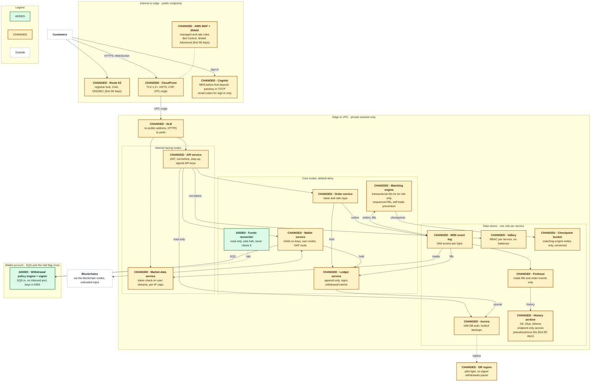
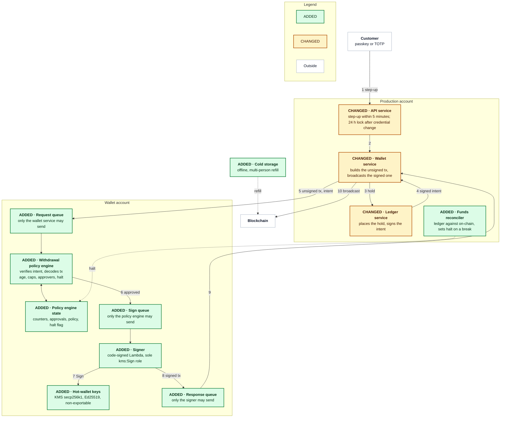
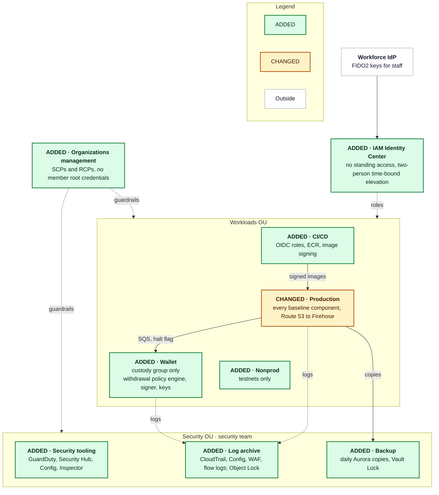

# Problem 5: Fortify The Castle

Money moves in the ledger service, the wallet service and the MSK event log that feeds both, so the controls concentrate there. Signing leaves EKS for a wallet account. There a withdrawal policy engine decodes every unsigned transaction against the intent the ledger service signed, and only then does a signer call KMS with a non-exportable key; production can change the engine's state only by setting its halt flag. The order path gains per-topic writes, fenced leaders, sequenced fills, an append-only ledger and a halt-only funds reconciler. Every funded account has a second factor. Nothing in the VPC has a public address, and only CloudFront reaches the ALB. The controls cost CPU, not a round trip, so they fit in 5 ms of the baseline's 47 ms reserve. The launch controls add $520 to $950 a month to its $13,950, and the first-90-day controls add $3,150 to $3,230, almost all of it Shield Advanced.

The baseline is [Problem 1](../problem1/SOLUTION.md): a spot crypto exchange in ap-southeast-1 across three AZs, pilot-light DR in ap-northeast-1, 500 rps at peak, 50,000 MAU, a 100 ms p99 order budget with 47 ms in reserve. Its components:

| Component | Role |
|---|---|
| Route 53 | DNS |
| CloudFront | Edge, TLS |
| AWS WAF and Shield | Edge filtering, DDoS protection |
| The ALB | Load balancer to the API and market-data services |
| API service | JWT, rate limits |
| Order service | Pre-trade checks |
| Matching engine | One per partition |
| Market-data service | WebSocket feeds |
| Ledger service | Balances, holds |
| Wallet service | Deposits, withdrawals |
| Cognito | Sign-in, MFA |
| MSK (the event log) | Orders, fills |
| Aurora PostgreSQL | Ledger journal |
| ElastiCache Valkey | Limits, sessions |
| History archive (S3, Glue, Athena) | Trade history |
| Checkpoint bucket | Matching engine checkpoints in S3 |
| Blockchain nodes | Full nodes per chain |
| Firehose | Event log to Parquet |
| EKS | Cluster, observability |
| Withdrawal policy engine, signer, funds reconciler | New in this design |

## Contents

- [Scope](#scope)
- [Decisions](#decisions)
- [Threat model](#threat-model)
- [Secured architecture](#secured-architecture)
- [Security changes register](#security-changes-register)
- [Priorities](#priorities)
- [Latency and cost impact](#latency-and-cost-impact)
- [Facts I would need](#facts-i-would-need)
- [Trade-offs](#trade-offs)

## Scope

### In scope

The baseline at launch scale (500 rps, 50,000 MAU, 4 partitions, 2 chains, two regions), from the edge to the image pipeline.

### Out of scope

| Item | Where it belongs |
|---|---|
| KYC and AML, with a vendor | The compliance programme |
| Fiat rails and cards (no PCI DSS scope) | A cardholder-data environment if cards come |
| Corporate IT | The workforce IdP's device policy |
| Physical security of cold storage | The custody procedure |
| A 24/7 security operations centre | The operations plan |
| Mobile hardening; back-office tooling | The mobile pipeline; a separate account |

### Assumptions

- **Baseline figures hold**: $13,950 a month, the 47 ms reserve, the 70 ms alarm, the 2× soak and 5× burst test.
- **Keys are set at creation**: MSK, Aurora and [ElastiCache](https://docs.aws.amazon.com/AmazonElastiCache/latest/dg/at-rest-encryption.html) cannot change their encryption key later, and Cognito replication needs a multi-Region key from the start.

## Decisions

| # | Decision | Alternatives | Why | Revisit when |
|---|---|---|---|---|
| 1 | KMS hot-wallet keys in a wallet account | Custodian; CloudHSM; MPC | Non-exportable keys, nothing to run | A regulator or the custody terms require otherwise; KMS cannot sign a listed chain |
| 2 | The withdrawal policy engine decodes each transaction against its intent | Checks inside the wallet service; approval alone | Production cannot write the engine's state except to set the halt flag | The hot float passes insurance cover |
| 3 | Cognito stays on the Plus plan | In-house; third-party | Managed MFA and threat protection | The replica's limits become unacceptable |
| 4 | Private ALB behind a CloudFront VPC origin | Prefix-list ALB | No public address | Clients need gRPC at the edge, which VPC origins do not carry |
| 5 | EKS Pod Identity per service | IRSA; node role | No OIDC provider per cluster | A workload outside EKS |
| 6 | One role per service per store | A shared application role | Blast radius of one service | Per-role review slows |
| 7 | Default-deny network policy; node groups by exposure | Service mesh; flat network | Kernel-enforced, no proxy hop | An auditor requires per-call identity between pods |
| 8 | Shield Advanced within the first 90 days | At launch; Shield Standard alone | Turns on in minutes; $3,000 a month | DDoS history, extortion, a high-profile listing |
| 9 | One AWS account per blast radius | Permission boundaries | The only boundary SCPs and RCPs attach to | A new product |
| 10 | The signer as a code-signed Lambda function | A signer pod; Nitro Enclaves | No listener, unreachable from the cluster | A custody standard requires attestation |
| 11 | Two-person, delayed policy changes; emergency path only tightens | Single-administrator changes | One administrator cannot raise a cap | On-call staffing covers every large withdrawal |
| 12 | SMS removed; email codes for sign-in only, never for step-up | Keep SMS; drop email | SIM swap; the DR replica cannot check TOTP | The replica supports TOTP |
| 13 | Append-only journal with compensating entries; balance rows change only in the transaction that inserts their journal entry | Journal rows that can be updated or deleted | No role can edit history, and the hold stays one transaction | Journal size slows reconciliation |
| 14 | A read-only funds reconciler that can only halt withdrawals | The baseline's hourly journal check alone | Compares the ledger with the chains and broadcasts as well as the fills topic, and halts withdrawals within minutes | On-call staff act within minutes |

## Threat model

### Assets

In priority order:

| Asset | Loss mode |
|---|---|
| Customer funds and hot-wallet keys (wallet service, signer, KMS) | Final on-chain |
| Ledger and order-flow integrity (Aurora, MSK, checkpoint bucket) | Unseen until withdrawals fail |
| Credentials, sessions and API keys (Cognito, Valkey, API service) | Account takeover |
| Personal data (Aurora, history archive, logs) | Disclosure |
| Availability (Route 53, CloudFront, AWS WAF, the ALB, EKS) | An outage timed to a market move |
| Audit evidence (CloudTrail, Config, application logs) | Erased traces |

### Adversaries

| Adversary | Goal | Entry | Controls |
|---|---|---|---|
| Account takeover | Withdraw a victim's balance | Cognito sign-in, API keys | MFA before funding, Cognito threat protection, token revocation, refresh-token reuse detection, withdrawal step-up, scoped API keys, cross-user authorization tests, withdrawal policy checks |
| Hot-wallet thief | A signature on their transaction | Wallet service, production account, CI | Isolated signer, single-region signing, withdrawal policy checks, capped hot float, account per blast radius, signed pipeline |
| Insider | Move funds, edit balances, erase traces | Console, databases, back-office tools | Append-only ledger, withdrawal policy checks, locked backups, no standing access, locked audit trail |
| DDoS and extortion | An outage at a market move, or ransom | Route 53, CloudFront, the ALB, market-data service | Private ALB behind a CloudFront VPC origin, WAF rules, Shield Advanced |
| Supply chain | Attacker code in production | Dependency, base image, CI, SPA | Browser hardening, signed pipeline |
| API abuse, market manipulation | Spoofing, wash trading, order floods, scraping | API, order and market-data services | WAF rules, scoped API keys, signed-request timestamp window, body-bound idempotency keys, pre-trade caps |
| Cloud credential theft | A leaked key or pod role | IAM, instance metadata, CI | Pod Identity, private egress, checkpoint integrity, account per blast radius |
| Malicious chain data | Credit for an unsettled deposit | The wallet service's view of a chain | Halt-only funds reconciler, confirmed deposits |

### Trust boundaries

| Boundary | Rule |
|---|---|
| Internet to edge | Anything reaches Route 53, CloudFront and Cognito sign-in; AWS WAF and Cognito filter first |
| Edge to VPC | Only CloudFront reaches the ALB, through a VPC origin; nothing inside has a public address |
| Internet-facing pods to core pods | The API and market-data services parse untrusted input on their own nodes; the API service reaches only the order and wallet services, Valkey and read-only Aurora, the market-data service only MSK and Valkey |
| Workloads to data stores | One IAM or database role per service |
| Production to wallet account | Withdrawal requests go in and signed transactions come back through SQS; production can set the withdrawal policy engine's halt flag but never clear it, and only the custody group clears it |
| Blockchains to wallet service | Untrusted until the blockchain nodes confirm and an independent source matches |
| People and CI to control plane | Staff via Identity Center, CI via OIDC roles, under organization guardrails |

## Secured architecture

Each node carries a header tag (`ADDED ·` or `CHANGED ·`) and a matching fill; white nodes are outside the system. Accepted risks are rows in their own table, not node marks. Five changes alter the design rather than configure it: signing moves to the withdrawal policy engine and signer behind queues in a wallet account; the ALB leaves the internet; the cluster splits by exposure, with private egress; the funds reconciler can only halt; and each blast radius gets its own AWS account.

### Runtime topology

### Withdrawal path

Each step stops a different attacker: a stolen session fails the step-up; a compromised wallet service cannot change the destination or amount, because the withdrawal policy engine decodes the transaction against the intent the ledger service signed; a compromised production account can sign false intents, so address age, caps and approvers bound it; a modified signer fails code signing; and the funds reconciler halts what nothing else catches. Above a value threshold that the custody terms set, two approvers confirm the decoded fields, never raw bytes.

### Account structure

## Security changes register

Marks are against the baseline.

### Edge and network

| Control | Component | Mark | Change | Protects against | Tier |
|---|---|---|---|---|---|
| Domain lock and CAA | Route 53 | CHANGED | Registrar and registry lock, registrar MFA, CAA for ACM only | Domain hijack, rogue certificate | Refuse to ship without |
| DNSSEC | Route 53 | CHANGED | DNSSEC on the hosted zone | Forged DNS answers | First 90 days |
| Private ALB behind a CloudFront VPC origin | CloudFront, the ALB | CHANGED | The ALB private behind a CloudFront [VPC origin](https://docs.aws.amazon.com/AmazonCloudFront/latest/DeveloperGuide/private-content-vpc-origins.html), HTTPS to pods; the DR ALB's subnets in ap-northeast-1 avoid the `apne1-az3` Availability Zone, where VPC origins are not supported | WAF bypass | Refuse to ship without |
| Browser hardening | CloudFront | CHANGED | TLS 1.2 minimum, HSTS, strict CSP, origin access control | Injected script, clickjacking | Refuse to ship without |
| WAF rules | AWS WAF | CHANGED | Managed rule groups, rate rules per IP and API key, a web ACL on Cognito | Floods, stuffing, injection | Refuse to ship without |
| Bot Control | AWS WAF | CHANGED | Bot Control on sign-up, sign-in and reset; the separate account-takeover prevention rule group [cannot attach](https://docs.aws.amazon.com/cognito/latest/developerguide/user-pool-waf.html) to Cognito | Automation under per-IP limits | First 90 days |
| Shield Advanced | AWS WAF and Shield | CHANGED | Shield Advanced on CloudFront and Route 53, the only public entry points; the private ALB receives traffic only through CloudFront | DDoS at a market move | First 90 days |
| Pod Identity | EKS | CHANGED | EKS Pod Identity per service, IMDSv2 hop limit 1, private endpoint | Node-role abuse | Refuse to ship without |
| Default-deny pod network | EKS | CHANGED | Default-deny network policy, node groups by exposure, no `kubectl exec` | Lateral movement | Refuse to ship without |
| Private egress | VPC | ADDED | Organization-only VPC endpoints, a NAT route for the wallet service and blockchain nodes only, DNS Firewall allow-list | Exfiltration | Refuse to ship without |

### Identity and sessions

| Control | Component | Mark | Change | Protects against | Tier |
|---|---|---|---|---|---|
| MFA before funding | Cognito | CHANGED | MFA before a deposit address or API key: passkeys or TOTP, with email codes for sign-in only; no SMS | Password reuse, SIM swap | Refuse to ship without |
| Cognito threat protection | Cognito | CHANGED | [Plus plan](https://docs.aws.amazon.com/cognito/latest/developerguide/cognito-sign-in-feature-plans.html) threat protection, full-function mode | Credential stuffing | Refuse to ship without |
| Token revocation | API service, Cognito | CHANGED | Refresh token rotation, 60-minute access tokens, a per-user not-before time in Valkey | A stolen token after sign-out | Refuse to ship without |
| Refresh-token reuse detection | API service, Cognito | ADDED | Token refresh goes through the API service, which tracks each session's current refresh token by its `origin_jti` claim; a rotated-out refresh token presented after Cognito's grace period revokes the session's refresh token and every access token carrying that `origin_jti` | A stolen refresh token used beside the real client | First 90 days |
| Withdrawal step-up | API service | CHANGED | Step-up (passkey or TOTP, 5 minutes) for withdrawals, API keys and security changes; a credential change locks withdrawals 24 hours | Session hijack cash-out | Refuse to ship without |
| Scoped API keys | API service | CHANGED | Scoped API keys (read, trade, withdraw), an IP allow-list for withdraw, Ed25519 request signatures | Leaked or replayed keys | Refuse to ship without |
| Signed-request timestamp window | API service | ADDED | Each signed API request carries a timestamp inside its signature; the API service refuses one more than 5 seconds from its own clock, and inside the window a repeated order or withdrawal meets its idempotency key | A captured signed request replayed later | Refuse to ship without |
| Authenticated user streams | Market-data service | CHANGED | User streams carry the access token, checked as the API service checks it | Cross-user reads | Refuse to ship without |

### Order flow and ledger

| Control | Component | Mark | Change | Protects against | Tier |
|---|---|---|---|---|---|
| Pre-trade caps | Order service, matching engine | CHANGED | Maximum order value, per-account order rates, self-trade prevention in the matching engine, integer minor units, one ledger hold for orders and withdrawals | Double spend, spoofing, wash trades | Refuse to ship without |
| Body-bound idempotency keys | Ledger service | ADDED | The hold's unique key (the client order id, or the withdrawal request's idempotency key) stores a SHA-256 hash of the exact request body; a retry with the same key and body returns the first result, and one with a different body gets 422 and changes nothing | A retry that places or withdraws twice; a reused key that answers with another request's result | Refuse to ship without |
| Per-topic MSK writes | MSK, Firehose | CHANGED | [IAM access control](https://docs.aws.amazon.com/msk/latest/developerguide/kafka-actions.html) per topic: the order service writes `orders`, the matching engine writes `fills` and `trades`, Firehose reads only fills and order events; Kafka 3.8 or later, the first version whose IAM access control can abort a hanging transaction; TLS | Forged orders or fills | Refuse to ship without |
| Fenced leaders and sequenced fills | Matching engine, ledger service | CHANGED | Per-partition transactional IDs for the matching engine's role only; a per-symbol fill sequence that the ledger service checks | Impostor leader, reordered fills | Refuse to ship without |
| Checkpoint integrity | Checkpoint bucket | CHANGED | Only the matching engine's role writes the checkpoint bucket; versioning keeps each earlier checkpoint | A tampered book loaded on cold start | Refuse to ship without |
| Append-only ledger | Ledger service, Aurora | CHANGED | Append-only journal (only the ledger service inserts, entries sum to zero per asset); balance rows keep the `available >= 0` check and change only in the transaction that inserts their journal entry; IAM database authentication, pgaudit | Balance edits by anyone | Refuse to ship without |
| Halt-only funds reconciler | Funds reconciler | ADDED | Read-only funds reconciler of ledger, fills and withdrawals against chain, settlement and broadcasts; a break sets the withdrawal policy engine's halt flag, which only the custody group clears | Unseen loss | Refuse to ship without |
| Nightly matching replay | Funds reconciler | ADDED | Nightly replay of `orders` through the same matching engine build; fills must match production's | Tampered matching | First 90 days |

### Wallet and withdrawals

| Control | Component | Mark | Change | Protects against | Tier |
|---|---|---|---|---|---|
| Isolated signer | Signer | ADDED | Signing moves to the signer, a code-signed Lambda function in the wallet account, with non-exportable [KMS keys](https://docs.aws.amazon.com/kms/latest/developerguide/symm-asymm-choose-key-spec.html); `kms:Sign` for the signer's role alone | Key theft, a modified signer | Refuse to ship without |
| Single-region signing | DR region | CHANGED | The signer and hot-wallet keys stay in the primary region, so withdrawals pause during a regional failover and resume when the primary returns; the baseline's failover resumes them in DR | Hot-wallet keys exposed in a second region | Refuse to ship without |
| Withdrawal policy checks | Withdrawal policy engine, ledger service | ADDED | The ledger service signs the intent with a production KMS key that only its role can use; the withdrawal policy engine verifies it, decodes the unsigned transaction against it, then checks address age, caps, address screening, approvers and the halt flag | Compromised wallet service; a compromised production account, up to the hourly cap | Refuse to ship without |
| Capped hot float | Wallet service | CHANGED | Hot float capped per asset, deposits swept to cold, manual multi-person refill | Unbounded loss | Refuse to ship without |
| Confirmed deposits | Wallet service | CHANGED | Credit after the blockchain nodes' confirmation depth plus a match from a second source, without which the credit waits; a deeper reorganization freezes the amount | Fake deposits, reorg double spends | Refuse to ship without |
| Kill switches | Withdrawal policy engine, order service, Cognito | ADDED | Kill switches with runbooks: halt all withdrawals, halt one symbol, sign one user out everywhere | Slow incident response | Refuse to ship without |

### Data protection

| Control | Component | Mark | Change | Protects against | Tier |
|---|---|---|---|---|---|
| Keys set at creation | MSK, Aurora, Valkey, history archive, Cognito | CHANGED | A KMS customer managed key per data class, set when each store is created; MSK, Aurora and Valkey cannot change it later, and Cognito's key is multi-Region from the start, since a key [cannot become multi-Region](https://docs.aws.amazon.com/kms/latest/developerguide/multi-region-keys-overview.html) later | Readable snapshots, unreplicable user pool | Refuse to ship without |
| TLS and cache RBAC | Aurora, Valkey | CHANGED | TLS required, ElastiCache RBAC per service, no balances in Valkey | Traffic capture, cache tampering | Refuse to ship without |
| Locked backups | Aurora | CHANGED | Deletion protection; a daily AWS Backup copy, kept 7 days, in a Vault Lock vault in the backup account; SCPs deny deleting clusters and snapshots | Ledger and backups destroyed together | Refuse to ship without |
| Field encryption | Aurora, history archive | CHANGED | Email, phone and KYC reference encrypted in the application with a separate key; pseudonymous user IDs in the history archive | Personal data in a dump | First 90 days |

### Accounts, detection and supply chain

| Control | Component | Mark | Change | Protects against | Tier |
|---|---|---|---|---|---|
| Account per blast radius | Accounts | ADDED | Eight accounts by blast radius; SCPs and RCPs deny leaving the organization, disabling audit, IAM users, extra Regions and key deletion; no member root credentials | Cross-account spread | Refuse to ship without |
| No standing access | People | ADDED | Identity Center federated to the workforce IdP (FIDO2), no standing write access, two-person time-bound elevation, no SSH, separate wallet administrators | A lone insider, a stolen laptop | Refuse to ship without |
| Locked audit trail | Detection | ADDED | Organization CloudTrail and Config under [S3 Object Lock](https://docs.aws.amazon.com/AmazonS3/latest/userguide/object-lock.html); GuardDuty with EKS, S3 and RDS protection; alarms on root sign-in, policy changes and `kms:Sign` outside the signer | Unseen compromise, deleted evidence | Refuse to ship without |
| Runtime and image scanning | Detection | ADDED | GuardDuty Runtime Monitoring on EKS nodes, Security Hub CSPM, Inspector on ECR images | Container escapes, drift, new CVEs | First 90 days |
| Signed pipeline | CI/CD | ADDED | OIDC roles, digest-pinned dependencies, a scan gate on fixable HIGH and CRITICAL, two-person review; [ECR managed signing](https://docs.aws.amazon.com/AmazonECR/latest/userguide/managed-signing.html) signs each image on push only, so an EKS admission controller (Kyverno, or Ratify with Gatekeeper) verifies its Notation signature against the AWS Signer profile before any pod starts | Tampered dependency, image or pipeline | Refuse to ship without |
| Cross-user authorization tests | CI/CD | ADDED | A CI suite signs in two test users and calls every authenticated route with one user's token against the other's order, balance and withdrawal ids; any answer but 403 or 404 fails the build | One user reading or acting on another's orders, balances or withdrawals | Refuse to ship without |

### Accepted risks

| Risk | Component | What is accepted | Why acceptable now | Compensating control | Revisit when |
|---|---|---|---|---|---|
| Open public market data | Market-data service | Public market-data channels unauthenticated | Identical public data; user streams carry the access token | Per-IP connection caps, own node group | Scraping outgrows the caps |
| No pod-to-pod mutual TLS | EKS | No mutual TLS between pods | A sidecar mesh adds two proxy hops from the 47 ms reserve | [Nitro in-transit encryption](https://docs.aws.amazon.com/AWSEC2/latest/UserGuide/data-protection.html), default-deny policy, TLS on Kafka | Another team's workload joins the cluster |
| No withdrawals in DR | DR region | Withdrawals pause in a regional outage | A key replica doubles its exposure | Trading and deposits fail over; withdrawals resume in the primary region | Terms require DR withdrawals |
| Fail-open revocation check | Valkey | The API service accepts orders without the not-before check while Valkey is down | Failing closed makes a cache outage a trading outage | A revoked token trades at most 60 more minutes | Abuse seen during a Valkey incident |
| Shared KMS HSMs | Signer | Multi-tenant KMS HSMs, not CloudHSM | Non-exportable keys; CloudHSM is a cluster to run | Key policy, SCPs, the `kms:Sign` alarm | Single-tenant HSMs or hierarchical derivation required |
| Email sign-in factor | Cognito | Email codes stay a sign-in factor | The DR replica cannot check TOTP | Never satisfies step-up; sign-in notifications | The replica supports TOTP, or a mailbox takeover |
| Hot-float loss | Wallet service | Loss up to the hot float | Unattended withdrawals need funds online | The withdrawal policy engine's hourly caps, the funds reconciler's halt, insurance | The float passes insurance cover |
| Administrator-filed intents | Production account | A production administrator files many users' intents and, after 24 hours, drains up to the hourly cap | User-signed withdrawals need a custom WebAuthn flow | The withdrawal policy engine alarms on new-address volume | User-signed withdrawals land |

## Priorities

### Refuse to ship without

Without these controls a loss is irreversible (funds, keys, ledger, evidence), or adding them later is a rebuild.

- **Withdrawal step-up, isolated signer, single-region signing, withdrawal policy checks, capped hot float, kill switches**: funds leave only through independent checks.
- **Pre-trade caps, body-bound idempotency keys, per-topic MSK writes, fenced leaders and sequenced fills, checkpoint integrity, append-only ledger, halt-only funds reconciler, confirmed deposits**: the ledger cannot be silently wrong.
- **MFA before funding, Cognito threat protection, token revocation, scoped API keys, signed-request timestamp window, authenticated user streams**: a stolen password or a captured request is not enough.
- **Private ALB behind a CloudFront VPC origin, Pod Identity, default-deny pod network, private egress, TLS and cache RBAC, account per blast radius, no standing access**: one stolen credential stays contained; separate accounts later are a migration.
- **Keys set at creation**: MSK, Aurora, Valkey and Cognito cannot change their key or its multi-Region status afterwards.
- **Locked backups, locked audit trail**: evidence and backups outlive the attacker.
- **Domain lock and CAA, browser hardening, WAF rules, signed pipeline, cross-user authorization tests**: only reviewed code runs, and no release lets one user reach another's account; browser and DNS routes are closed.
- **Launch gate**: an external penetration test of the API service, wallet service, withdrawal policy engine, signer and the withdrawal flow with no open critical or high finding; one tabletop of the hot-wallet-drain runbook.

### First 90 days

- **DNSSEC**: a signing mistake takes the domain offline, and the domain lock already blocks the common hijack path.
- **Bot Control**: rules tuned without real traffic lock customers out.
- **Refresh-token reuse detection**: rotation and the withdrawal step-up already keep a stolen refresh token from cashing out; detection needs token refresh routed through the API service.
- **Shield Advanced**: it turns on in minutes; DDoS history, extortion or a high-profile listing pulls it forward.
- **Nightly matching replay**: it needs reproducible matching engine builds first.
- **Field encryption**: cluster encryption covers a stolen snapshot; field encryption is schema work.
- **Runtime and image scanning**: findings need someone on call to triage them.
- **Process**: a quarterly hot-wallet-drain game day; a public bug bounty after the penetration test.

### Deferred

- **Service mesh with mutual TLS**: proxy hops on every synchronous order-path call.
- **CloudHSM or MPC custody**: until a regulator or insurer requires it, or KMS cannot sign for a listed chain.
- **User-signed withdrawals**: the customer's passkey signs the details the withdrawal policy engine verifies, which needs a custom WebAuthn flow.
- **Nitro Enclaves attestation for the withdrawal policy engine and signer**: until a custody standard requires attested execution.
- **Network Firewall egress, Database Activity Streams on Aurora, Macie on the history archive**: until command-and-control by IP, a database audit standard or personal data in the archive.
- **Proof of reserves, market surveillance on the history archive**: their form depends on the licensing regime.
- **SOC 2 Type II or ISO 27001**: when institutional clients or the regulator ask.

## Latency and cost impact

Only AWS WAF, TLS and the API service's token and request checks sit on the order path, and none adds a round trip.

| Control | Path | Latency effect |
|---|---|---|
| WAF rules and Bot Control | Order, market data, sign-in | Edge, outside the measured p99 window |
| TLS everywhere | Order | Pooled connections; broker and pod CPU |
| JWT, not-before, request signatures | Order | Local checks; not-before rides the Valkey call |
| Default-deny pod network, node groups | Every internal call | Kernel-enforced |
| KMS keys at rest | Off the request path | None |
| Withdrawal policy checks and signing | Withdrawal only | Seconds through SQS, the withdrawal policy engine and KMS; 24 hours for a new address |
| Cognito Plus | Sign-in only | Inside Cognito |
| VPC endpoints | AWS API calls from pods | Shorter than NAT |
| Detection | Off the request path | None |

New order-path work (TLS from the ALB to pods, request-signature checks, the not-before lookup) gets 5 ms of the 47 ms reserve. The baseline's load test confirms it with every control on: p99 under the 70 ms alarm and 5xx under 0.1%.

Costs are list prices read on 2026-11-03 and 2026-11-04, at ap-southeast-1 rates where the pricing page gives them and US East rates otherwise: [WAF](https://aws.amazon.com/waf/pricing/), [Shield](https://aws.amazon.com/shield/pricing/), [KMS](https://aws.amazon.com/kms/pricing/), [PrivateLink](https://aws.amazon.com/privatelink/pricing/), [GuardDuty](https://aws.amazon.com/guardduty/pricing/), [Config](https://aws.amazon.com/config/pricing/), [Route 53](https://aws.amazon.com/route53/pricing/), [Security Hub CSPM](https://aws.amazon.com/security-hub/cspm/pricing/) and [Inspector](https://aws.amazon.com/inspector/pricing/). Cognito Plus is already in the baseline ($1,000 against $600 on [Essentials](https://aws.amazon.com/cognito/pricing/) at 50,000 MAU). The CI/CD and nonprod accounts' workloads are left out, as in the baseline.

| Item | Basis | USD per month |
|---|---|---|
| VPC endpoints | 7 interface endpoints in 3 AZs at $0.013 an hour | 200 |
| Node groups by exposure | The general node group splits into internet-facing, core and wallet groups: 2 × m7g.large for the wallet group, and up to one more m7g.xlarge for AZ-loss headroom | 150 to 300 |
| GuardDuty | 5 to 10 million management events at $4 per million; 15 to 60 GB of flow and DNS logs at $1 per GB; EKS audit logs and S3 data events; 8 Aurora vCPUs at $1 | 50 to 150 |
| AWS Config | 10,000 to 30,000 configuration items at $0.003, and their rule evaluations at $0.001 | 50 to 150 |
| Locked backups | A daily Aurora copy kept 7 days: 1.4 TB, since Aurora copies across accounts are full snapshots | 30 to 40 |
| Audit logs | Flow logs, and WAF logs filtered to blocked and counted requests, delivered to the Object Lock bucket | 10 to 30 |
| KMS | About 15 customer managed keys at $1 (data classes, Cognito's replica, field encryption, intent signing, one hot-wallet key per chain) and their requests | 15 to 25 |
| AWS WAF | A web ACL on Cognito at $5 with its rules, and added managed rule groups at $1 each | 10 to 20 |
| DNS Firewall | 10 to 50 million queries at $0.60 per million | 5 to 30 |
| Signer, queues and policy engine state | Lambda, SQS and the state store at withdrawal volume; signing at $0.15 per 10,000 requests, within the default [quota](https://docs.aws.amazon.com/kms/latest/developerguide/requests-per-second.html) | 0 to 5 |
| **Launch controls** | 3.7 to 6.8% of the baseline | **520 to 950** |
| Shield Advanced | 1-year commitment; one fee covers the organization's accounts and the standard WAF fees on protected resources | 3,000 |
| Bot Control | Targeted level on sign-up, sign-in and reset: $10 plus $10 per million requests after the first million | 10 to 20 |
| GuardDuty Runtime Monitoring | 76 to 80 EKS node vCPUs at $1.50 | 115 to 120 |
| Security Hub CSPM | 10,000 to 40,000 security checks at $0.001 | 10 to 40 |
| Inspector | ECR image scans at $0.09 per pushed image | 15 to 50 |
| **First 90 days** | About 23% of the baseline | **3,150 to 3,230** |

## Facts I would need

| Fact | Source | How to get it | Why it matters | Assumed meanwhile |
|---|---|---|---|---|
| Licensing regime and regulator | Counsel | A meeting with counsel on each target country's licensing and travel-rule obligations | Custody, retention, screening, travel rule, reporting | Segregated assets, address screening, 5-year retention under Object Lock |
| Custody model and insurance | Treasury lead | A treasury questionnaire on float, approval thresholds and refill, checked against the insurer's policy terms | Hot float cap, approval threshold, cold-storage procedure | 24 hours of the 95th-percentile daily withdrawal volume per asset; offline cold storage |
| Asset list and signing schemes | Roadmap | The listing roadmap, with each chain's signature curve checked against the KMS key specs | KMS has no hierarchical key derivation | secp256k1 or Ed25519 only; addresses derive from public keys |
| Users' countries and data residency | Counsel | A meeting with counsel on the target countries from the go-to-market plan | Where personal data may live | Southeast Asia; replication to Tokyo allowed |
| Peak traffic and DDoS history | Forecast | A launch traffic forecast replayed as a load test; the incident record of any domain the exchange already runs | Whether Shield Advanced is needed at launch; WAF rate limits | No targeted DDoS at launch; 500 rps peak |
| Workforce identity provider | IT team | A question to the IT team: which IdP, and whether it enforces FIDO2 keys | Identity Center federates to it | An existing IdP with FIDO2 keys |
| Compliance targets | Business roadmap | A planning session with the business owner on the certification clients will ask for first | When evidence collection must be continuous | SOC 2 within the first year; no PCI DSS scope |
| Monthly active users | Business forecast | The business forecast's sign-up and activity curve for the first year | Sizes Cognito Plus and Bot Control costs | The baseline's 50,000 MAU |
| KYC vendor and document storage | Compliance | The vendor's integration guide and data processing agreement | Whether identity documents enter Aurora or the history archive | The vendor holds documents; Aurora stores a reference |
| Deposit address scheme | Wallet team and treasury | A design review between the wallet team and treasury that prices each candidate against the KMS per-key fee | KMS has no hierarchical key derivation, so a KMS key per deposit address costs $1 a month each: about $100,000 a month at 50,000 users on two chains | Not decided. Candidates: addresses derived from an extended public key and swept by an offline-held seed into the KMS-held hot wallet; a per-user memo on the account-based chain; an MPC custody provider. The cost estimate excludes deposit keys |
| Second deposit source | Wallet team | A testnet trial comparing candidate providers' blocks with the exchange's own nodes | Confirmed deposits need a second confirmation | A commercial node provider per chain, as a check beside the exchange's own nodes |
| On-call capacity | Staffing plan | A staffing plan review with the operations lead | Whether a detection is acted on within minutes | None 24/7 at launch; the withdrawal policy engine and funds reconciler halt automatically |

## Trade-offs

- **Slower withdrawals**: a new address or credential change waits 24 hours; large withdrawals wait for two approvers; raising a cap takes two people and 24 hours.
- **A second deployment surface**: the withdrawal policy engine and signer ship through their own pipeline, run by a different group.
- **Higher run cost**: $520 to $950 a month at launch, mostly VPC endpoints, the wallet node group and detection; Shield Advanced adds $3,000 a month within the first 90 days.
- **Engine and protocol constraints**: Kafka 3.8 or later, so IAM access control can abort a hanging transaction; no gRPC on the public API, because VPC origins do not carry it.
- **A second view of each chain**: a deposit credits only when a commercial node provider agrees with the exchange's own blockchain nodes, so a provider outage delays credits; neither view credits alone.
- **A second sign-in for withdrawals**: the step-up asks for a passkey or TOTP again inside a session.
